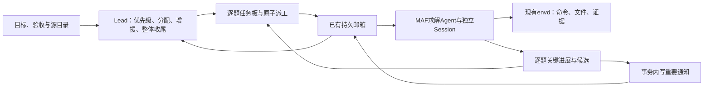

# CTF 架构效率审查与重构方案

日期：2026-10-28（北京时间）。样本：本地任务 `d789b8b0-c332-45dd-91c6-41826e1e951f`。当前工作树 `platform-performance-audit` 包含前期未提交修复；运行镜像为 `model-replay-v2-20261019`。

本轮只读分析、讨论和方案编制。没有修改运行代码、提示词、模型配置或任务状态，没有续跑、部署或调用任务模型。三个 GPT-6 Astra high 子代理分别负责协作协议、执行与资源、独立反方审查，并进行了两轮交叉审查；主会话汇总取舍。方案中的性能指标均为待验证目标。

已核对运行容器内的CTF context、coordinator、middleware和blackboard任务板四个核心文件，SHA256与本工作树对应源码一致。

## 一、结论

应把重构集中在**题目粒度、模型可见信息、派工与成果反馈、长操作生命周期**。保留现有 MAF Agent、Session、消息注入、持久邮箱、PostgreSQL、MinIO 和任务独立执行容器。

本轮存在明确的平台问题，但证据不支持把主要耗时归因于数据库、轮询调度器或缓存失效。平台已经能并发执行；它给 Agent 的工作边界和信息不够好，导致并发资源没有充分转化为解题进展。

CTF 模式是 Lead 与具名队友协作，不使用普通黑板的 Fact/Intent/Derive/Close 调度。本方案先限定 CTF；共享模型及执行基础设施的调整需同时验证普通模式兼容性。

## 二、本次任务的实际情况

| 项目 | 证据 |
| --- | --- |
| 运行窗口 | 11:00:32–11:33:23，约32分50秒；用户停止，不是本轮平台崩溃 |
| 团队 | 1 Lead + 9 队友；配置允许20队友 |
| 预算与账本 | 原预算¥100/120分钟；记录费用¥7.79 |
| 首批真正派工 | 开始后12分03秒，约占全程36.7%；7人提前创建后等待约6分31秒 |
| 初始派工投递 | 派工消息落库到送达仅约3.0–4.15秒 |
| 任务板粒度 | 9个任务包，标题范围合计63道独立题；单owner承担3–11题；9包最后均in_progress |
| 已证成功 | 两道题的命令观察包含外部平台JSON `correct:true`；不是0题成功，但尚未形成平台可信候选/验证闭环 |
| 模型调用 | 379次成功；累计输入26,813,706 token；加权输入缓存命中94.82% |
| 输出 | 499,380 token，其中推理342,220，占68.53%；推理已含在输出内 |
| 模型请求时延 | p50 5.976秒，p95 29.801秒，最长104.097秒 |
| 执行工具 | 425次execute_command，累计7534.1工具秒，p50 3.382秒，p95 60.782秒，最长501.13秒 |
| 其他工具 | 162次，累计约69.4秒 |
| 两次模型连接故障 | 合计28.885秒；已自动恢复，后续turn约2–3秒启动 |

累计模型秒、工具秒允许重叠，不能相加当任务墙钟。按成员turn的时间区间合并，模型和工具覆盖约97.39%；余下2.61%还包含遥测、结算和中断时未完整记录的工作，不能全部视为平台开销。

未收集本轮历史CPU、网络及供应商TTFT，不能据共享3CPU/8GiB配置推断CPU饱和。没有同题、同模型、同预算的单Agent对照，不能用其它靶场的完成时间宣布团队模式必然更慢或重构后必然更快。

## 三、已经核实的问题

### 1. 结构化任务板被按普通文本截断

77次list_challenges均成功，但46次模型视图被截断。全板约17.5k字符，通用预览截掉中间题目；两名队友分别调用19次、22次，队友共查到9次空页。

源码：`ctf/context.py:171–215`。预览决策持久化，上限8192并采用字节头尾截取。`ctf_board.py:139` 列表直接返回完整题目正文，`ctf/board_tools.py:20` 没有按owner过滤。

仓库默认profile已经列入read_saved_tool_result，但本次冻结的运行工具白名单没有开放它。发布代码更新不等于已有配置快照已经采用新能力。因此不能把重复查询简单归咎于Agent忘记补读。

### 2. 关键成果写入黑板，不等于Lead获得消息

两份成功结果约11:18:55写入记录。Lead均未读取；其中一名队友到11:31:36才显式通知，延迟约12分39秒；另一名没有显式通知。record_candidate调用为0。

普通append_record仅写板事件（`ctf_board.py:675`）；coordinator调度事件不包含普通record事件（`ctf/coordinator.py:31`）。仅扩大事件订阅也不足够：没有pending输入的Lead不会自动获得记录正文。候选和验证记录也要覆盖通知闭环。

### 3. 一个任务包包含多道题，独立进度被隐藏

每组只有一份owner/status/solution。组内某题完成、某题资源不可用、某题需要增援，都难以准确表达；完成一题后仍只有整个组in_progress。调度与前端均无法可靠知道下一步该重新分配什么。

全部collaborator为空本身不是错误；独立题应允许独立求解。应衡量求助能否得到有边界的支援，而不是强制多个Agent共同做每一道题。

### 4. Lead准备成为启动前置条件

队友开始前，Lead已调用26次模型、执行38条命令，涉及网络/代理探测与修正、API目录、材料下载及共享脚本准备；其中模型时间约441.7秒。不能把全部12分钟归为调度器等待，也不能假设准备都可以取消。

当前Lead模板第5行要求首次派工前核对全部已知范围，容易形成集中准备。应保留任务要求的必需连通性/权限前置检查，已明确可执行的独立题先派，其余目录核对和材料准备继续推进。

### 5. 长操作使协作消息迟迟不能进入模型

已观察运行中消息投递延迟128–219秒。MAF消息注入发生在下一次模型调用边界；长模型请求、长命令和工具批次都会推迟消费。消息queued/delivered不等于成员已理解、执行完毕。

本次没有催促风暴：三次coordination.reminded分别是两次模型恢复和一次用户停止；Lead普通消息主要用于代理修正、资源协调和研究交接。

### 6. 全角色max推理有明显长尾，但要通过实验调整

所有角色共用deepseek-flash/max。逆向成员21次请求输出108,536 token，其中93.91%为推理；四个请求分别耗时63–104秒。协调、简单读取和困难求解统一强度，值得分角色验证。

当前CtfAgentProfile只有一个model，角色策略并非现成功能。最大输出未显式配置，本模型命中393216的兼容回退值；这只是上限，不代表每次实际生成这么多。当前证据没有显示本轮被费用预留长期阻塞。

## 四、目标架构

### A. 以可独立验收的题目为实体

- CtfTask仍代表整次任务；CtfChallenge代表一项可独立交付的目标。
- 分组只用于显示和筛选，不拥有另一套完成状态。可先用已有题目来源信息；需要稳定分组时再增加可选group_key。
- 一次派工复用instruction、assignment_message_ids和turn，不新增工作单元表或状态机。每题一条带引用的instruction；同一成员可一次领取少量相关指令。
- owner负责结果，collaborators负责共同推进。路线选择仍由Agent判断，Lead不逐条批准命令。
- 完整源目录核对是整体收尾条件。先派已知、满足前置条件的题，后续范围变化用明确更正与CAS更新，不静默删除正在执行的范围。
- 首版源清单使用已有登记artifact，数量从逐题条目派生，不新增inventory表。只有未来要求服务端强校验全源覆盖时才单独设计库存合同；不能据“目前已登记题全完成”代替完整范围证明。

### B. 工具提供完整索引，正文按需获取

- list_challenges默认返回短索引：id、external_id、title、owner、状态、revision、简短验证状态及有效continuation；支持owner/status筛选。
- 按响应预算逐项分页，保证每条完整；即使63条短索引仍超预算，也只减少页大小，不切断JSON中间。
- get_challenge读取完整题面，记录/证据按页或引用读取。大日志可以预览，但必须提供实际可用的补读工具。
- 不仅扩大8192阈值，也不无条件放行任意大JSON。
- 已持久化的旧预览不原地重写；通过新查询和新工具合同获得完整信息，维持旧Session前缀稳定。
- 配置发布和创建任务时检查实际工具schema与补读能力，不能仅验证仓库YAML。

### C. 派工带题目引用，并支持小批量原子操作

- 在现有消息合同增加可选challenge_id标量。当前合同没有这个持久字段，中间件读取row.get不能代替存储。
- 复用update_challenge的分配与派信事务；同事务生成带可信题目ID、revision、工作边界和交付要求的输入，减少成员自己全表寻址。
- 批量只是现有单题操作的外壳：每题独立CAS、幂等request_id和结果回执。一题冲突不回滚其它题；只重试未完成项，结果未知先查询同request_id。
- 使用源external_id时明确同源唯一性，不按标题猜测重复。旧数据若冲突，先报告映射问题，不直接加唯一约束导致迁移失败。
- 起步只给各成员少量明确工作；不要求先创建完全部成员、下载完全部材料或盘完全部题才派第一批。

### D. 关键成果直接进入现有协作闭环

- result、breakthrough、candidate、可信verification、help、释放责任和资源失效，写入记录时在同一事务写入已有mailbox。
- 通知只带短摘要、challenge_id、record_id和版本，发给Lead及确实受影响的owner/协作者。普通attempt留板，不广播每条工具记录。
- 同事件、同收件人、同purpose幂等；在下一次安全边界合并未处理通知，避免通知风暴和重复模型唤醒。
- 现有ux_ctf_result约束用于一次turn唯一结果。记录通知不能套用相同source_turn_id/purpose而冲突，应使用独立的确定消息ID并保留原turn结果语义。
- 外部命令中correct:true是已有观察证据；可信适配器验证后才能写平台accepted。不得解析任意文本就伪造验收，不增加人工验证UI。
- 停止或closing后不再通过通知恢复执行。人工停止不要求强行补齐solution才允许退出。

### E. 资源准备与长作业分阶段处理

近期先把共享连接/材料准备结果明确标为ready、失败或阻塞，提供版本化引用；必要准备串行完成，可独立准备部分并行。保留任务共享文件与环境。

每Agent已有独立网络命名空间，用于流量归属；Lead的localhost服务不会天然成为全队localhost服务。普通命令退出还会清理进程组。稳定任务服务需要envd托管，不能依赖Lead短命令留下后台进程。本轮代理问题是否都由这些机制导致尚未证实。

外部资源先复用CtfPlatformToolBinding的可信typed adapter，区分ready/busy/unknown/failed，携带resource_key、version和可查询引用。明确busy才由代码有界等待，ready/失效再通知受影响成员。任意shell输出不自动推导资源状态；unknown可能已经占用，不能立即重放申请或按TTL假定已释放。首版不建立通用pool/request/lease框架。

长作业是独立后续里程碑：扩展现有envd命令registry的start/status/get_result/cancel，沿用command_id、参数摘要、boot和generation，不另设执行事实源。

- 旧同步短命令接口保持兼容；异步路径由新任务明确启用。
- 首版新异步路径每成员最多一个pending长作业；不追溯禁止现有同步短命令的并行批次。
- 明确command_pending边界，保持同turn/generation；MAF返回final不自动结束含未完成作业的turn。同一Session始终单写者。
- runtime等待完成事件并以原ID读回，完成结果checkpoint确认后只投递一次；模型不循环轮询。先不支持跨generation迁移后台作业。
- stop优先取消并确认进程回收，再结束与归档；HTTP断开、取消模型、停止请求都不等于进程已停止。未知结果不重放。

### F. 模型运行策略独立验证

保留供应商能力上限；本次调用的effort和输出额度由明确的运行策略选择。先验证现有任务级配置的对照，再增加可选lead/teammate覆盖；旧快照缺字段就继承原model。

首版只增加reasoning_effort、max_output_tokens，不引入任意模型路由。日常协调可以试验较低强度，困难求解保留较高强度；输出上限不能武断固定为8K，因为推理也占输出额度。

以后若按步骤选参数，可复用MAF ChatMiddleware的options；实际请求、上下文保留空间、费用预留和trace必须使用同一份effective options。不能用平均或p95费用代替最坏费用预留来制造虚假的并发提升。

## 五、三位Astra互审后的取舍

| 初始提议或风险 | 最终取舍 |
| --- | --- |
| 多题scope数组及单独work unit状态 | 每题一条instruction、可空challenge_id，复用现有challenge状态 |
| 大批量一个事务 | 每题独立CAS和派信，逐项回执与重试 |
| 仅订阅record事件 | 必须同事务生成mailbox输入；订阅不等于Lead收到了内容 |
| 列表不截断就全部返回 | 按预算保留完整条目并继续分页 |
| 通用外部资源池和租约系统 | 先用已有typed平台适配与少量调用状态 |
| 加start工具即可后台执行 | 必须设计command_pending、同generation、checkpoint与stop/drain，单独排期 |
| 每成员只许一个命令可能降低并行 | 限制只用于首版新异步长作业，旧同步工具保持兼容 |
| 用较低预计费用放大并发 | 预留仍与实际请求最大输出绑定 |
| 强制增加协作人数 | 以独立题并行和有效增援为准，不制造重复解题 |
| 替换整个编排框架 | 现有数据不支持；复用已安装MAF能力与既有可靠性机制 |

已安装MAF core 1.19.0具有AgentSession、MessageInjectionMiddleware、HistoryProvider、WorkflowBuilder/checkpoint接口。当前已大量使用其Agent基础组件；不把未安装的编排扩展当成可直接替换的现成功能。MAF不代替平台的任务预算、持久投递证明、generation fencing与未知副作用处理。

## 六、实施次序与验收

### 第一阶段：修复信息与反馈链路

实现短索引与可靠分页、精确派工引用、实际工具白名单校验、重要成果事务通知。先不改变模型参数与长命令机制，以便判断改善来源。

验收：63条以上长题面样本中，模型能完整获取每个ID/revision/continuation；无结构化JSON头尾丢失；重试不重复派工和成果通知；重要成果入通知队列目标p95≤1秒；单独记录队列、领取、下一安全模型输入的时间，不能用入队速度冒充模型响应速度。

### 第二阶段：逐题工作与渐进启动

加入小批量登记/派工、单题状态与完成闭环，调整Lead/队友通用提示词，保留完整源目录检查。基于明确适配器状态补充资源等待反馈。

验收：前置条件满足、首批题已明确后到首次派工目标p95≤30秒；纯平台dispatch到空闲成员启动目标p95≤5秒。分别报告外部准备耗时、Lead规划时间和执行等待；真实求助有明确责任人与回复，不以collaborator数量作成功指标。

### 第三阶段：分别验证模型策略与长作业

角色参数覆盖先做独立对照；长作业/稳定connector另设生命周期专项，前两个阶段通过后才上线。不能把这两个变量和全部协作变化一次性混合，导致效果无法归因。

验收：比较首个可信结果时间、独立题完成数、每题模型/工具/等待耗时、费用、截断率及恢复次数。异步路径验证完成与停止竞态、响应丢失、重启、boot变化、单Session写入和归档屏障。真实解题效果需要另行受控实测，本次不续跑。

## 七、迁移与限制

- 已停止历史任务保持原样。9个旧任务包不能自动冒充63个已拆分且已验收目标；有可靠源映射后才可在显式续跑时建立新逐题范围并保留legacy引用。
- 旧消息challenge_id为空仍可读取；旧profile沿用原模型和工具快照，不静默改费用上限或推理强度。
- 不修改旧Session的已确认历史和稳定预览；不重放旧执行命令、消息或资源申请。
- 跨题附件有现存关联约束，迁移使用来源链接，不盲目复制候选或附件归属。
- 以新任务先验证，已有运行任务不切换语义；数据、预算、配置、流量归属与人工停止优先级保持。
- 未对整仓做逐文件审计，未进行真实模型A/B、CPU历史分析或重新验证外部评测平台。性能收益尚未实测。

本次私有证据仅保存在忽略目录 `.data/ctf-latest-audit/`，原始内容权限0600；报告不包含凭据、flag或攻击命令。建议按第一、第二、第三阶段分别实施、审查和提交；本轮没有源码提交。
