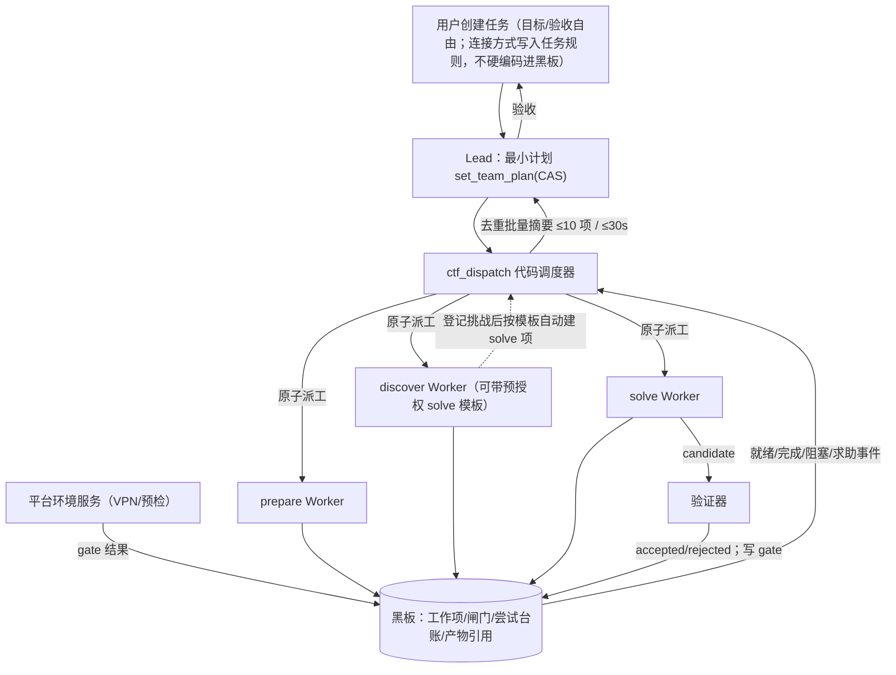

# CTF 团队模式多 Agent 架构 v3 终稿（实现规格，2026-11-03）

本文件是经 v2 设计与 Codex 两轮讨论后的**合并终稿**，面向实现：Codex 审阅后可按文中「Phase 1 提交顺序」直接开工。全文简体中文。本轮不修改运行代码、不调用真实模型、不推送、不读取任何密钥。

**基线**：在 Pi 运行时基线开发（本地 `main` ≈ `56fa9e0`，与 `feature/pi-runtime-migration` 在 `packages/services/profiles/web` 下无代码差异）。功能提交与已完成的迁移提交分开。不以远端旧 `55044a9`（MAF）为实现基线。

**模式兼容**：新配置显式 `dispatch_mode=automatic` 才启用本规格；缺字段的旧快照按 `manual`，行为与今天一致。不得为让测试全绿而把旧 fixture 默默改成 automatic。

**时间**：文中所有时延、吞吐均为**设计目标/容量估算**，未经实测。报告时间均为北京时间（Asia/Shanghai，UTC+8）。

**Codex 实现前审阅**：已对照本地 Pi 源码通读并修正。下列 §2.4、§5.1、§7.1、§11 的澄清为本轮实现合同；未发现必须由用户另行决定的阻塞项。只修改本规格，不修改 `docs/design/`。共享 VPN/受控特权接口不随 Phase 1 暗中启用。

---

## 0. 一句话结论

**默认 automatic：Lead LLM（规划 / 验收 / 例外，无 shell）+ 确定性代码调度器 `ctf_dispatch`（原子派工 / 补位 / 闸门）+ Worker（prepare | discover | solve）。第一阶段不加常驻监工 LLM；可选监工以后按实测信号（决策积压、反馈延迟、上下文占用、管理费用）再开，不用固定题数阈值。旧 manual 行为不变。**

---

## 1. 角色与控制流

### 1.1 角色

| 角色 | 类型 | 职责 | 禁止 |
|---|---|---|---|
| Lead | LLM，1 个，干净上下文 | 理解目标与验收；提取硬前置/停止条件；提交最小可开工计划（`set_team_plan`）；例外决策与停滞重规划；最终验收与对用户沟通 | shell、VPN、扫描、下载、exploit、逐条读工具输出、直接派工/建成员（日常） |
| 代码调度器 | 确定性，runtime/blackboard 内，非新微服务 | 读计划；按已声明条件一人一题原子派工；按已授权容量建/复用/停成员；复用 runner.settle→drain→finish_turn 后补位；闸门满足后重检；事件合并与去重摘要；容量准入 | 决定漏洞路线；伪造 gate；改总预算；越过用户停止 |
| Worker | LLM，池化 | `prepare` / `discover` / `solve` 之一；按 `permission_profile` 执行；登记证据与失败方向；求助；交付可复查结果 | 全局派工、结束任务、写 gate、建普通成员（Phase 1） |
| 平台环境服务 | 平台（envd + 受控接口） | 共享 VPN 出口、预检、受控特权操作；结果持久化为 gate | 任意 root shell 字符串 |
| 独立验证器 | 代码 + 平台适配 | candidate 提交、逐 flag 回执、确定性核分；写入 gate 结果 | — |

**可选监工 LLM（非 Phase 1）**：仅当实测出现 Lead 决策积压、反馈处理延迟、上下文占用或管理费用超阈时再考虑；先可用短命诊断子 Agent。不用「题目数 > N」拍板。

### 1.2 控制 / 数据流



### 1.3 什么用代码、什么用 LLM

| 职能 | 代码 | LLM |
|---|---|---|
| 选就绪项、挑空闲成员、原子占 owner、补位 | ✅ | |
| drain→settle→交接；四层容量/预算准入 | ✅ | |
| gate 满足后重派；已知材料拉取；确认局部故障后最多自动重派 1 次 | ✅ | |
| 事件按 `(work_id, reason, scope_revision)` 去重合并 | ✅ | |
| 最小计划、优先级、边界、例外取舍、验收 | | ✅ Lead |
| 具体解题路线、exploit、调试 | | ✅ Worker |
| 停滞「含义」判断（换路线/取 hint/放弃） | 代码发复查信号 | ✅ Worker / Lead |
| VPN/预检/受控特权 | ✅ 平台 | |
| 核分 | ✅ 验证器 | |

> **纠正 v2 过度概括**：Magentic-One / Anthropic 的协调者本身是做语义判断的 LLM。本规格的意思是「**保留一个**协调 LLM（Lead），日常派工用代码」，不是「一切编排都可变成代码」。

---

## 2. `set_team_plan` 合同（精确，按 Codex 提案固化）

增量修改；遗漏的旧工作项**不**表示删除。单次 upsert ≤ 20。CAS + `request_id` 幂等。

```ts
{
  request_id: UUID,
  expected_plan_revision: number,
  dispatch_enabled: boolean,
  upsert: WorkItem[],       // ≤20
  cancel_ids: UUID[]        // 仅未派发项
}

WorkItem {
  work_id: UUID,            // 稳定 ID；可复用现有 challenge/工作项 ID
  kind: "prepare" | "discover" | "solve",
  source: {
    namespace: string,       // 如 task-input、某平台标识
    external_id: string | null
  },
  scope: {
    objective: string,
    boundary: string,
    input_refs: string[],   // 已登记资料引用，禁止任意宿主路径
    resource_refs: string[]
  },
  requires: (
    { kind: "gate"; ref: string } |
    { kind: "work_completed"; ref: UUID }
  )[],                      // 全部满足；引用必须存在；禁止环
  priority: 0 | 1 | 2 | 3,
  deliverable: {
    criteria: string,
    evidence_required: boolean,
    validator_ref: string | null
  },
  permission_profile: "solver" | "env_prepare"
  // discover 的预授权派生合同，按 §2.4 的冻结与来源约束执行
  solve_template?: SolveTemplate | null   // 仅 kind=discover 可带
}

SolveTemplate {
  permission_profile: "solver",           // 不得高于任务已授权档
  deliverable: { criteria: string, evidence_required: boolean, validator_ref: string | null },
  priority: 0 | 1 | 2 | 3,
  boundary: string,                       // 固定边界文本；不执行模板表达式
  input_refs: string[],                   // 已登记且在任务授权范围内
  resource_refs: string[],                // 派生时只能复制，不能从 connection 推导授权
  requires: Prerequisite[],              // 与 discover 原有前置合并，all-of
  max_auto_solve_items: number,           // 默认20，范围1..200，按 discover work_id累计
  source_namespace: string                // 必须与 discover 项 source.namespace 相同
}
```

### 2.1 硬约束

- 前置只支持 **all-of**；禁止脚本、表达式、循环、动态路由、自定义评分函数（**不是 DSL**）。
- **`gate` 结果只能由对应验证器写入**；Lead 不能直接填「已满足」。
- `permission_profile` 只能选自任务已授权的冻结配置，计划里不能编写新权限。
- `prepare` / `discover` **不计入** CTF 通关题数。
- 计划发布：有界事务 + CAS；重复 `request_id` 返回原结果。
- 派工消息保存**不可变范围快照**；不增加「待生效计划」状态机，不悄悄改 Worker 正在执行的合同。

### 2.2 计划更新规则

| 修改 | 未派发 | 已有排队指令 / 已领取 / 运行中 |
|---|---|---|
| 优先级 | 可改 | 可改元数据，不抢占当前执行 |
| 范围、输入、前置、交付、权限、模板 | 可改 | **拒绝**，返回 `work_in_flight` |
| 撤回 | 原子取消 | 先显式停止 → 确认清理 → 再撤回 / 重新规划 |

### 2.3 调度器无需再问 Lead 的条件

已启用、未派发、所需输入存在、前置满足、权限可授予、资源与成员可用。同级按等待时间排序；跨级长期等待只提醒 Lead 调整，Phase 1 不做复杂评分。

### 2.4 新增（A）：discover → 自动建 solve（「出一题派一题」）

**动机**：Lead 不必每登记一题再醒一次去派 solve；保持 Lead 离开关键路径。

**行为**（审阅后确定）：

1. Lead 在 `discover` 工作项上附带冻结的 `solve_template`。首次派发后不可原地修改；显式停止并清理后才能重新规划。派生记录保存模板内容/摘要与来源版本，后续计划不改写已派生项。
2. discover Worker 在其 scope 内调用 `create_challenge`（或等价登记）成功登记一题后，调度器**自动** upsert 一个 `kind=solve` 工作项：
   - `source.namespace` = 模板的 `source_namespace`（= discover 的 namespace）；
   - `source.external_id` 使用来源真实外部 ID（如 unique_code），不是随机内部 UUID；automatic discover 登记必须提供非空外部 ID；
   - 新挑战记录本身就是 solve 工作项，不再复制一份题目实体。objective/题面中插入的挑战元数据仅作为材料；固定 boundary、permission_profile、deliverable、priority、input/resource refs 由模板复制；
   - `requires` 为 discover 原有前置与模板前置的去重并集，**不依赖整个 discover 完成**；本条题目与派生信息同事务提交后可独立调度，缺材料或 gate 未满足仍等待；
   - 一个 `(task_id, namespace, external_id)` 只对应一个 solve 项。重试、重复发现、多个 discover 的交叠都不创建重复求解；元数据变化记冲突/更正，不能覆盖在途 scope；
   - 仅新建的唯一 solve 项计入父 discover 的累计配额；取消、完成、重启和显式续跑均不返还、不重置计数。超限仍可记录发现，但不自动派生执行项，只合并提醒 Lead。
3. 派生后按普通就绪规则自动派工，**不唤醒 Lead**。
4. Lead 之后可改优先级 / 取消未派发项 / 对在途项走 stop+cleanup。
5. **边界**：后端从调用者当前有效派工确定父 discover，模型不得自填别的父身份/namespace/权限。namespace 相同不等于获准访问任意新目标；source、input/resource refs 必须属于本任务已登记授权，发现的 connection 不自动成为新授权。模板授权不得超出任务冻结能力，Worker不能修改模板或 gate。
6. 发现登记、来源去重、配额占用和派生在同一个任务锁事务中完成；确定性 ID/request_id 与内容摘要保证响应丢失可读回。取消父工作、停止任务、旧 generation 或过期 scope 都不得产生新 solve。基础设施结果未知不换 ID 重试副作用。
7. Phase 1 不提供可信目录真实性判定或任意 shell 的目标沙箱。无法通过已登记来源/资源授权核验的发现只保留为材料，不自动取得网络/平台权限。

---

## 3. Lead 首轮约束与超时兜底

### 3.1 初始值（待验证的启动策略，非供应商 SLA）

- 最多 **3 次**模型调用；
- 自**首次调用发出**起 **60 秒**内必须提交最小计划；先到者触发规划截止。

### 3.2 首轮开放工具

- `list_challenges`、`get_challenge`、`get_record`、`read_saved_tool_result`
- `set_team_plan`（新）
- `finish_task`（无法继续或明确终止）
- `read_task_input`（新，有界只读）：读已登记任务材料；**秘密绑定永不返回值**

不开放：shell、平台操作、创建成员、直接派工。原始目标沿现有初始消息注入（`ctf.py` 输入构造路径）。

### 3.3 超时未产出

1. 原子封住首轮规划；已发调用的费用不确定性保留。
2. 若仍有预算、无停止/恢复屏障 → 幂等创建一个**只读任务整理（triage）**工作项。
3. 兜底 Worker：**无 shell、无网络、无特权**；只整理原始目标、已有资料、前置与缺口。
4. 迟到的首轮计划**不能覆盖**兜底计划；须刷新 `plan_revision` 后重新提交。

只保证「尽早开始安全调查」，不冒充「已经解题」。资源不足或检查点未确认时不强行启动兜底。

### 3.4 TSec 在 VPN gate 通过前

允许：读规则、整理本地材料、来源清单、脚本**草稿**准备。
禁止：调用 Benchmark API、访问靶机、执行这些联网脚本。

---

## 4. 事件路由与合并

粗估：20 Worker ≈ **8 条/分钟**（由 7 成员 / 8.3 分钟 / 24 条线性外推，含结束突发；非实测模型时延）。若每条触发一次 ~10s 模型回合会超过串行能力 → 必须合并。

### 4.1 代码直接处理（不逐条醒 Lead）

| 情况 | 条件 |
|---|---|
| 普通完成 → 补位 | 原回合已结算、执行已清理 |
| 预算暂占 `budget_wait` | 沿用现有退避（`middleware.py:205`，≤2s）；不叫 Lead 判账本 |
| 资源/名额 refill | 状态变化后重检就绪队列 |
| gate 满足 → 重派 | 来自可信验证器写入的 gate |
| 缺已知材料 | 计划里已有获取材料工作及授权 |
| 确认局部故障后换人 | 已确认局部、有交接、无未知副作用；**Phase 1 最多自动重派 1 次** |

### 4.2 需 Lead 的事件

- 按 `(work_id, reason, scope_revision)` 去重；相同未决问题不重复提醒。
- 普通待决最多每 **30s** 一批；Lead 忙时继续合并；最多保留 **一个**待唤醒标记。
- 摘要最多展示 **10** 项 + 剩余数量/引用；原事件完整保留。
- 不覆盖已租用消息或已确认 Session 历史。
- **用户停止 / 硬终止：代码立即执行，不等摘要窗口。**

语义不清的缺料、要新权限、改路线、语义失败后再试 → 交给 Lead。

---

## 5. 工具与权限矩阵（Phase 1）

角色合同仍为 `lead` / `teammate` 两类；Worker 能力由 `permission_profile` 区分。`start_command` / `cancel_command` / `read_command_result` 以 Pi 基线为准（本地分支有；实现时按基线工具表）。

| 档位 | 工具 |
|---|---|
| **Lead（日常）** | `list_members`, `list_challenges`, `get_challenge`, `list_records`, `get_record`, `read_turn_result`, `read_saved_tool_result`, `send_message`, `list_deferred_messages`, `confirm_messages`, `set_verification_required`, `finish_task`；**新增** `set_team_plan`, `read_task_input` |
| **Lead 例外接管** | 保留 `create_teammate`, `stop_teammate`, `resume_teammate`, `remove_teammate`；**必须先暂停自动派工**再使用；仍受同一范围检查 |
| **求解 Worker（solver）** | 本范围读取 + `execute_command`, `start_command`, `cancel_command`, `read_command_result`, `view_image`, `register_artifact`, `append_record`, `record_candidate`, `request_help`, `send_message`；`update_challenge` 仅本工作状态与释放请求；`create_challenge` 仅当该项为 discover 且在 scope 内 |
| **环境准备 Worker（env_prepare）** | 本范围读取、**非特权**命令、产物登记、进度与求助；无全局派工、计分、结束任务；特权操作只走受控环境接口（配置/凭据引用） |

**Phase 1 明确不做**：Worker 自行创建普通成员；受控子 Worker（深度 1、同范围、预算切片）→ **Phase 2**。

### 5.1 sudo / 特权策略

现状：`services/envd/Dockerfile:22` 给 `bbx-agents` `NOPASSWD: ALL`；用户创建在 `app.py:353`。仅禁 `privileged=true` 不够，命令正文仍可直接 `sudo`。

要求：

- **automatic 模式**新建用户**不**获得任意 sudo；**创建路径与归档恢复路径**都执行该策略。
- VPN 等特权 → 新增**受控环境操作接口**，参数为已授权配置/凭据引用，**不接收任意 root shell 字符串**。
- 普通依赖用预装工具或用户级 venv；不开「可夹带任意安装脚本的 sudo 前缀白名单」。
- **旧 manual** 按冻结策略兼容，运行中不改。

Phase 1 只交付 automatic 无任意 sudo 的策略；受控 VPN/特权操作接口随 §6 单独交付。env_prepare 此时也只能非特权执行；缺少对应环境能力时显示阻塞，不用任意 sudo 作为临时回退。权限来自可信任务/派工配置，不从归档内可编辑文本或命令参数恢复。

---

## 6. 共享 VPN（独立小项，不并入 Phase 1 主切片）

落点：`services/envd/src/bbx_envd/networks.py`、`traffic.py`、`app.py` + runtime `execenv/manager.py`。
**不要**扩成「目录 + 配额 + 验证」的大环境服务。

要点：

- 在 **root 任务网关**建 VPN/TUN，对 `198.18.0.0/24` 全队可达；生命周期绑任务，不随某个 Worker turn 结束清理。
- **direct 模式**原则上兼容：Agent ns → root 网关 → VPN；MITM 在 root 发起的上游也可走 VPN。
- **upstream-proxy 模式**有坑：内网请求可能被交给无法访问 VPN 的外部代理；不能靠偷偷加 `NO_PROXY` 绕过部署限制。
- 当前 direct 下任务 `egress_allowlist` **只记录需求、不执行白名单**。
- 须处理 DNS、路由网段冲突、控制通道保留；健康检查必须从**实际 Worker 路径**发起。
- 检查结果持久化为黑板 **gate**；调度器只读 gate，不自己探活。
- Benchmark 凭据注入需受控绑定；现有观测代理认证 ≠ 任务凭据 vault。

---

## 7. 失败隔离与必须先修的停止竞态

### 7.1 默认策略

> **隔离故障成员、保留现场，并暂缓新增派工；不立即把整场结算成失败。**

该新默认仅用于 `automatic`。停止竞态的正确性修复可覆盖两种模式；旧 manual 的未分类异常/收尾语义与旧断言保持。暂停只由服务端控制字段表示，不伪造用户停止，也不创建新的任务终态。检查点或外部副作用无法核清时，不自动解除暂停；可保守保持现场并向 Lead/用户给出明确待处理原因。

随后核对：检查点、费用状态、执行身份、drain。

- 证明局部且已安全收敛 → 解除派工暂停，其他工作继续。
- 共享账本 / boot / 环境 / 外部副作用无法确认 → 暂停任务后续模型/工具准入，进入恢复；不能假装已隔离成功。
- **不以异常类名、`ExceptionGroup`、或「能保存 Session」直接判定局部安全。**

### 7.2 分类表（无权威白名单；按状态证明）

| 情况 | 处理边界 |
|---|---|
| 参数校验失败、命令非零退出、已确认超时 | 返回工具反馈；通常不结束成员，更不结束整场 |
| `provider_transient`、上下文边界、`step_limit` | 成员级有界恢复；保留身份与账本 |
| 黑板控制瞬断 | 能保存/确认检查点 → 局部延期或中断；未确认状态继续保留 |
| 工具包装错误 | **确定未派发**或副作用已查清，且检查点与执行已安全收敛，才可隔离 |
| envd 瞬断 | 先按同 command ID 查询；未知结果不能当未执行或释放成功 |
| 单命令进程 OOM | 确认仅影响该进程、boot 未变、执行可回收后局部处理；退出码 137 本身不足 |
| 容器 OOM/重启、共享 VPN/代理死亡、账本或执行身份不明 | **任务级**暂停/恢复，不能默认只隔离一个成员 |

`ExceptionGroup`、`CtfToolFailure` 只是包装。只有所有相关原因都满足局部隔离条件，才能局部收敛。

### 7.3 必须先修：停止竞态

路径：

1. runner 读到当前 turn 仍 `running`（约 `runner.py:895`）；
2. `stop_member` / drain 期间，另一停止流程将该 turn 持久化为 `stopped`（约 `ctf.py:2788`）；
3. runner 随后 `finish_turn(completed)`；
4. 服务端返回已有 `stopped`；
5. runner `_validate_finished` 因结束原因不同抛错 → 今日可打到整场 `system_failure`。

**修复**：直接返回路径也做**权威停止证明核对**，停止优先于 `completed`；不要忽略所有结果差异，也不要一律升级为整场失败。

---

## 8. 预算

- Phase 1 **不**新增预算释放事件；沿用 `middleware.py:205` 的 ≤2s 退避兜底。
- 预算预检**不占额**，不能保证新 turn 永不等待 → 保留安全的 `budget_wait`。
- **纠正 v2**：`ctf_spend_limit(max_cost×0.8)` **当前无生产调用方**；实际准入比较完整 `max_cost`。不得按 80% 推算容量。`CTF_BUDGET_RESERVE_RATIO` 留在合同里，但 Phase 1 行为以现网准入为准。

---

## 9. pass@k / 多尝试（Phase 1 不做）

- 可复用记录、CAS、回执、单请求幂等，但**不够**覆盖跨尝试竞赛（幂等按调用者 + request_id，不会自动合并不同子 Worker 的同一 flag）。
- **第一个 candidate 不得停兄弟路线。**
- **TSec 多 flag：第一个 accepted flag 也不得停止整题其他有价值路线。**
- 只在「同一子目标已可信完成」时停止冗余尝试。
- pass@k 是指标、同题多尝试是策略；不能直接推出固定预算下总分必然更高。**Phase 1 暂不实现。**

---

## 10. Phase 1 实现规格

### 10.1 文件清单（最小改动面）

| 文件 | 内容 |
|---|---|
| `packages/contracts/src/bbx_contracts/ctf.py` | `dispatch_mode`；`set_team_plan` / WorkItem / SolveTemplate（若确认 A）合同；旧快照兼容 |
| `profiles/ctf/prompts/lead.md.j2` | automatic：无执行工具；首轮最小规划后立即 `set_team_plan` |
| `profiles/ctf/profile.yaml` | 新 automatic 配置与工具集 |
| **新增** `services/blackboard/src/bbx_blackboard/ctf_dispatch.py` | 同连接 `reconcile_dispatch`：就绪查询、原子派工、补位、闸门重派、（若确认 A）discover 自动派生 |
| `…/ctf_board.py`、`ctf.py`、`ctf_api.py` | 范围校验；受限内部入口（抽取同连接方法，保留授权，避免嵌套事务锁）；`set_team_plan` / `read_task_input` API；结果/求助路由 |
| `services/agent-runtime/…/coordinator.py` | 就绪事件唤醒、有限批量补位、空闲看门狗、去重摘要、失败默认（隔离+暂缓派工） |
| `…/runner.py` | **停止竞态权威核对**；局部错误处理条件 |
| `…/middleware.py` | 沿用预算 ≤2s 退避（不改事件模型） |
| `ctf_profile_publish.py`、`worker_settings.py` | 模式/版本/能力校验与发布 |
| `NewTaskPage.tsx`、`CtfSettings.tsx` + 生成 schema / OpenAPI | 完整 UI 与类型接入 |
| `services/envd/Dockerfile`、`…/app.py` | automatic 用户无任意 sudo；创建与归档恢复双路径 |
| 对应合同 / 派工 / 权限 / 停止竞态测试 | 见下表 |

**Pi 接缝核对结论（Codex）**：`邮箱就绪 → claim_turn → Pi 执行 → runner.settle() → stop_member/drain → finish_turn` 基本不变，不必另建清理链。`service`/`system` 可创建成员，但公开 assign / 协作者 / 成员管理仍有 Lead 检查 → 调度器应走**抽取的同连接内部方法**。当前未装配 `pi-subagents`，不能安装后自动获得平台管控子 Worker（故子 Worker 放 Phase 2）。

**共享 VPN**：独立小项（§6），不阻塞上表主切片合并。

### 10.2 建议提交顺序（小步可审）

1. **停止竞态修复 + 失败默认**（`runner.py` / `ctf.py` / `coordinator.py`）——竞态修复覆盖两模式；新失败暂停策略仅 automatic。
2. **合同 `dispatch_mode` + 旧快照兼容**（`contracts/ctf.py` + 生成类型）。
3. **`set_team_plan` + `ctf_dispatch.py` 原子派工/补位**（含内部入口抽取）。
4. **Lead 首轮约束 + 超时只读 triage 兜底**（prompt / profile / 工具过滤）。
5. **事件合并与去重摘要**（coordinator）。
6. **sudo 策略**（envd Dockerfile + app 创建/恢复）。
7. **UI / Profile 发布 / OpenAPI**（`NewTaskPage`、`CtfSettings`、`ctf_profile_publish`、`worker_settings`）。
8. （并行或随后）**VPN gate 独立小项**（§6）。
9. （若 §11 确认 A）**discover `solve_template` 自动派生**——可紧挨步骤 3 或作为 3 的 follow-up PR。

功能提交与 Pi 迁移提交分开。

### 10.3 离线验收表（假模型；预置镜像后不访外网）

| 测试 | 可复用基础 |
|---|---|
| 计划 CAS、重复 `request_id`、非法引用、依赖环、在途修改 → `work_in_flight` | contracts 测试；`test_ctf_assignment_feedback.py` 的 `feedback` fixture |
| 两调度者不双领；回执丢失不重复派 | `test_ctf_assignment_feedback_integration.py` 的 `ctf`/`board_team`；**真实事务不双领必须用隔离本地 PostgreSQL 证明** |
| A/B 指令不串入；Lead 协调消息不被误过滤 | `test_ctf_runtime.py` 的 `MemoryCtf`、`ScriptedChatClient` |
| stop 插在 drain/finish 之间 | `test_ctf_turn_transport.py` 的 `HttpBoard`、fake envd |
| 旧 manual 工具/消息/冻结 Profile 不变 | `test_ctf_architecture.py`、`test_ctf_profile_publish.py`、`test_ctf_board_index_tools.py` |
| 3 次调用 / 60s 截止、只读兜底、迟到计划冲突 | `ScriptedChatClient` + 虚拟时钟；断言未发网络/执行调用 |
| 首条计划→派工模拟延迟；事件丢失兜底 | `test_ctf_event_wakeup.py` 的 `Events` + 虚拟时钟 |
| 积压且空闲时补位；有明确阻塞时不空转、不误收 partial | `test_ctf_coordination.py` 的 `Runtime` |
| 20 成员事件突发：合并、去重、只保留一个唤醒 | 同上，补事件批次 fixture |
| sudo 直接调用、`privileged=true`、恢复后提权均拒绝 | `test_core.py` + **隔离 Linux 容器**证明 |
| （若确认 A）discover 登记 N 题 → 自动派生 ≤`max_auto_solve_items` 个 solve；超限提醒；模板越权拒绝 | 新 fixture，挂 `ctf_dispatch` |

**测试策略**：

- `test_role_tool_permissions_and_explicit_fake_execution`：**保留**「旧 Lead 在有 envd 时具备 execute」断言；**新增** automatic 参数化案例，不删旧断言。
- `test_ctf_tool_authorization.py` 增加服务端拒绝 automatic Lead 执行的案例。
- Profile/API/设置测试增加模式、版本与能力校验。
- envd 用户创建、恢复与 sudo 测试增加新策略。
- **禁止**把所有旧 fixture 默默改成 automatic 来保 2605 全绿。

### 10.4 指标（设计目标，未实测）

| 指标 | 含义 |
|---|---|
| `time-to-first-prepare` | 任务开始 → 首个 prepare/discover/triage turn 开始 |
| `time-to-first-solver` | 任务开始 → 首个真正 solve turn 开始（全依赖 VPN 时 = 预检耗时 + 调度余量；期间状态标「等待共享前置」） |
| `time-to-first-credible-result` | 任务开始 → 首个经验证器确认的可信结果 |
| `idle-capacity-while-backlog` 时长 | 存在可执行就绪积压 + 空闲容量 + 无前置阻塞的持续时间；目标趋近 0 |
| 管理模型耗时 / 费用占比 | Lead（及未来可选监工）占总模型时间与费用的比例 |

验收分别证明：正确性不变量、启动、容量、（另轮真实模型）解题收益。绝不以「建了 20 人」或 mock 吞吐冒充解题效果。

---

## 11. 编码前请 Codex 确认的开放点

1. **solve_template**：按 §2.4 实现，纳入步骤3；固定文本，不做表达式插值；默认20、上限200、累计计数不回收。
2. **read_task_input**：读取 task 的 goal/domain_context/completion_requirements 与已登记公开附件的有界正文/元数据；只接受本任务附件 ID，不接受 path/URI。秘密绑定及其解析值不返回。当前输入合同缺少公开/秘密区分，需增加显式的可见性标记；automatic 对未分类附件只返回元数据，不能声称通过文件名或正则可靠识别所有秘密。
3. **内部入口**：公开工具继续核验 actor、代次、模式与冻结白名单；调度 service 只访问同连接的建成员/题目分配 helper，不借用 Lead 身份、不在锁内调用另开事务的公开方法。
4. **故障暂停**：task.ctf_control 保存准入暂停及故障成员/turn/代次引用；automatic 的新 claim/派发受其约束。故障成员被围栏保护；未证明共享安全时同时阻止后续执行准入，保留停止与只读查询入口。manual 保持既有未知异常收尾。
5. **配置版本**：保留旧 manual Profile，automatic 显式选择；缺失 capability/schema 的 automatic 任务创建/发布明确拒绝。每步生成受影响合同；步骤7完成 UI/OpenAPI/发布整体验收后才允许用户启用，不自动发布到业务配置。
6. **VPN**：按用户要求排在步骤1–7之后，任务网络模式属于冻结环境/gate配置；本轮主切片不实现 VPN连接、不使用真实凭据。
7. **基线**：从 feature/pi-runtime-migration 创建功能分支，沿用当前 Pi 源码；不向 main 合并、不推送。

---

## 12. 与 v2 / Codex 的收敛摘要

| 议题 | 终稿 |
|---|---|
| 常驻监工 LLM | Phase 1 **不做**；可选，按实测信号开 |
| 谁日常派工 | **代码** `ctf_dispatch` |
| Lead | 规划/验收/例外；首轮 ≤3 调用 / 60s；无 shell |
| 环境准备 | Worker `env_prepare` + 平台受控接口；共享 VPN = 任务网关服务 |
| 子 Worker | Phase 2 |
| pass@k | Phase 1 不做；首 candidate / 首 accepted flag **不停**兄弟路线 |
| 预算 | 无新释放事件；预检不占额；修正「0.8 上限」误读 |
| sudo | automatic 无任意 sudo；受控接口 |
| 旧任务 | `manual` 不变；测试不翻旧 fixture |
| 用户新增（A） | discover 预授权 solve 模板 → 自动派生派工；待确认 |

---

## 13. 本轮边界

- 只读了 `/workspace/bbx/codex-discussion-rounds.md`、v2 文档，并核对了合同工具名与关键路径引用。
- 未改运行代码/配置/提示词/业务数据；未调用真实模型；未推送；未读 `.env` 或任何密钥。
- 实现以本文件为准；Codex 审阅 §11 后按 §10.2 顺序开工 Phase 1。
