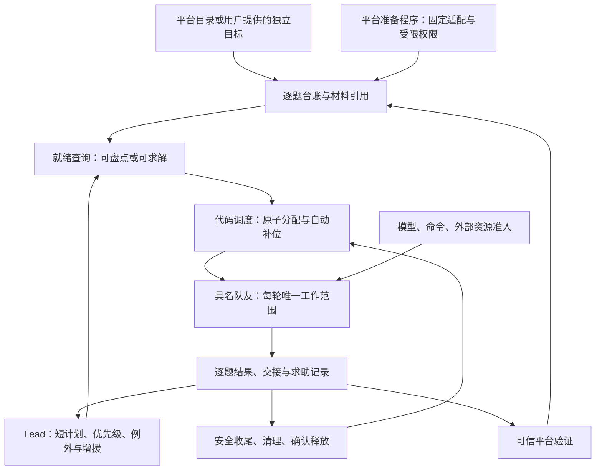

# CTF 自动调度与协作：多 Agent 架构讨论结论

日期：2026-11-03，北京时间。基线：`54c624f`；运行代码与当前主线 Pi 版本一致。本报告承接[策略审查](CTF-strategy-architecture-review-20261103-report.md)，细化可开发方案；不表示下述能力已经实现或性能目标已经达成。

用户要求多个子 Agent 讨论可实施性、简洁性与解题速度。主 Agent 与三个子 Agent 分别审查调度/数据模型、Lead/协作/平台准备、性能/可靠性，并进行了交叉反例讨论。所有子 Agent 使用当前模型与推理配置，没有额外创建下一层团队。本轮仅新增本报告，不修改生产代码、设计正本、提示词、配置或业务数据，不续跑任务、不调用真实模型或外部靶场。

## 1. 最终决策

保留 **1 个 Lead + 现有 runtime 内的代码调度器 + 最多 20 名持久队友**。Lead 负责有语义判断的策略与例外；代码保证已确定的工作被分配、补位、收尾和恢复。20 是队友名册上限，不含 Lead，也不等于模型调用、重计算或外部靶机并发上限。

首版的 ready 队列是 `ctf_challenges` 的查询视图；运行事实继续使用现有消息、turn、generation、checkpoint、费用账本和 envd。无需新消息服务、调度 LLM、assignment 表、工作租约、分类主管或通用工作流 DAG。

平台目录、附件与资源操作分阶段接入固定版本的真实适配器；通用任务可通过现有建题入口进入自动队列，不被某个特定平台阻塞。先实现按题分工和安全补位，再以模型/执行资源准入和实测容量作为 20 人真实灰度的门槛。



以上是现有服务内的职责，不代表新增这些部署服务。

## 2. 讨论改变了哪些初始设想

| 讨论点 | 最终选择与原因 |
| --- | --- |
| 材料全部 ready 后再求解 | 有题面和可访问来源时即可派初步盘点，足够后同一 Session 继续；缺材料且没有可执行获取步骤才等待。 |
| blocked owner 保留旧责任同时不断接新题 | 首版使用显式 yield 交接；安全结束后释放当前 owner，历史作者/交接保留。避免永久 owner 与 executor 两套责任。 |
| 为 yield 新增成员 pending operation | 不新增。用 dispatch、已结束 turn、execution 状态推导待清理工作，再以 `settle_dispatch` 收敛；避免人工 stop 被已有 yield 操作拒绝。 |
| 完成状态变更后立即补题 | 先等原 turn 和执行安全收尾；题目 completed、turn finished、外部 accepted 分开。 |
| 给每个成员加本地并发锁 | 模型准入按同账户/endpoint 跨任务协调；命令准入位于 envd 实际启动边界。锁的作用域必须对应真实资源。 |
| 直接复用 Lead 身份跑后台准备 | 使用独立、受限的 service 授权；原平台 wrapper 依赖 Lead 活跃 turn，不能冒用。 |
| 根据模型自报重/轻限制计算 | 任意 shell 无法可靠分类；采用可测定的任务级命令并发边界，或明确限制灰度负载。 |
| 多加模型接单/轮询/总结工具 | 接单从 checkpoint 投递证明推导；状态由代码读回；最多增加两个模型工具。 |
| 增加评分预测、技能市场或多级主管 | 先用简单优先级、等待时间与相关 Session 软偏好；实际出现瓶颈后再决定。 |

## 3. 当前代码提供的基础与真实缺口

- [任务行锁](../../services/blackboard/src/bbx_blackboard/store/repository.py#L642)已经串行化相关写入。20 队友、几十至数百题先保留短事务；不能加 `SKIP LOCKED` 就宣称消除了既有任务锁。
- [当前 coordinator](../../services/agent-runtime/src/bbx_runtime/ctf/coordinator.py#L615)只启动有邮箱输入的成员；没有面向 ready 题目的自动分配。[事件筛选](../../services/agent-runtime/src/bbx_runtime/ctf/coordinator.py#L32)也没有覆盖题目就绪变化。
- [题目更新与派信](../../services/blackboard/src/bbx_blackboard/ctf_board.py#L556)已有同事务、CAS、幂等回执；公开 API 自行开事务且有 Lead 权限检查，不能在新事务里直接嵌套调用。
- [claim_turn](../../services/blackboard/src/bbx_blackboard/ctf.py#L1575)以最早消息启动 turn，[claim_messages](../../services/blackboard/src/bbx_blackboard/ctf.py#L1686)会读取该成员待处理输入。当前 `assignment_message_ids` 是回执集合，不能表示唯一可信工作范围。
- [原 turn 结算](../../services/blackboard/src/bbx_blackboard/ctf.py#L2459)保留费用、恢复与结果通知；正常结束没有立即清理旧执行，旧代次目前在[下一次 prepare](../../services/agent-runtime/src/bbx_runtime/ctf/execution.py#L174)时清理。新调度必须主动驱动收尾，不能仅等待 `execution.drained=true`。
- [平台合同](../../packages/contracts/src/bbx_contracts/ctf.py#L146)仅有 `none/fake_ctf_v1` 结果适配。真实目录、附件及可查询资源状态仍需实现；当前不能把任意 shell 回显当作可信平台结果。
- [模板合同](../../packages/contracts/src/bbx_contracts/ctf.py#L130)严格限定可信身份占位符。容量摘要通过持久、去重的系统消息输入，不给旧模板随意追加变量。

最新历史任务的 7 名队友、9 个大包、首次派工约 16 分 38 秒，已由前轮只读核查。本轮未再次读取或改变业务数据；这些数据早于 Pi 部署，不能当作新版本性能实测。

## 4. 最小数据合同

下表为需新增的合同草案，最终命名随实现统一。所有跨服务定义放在 `packages/contracts`。

| 位置 | 最小增补 | 单一事实来源与边界 |
| --- | --- | --- |
| 冻结任务/Profile 配置 | `dispatch_mode: manual / automatic` | 旧快照缺字段按 manual；只在显式选择新自动配置时启用。 |
| 任务控制/计划 | `plan_revision`、短 `strategy_note`；题目优先级与理由 | 不让模型填写容量、实时费用或资源占用。配置发布与计划更新各自 CAS。 |
| `challenge.data.scheduling` | `next_action`、`readiness`、`blocked_reason`、`priority`、服务生成的 `ready_since`、`scope_revision`、输入引用、当前 dispatch 引用、可空 yield 交接引用 | 队列由这些事实查询派生，不存另一份 ready 列表；进度变化沿既有题目事件事务投影。 |
| `ctf_messages.dispatch`，nullable JSON | 题目、run、scope 版本、输入引用、工作边界/交付要求；可选帮助请求 ID | 消息 ID 即 dispatch ID；分配后不可变。重派使用新 ID，确定的逻辑请求重试复用原 ID。 |
| `ctf_turns.dispatch_message_id`，nullable | 自动求解 turn 的唯一主派工引用 | 不替代旧 `assignment_message_ids` 回执；旧消息和普通复盘保持 null。 |
| `ctf_members.current_dispatch_message_id`，nullable | owner/helper 统一使用的当前执行槽引用 | 派工时原子占槽，只有同 ID 的 settle 才清槽；turn 结束不提前清除。题目上的 dispatch 引用仅指其主派工，不承担 helper 槽位状态。 |
| 现有帮助记录 | 请求引用、`blocks_owner`、成果引用；解决记录含 adopted/rejected/cancelled 与理由 | 运行状态从关联消息/turn 推导，不复制一套 helper 运行状态机。 |

`scope_revision` 仅在题面、必要输入被替换或授权边界实质改变时增加。普通进度、追加证据、同一范围中的 triage→solve、负责人展示变化都不应令在途派工失效。题目 `revision` 继续负责每次 CAS，两者不能混用。

输入引用指向服务确认的不可变文件或记录，不能由模型伪造哈希或对象 URI。目录提供稳定题目 ID 时，使用来源命名空间和外部 ID 幂等映射；分类只做分组，多 flag 题保留一个题目并记录各 flag 的验证。不存在稳定来源目录时，完整性只能标为待核，不能宣称系统已证明全部目标覆盖。

初期只增加消息、turn、成员的必要列，题目扩展沿 JSON 数据合同；索引根据实际查询增加。成员槽位是派工是否仍占用成员的权威引用，题目主派工引用供范围核对，两者在同一分配/结清事务更新。新增运行引用必须纳入归档、恢复与删除；展示事件重放不得复活已经结束的执行身份。

## 5. 调度与收尾算法

### 5.1 `reconcile_dispatch`：内部服务入口

事件唤醒为主、现有短周期检查兜底。增加题目就绪、计划变更、交接完成的相关唤醒；工具追踪事件不触发全队重新规划。调度只读短题目和成员状态，不载入全部 Session/工具记录。

每轮有限配对，每对使用一个短事务；数据库选择与最终检查为准，不相信 runtime 的旧缓存：

```text
for each available pairing in a bounded batch:
  begin transaction; lock task
  require automatic, running, permitted configuration
  reject stop/close/recovery/replacement/uncertain execution barriers
  select ready work without an unsettled dispatch
  select an eligible idle member, preferring useful prior context
  if none and roster/start-admission allow: create one member
  if none: return a bounded, explicit wait reason
  verify work scope and member eligibility again
  atomically write owner + dispatch reference + one instruction
  commit and notify
existing claim_turn starts the assigned member
```

成员可用要求：active、无当前 turn、无未结清 dispatch/helper 派工、无控制操作、无未确认检查点/恢复输入，不抢占待处理用户指令。人工 stopped 成员不自动恢复、移除或以替身绕过；名册上限仍计算未移除成员。

`claim_turn` 也必须执行服务端 scope 与收尾门禁，不能只在 reconcile 选人时检查。首次启动、尚未进入最终收尾的同 dispatch 合法有界恢复允许；进入完成/yield 最终收尾后，任何通知不得开启新 execution generation，直至 settle。不同 scope 的消息不能自行获得执行权，不能简单把“有 current dispatch”一律解释为禁止首次启动。

需要提取接受同一个 `conn` 的内部成员创建/派工 helper；服务身份固定为受限 system，不伪装成 Lead，不绕过冻结配置和工具白名单。Lead 的手工派工、重分配与旧 `release` 入口在 automatic 模式也要遵守相同执行边界，不能成为双领旁路。

相同 scope 下的逻辑派工使用持久序号/唯一消息 ID；回执丢失后重查当前 dispatch，不能换 ID 再创建相同工作。只读扫描、HTTP 和模型调用都不在事务锁内。

### 5.2 安全结束后自动补位

原题 completed 不立即释放成员。进入最终收尾的原 turn 结束、检查点/费用状态确认后，coordinator 主动清理准确的旧执行 `(member, boot, generation)`，再调用 service-only `settle_dispatch`。provider/context 合法恢复的中间 turn 不提前进入该最终收尾路径。

清理复用 envd drain 和[现有 proof 校验](../../services/blackboard/src/bbx_blackboard/ctf.py#L3145)。按执行身份去重的有限后台 future 承接耗时工作，不阻塞整轮 tick；正常收尾与既有 `member_operations` 人工停止路径共用此 helper，不能保留人工 stop 同步等待长 drain 而阻塞其他成员。它只是运行优化，重启后从持久 dispatch、turn、execution 推导待清理项。缺失执行绑定不等于已清理。

`settle_dispatch` 在任务锁内再次核验：派工未变、关联 turn 已结束、checkpoint 与已知 usage/outbox 持久结算、当前调用没有未处置的费用预留、对应执行 drained、没有接管此成员的 stop/remove/close。费用不明的已发送请求按原规则转入 unknown 并继续扣留；不要求 unknown 清零，纯费用未知不单独阻止安全换题，未知执行/平台副作用仍阻塞相关派工。满足后原子释放该成员的相同 dispatch 槽，成员保持 active；完成题保留最终 owner 与成果。然后才派下一题。

没有显式题目交付的 `turn completed` 进入 `needs_decision`，每个未解决条件只提醒一次；它既不是题目完成，也不是无限自动重试的理由。已有 provider/context 有界恢复继续保留，恢复期内禁止新题抢占。

待决后，Lead/user 可以通过结构化继续意图授权同 scope 续接，或补齐可核实交付、要求 yield；服务端核对当前 dispatch 和新的决定版本，不能让积压旧指令或普通通知隐式放行。若派工已经进入最终清理，只能先完成 settle，再建立新派工；不得与 drain 并发重开同成员执行。

以上题目交付条件用于主派工。helper 无权完成整题：登记与帮助请求关联的成果或明确阻塞交付，且自身 turn、drain、结算完成后即可释放其槽，owner 后续采用/否定结果不继续占用 helper。没有任何交付的 helper 才进入待决。owner 完成整题时应关闭新的支援准入，通知现有 helper 收尾并确认其派工安全结清，避免继续重复求解或把仍工作的 helper 当空闲。

### 5.3 阻塞与交接：明确选择 yield

X 处理 A，因缺资源需要改做 B：

1. X 用现有题目更新接口表达 yield，引用交接记录，写清尝试、必要产物、阻塞与未知副作用；只登记意图，尚未释放。
2. 停止扩展 A 的执行路线；同 scope 的 owner/helper 完成必要交接后结束，未确认的外部操作继续保持阻塞。
3. 与正常完成一样驱动锁外 drain 和 `settle_dispatch`。有 helper 时必须等待其关联派工安全收尾；不偷偷停止再恢复成员。
4. 原子清除 A 当前 owner/dispatch，保留 `previous_owner_id` 与交接来源。X 才能领取 B。
5. A 的资源到达后进入公共队列，由空闲 X 或 Y 以新 dispatch 领取。

未 yield 的 blocked owner 仍有责任，不直接当空闲复用；帮助请求本身不等于 yield。等待需显示具体原因，Lead 可选择续接、增援或要求交接。

不扩展 `pending_operation` 枚举：人工 stop 仍能写入既有控制操作。若 stop 在 drain 与 settle 之间到达，最终事务由停止流程接管，不放行新派工、不恢复生命周期。清理响应丢失可重查和幂等收敛；未知副作用不可因为超时而重做。

### 5.4 防止跨题串行会话串错工作

自动模式每个工作 turn 绑定唯一可信 dispatch。题目写入、候选提交、平台调用从 runtime 身份继承 scope，服务验证当前派工；模型不能自填执行身份。工作目录按题目/派工隔开，持久 Session 的已确认历史不重写。

旧题未执行工作指令在交接时明确撤销/延后；普通旧题通知只能作为只读信息或递交 Lead，不能自动恢复旧任务。真正继续旧题必须新派工。新题运行时即使收到旧题讨论，也不能借此变更当前执行权限；用户新的明确执行指令应先做受控交接，不能悄悄将两个执行范围合并。

dispatch 可保证受控工具权限、代次和记录归属，不能证明任意 shell 实际访问的目标。因此旧脚本的网络语义隔离仍取决于环境/受控适配能力，不能承诺加字段就隔离任意命令。迟到平台回执可入历史，但不得覆盖新 scope 的当前结论。

## 6. 策略、Lead 与协作

### 6.1 默认解题策略

- 已知来源先持续盘点、逐题登记；有可执行第一步的目标立即开始，不等全目录读完。
- 优先准备可转离线的材料；已经够用的独立题充分铺开。在线题按真实资源名额滚动推进，不强制等所有离线题解完。
- 初期用少量优先级档位、理由和等待时间排序，长期等待的可执行题得到机会；不建立未经验证的成功率/分数预测器。
- 同一队友相关上下文有价值时优先复用，但不把一整类未开工题私有分给某一个人。
- 长时间没有有效证据只触发复查。长计算、预算等待、模型限流和确实无进展分别显示；超时不是夺走工作并重复执行的充分理由。

### 6.2 两个新增模型工具足够

`set_team_plan`：Lead 用 CAS 更新短策略和逐题 priority/reason。默认策略在自动模式已可执行，计划工具不是每道题派工的必经审批。

`resolve_help`：owner/Lead 引用请求和实际成果，写 adopted/rejected/cancelled 及理由。没有成果引用的 helper turn 结束不自动关闭求助。

其余扩展已有接口：

- `update_challenge(action=schedule)` 提交准备事实和下一步；服务确认文件真实性，模型判断材料足以支持的工作。
- `update_challenge(action=yield)` 附交接引用；复用既有记录和结果，不要求额外模型接单确认。
- `request_help` 增加 `blocks_owner`，旧请求默认 true；非阻塞帮助允许 owner 继续独立路线。
- `append_record` 可引用 `help_request_id`；协作派工同时写 collaborator 权限与明确支援边界，helper 也占普通执行槽。

新能力只在 automatic 新配置发布时校验；不静默扩充旧快照工具。帮助状态通过请求/派工/结果/解决记录投影，原 owner 决定采用结果，必要时由 Lead 处理例外。

### 6.3 Lead 的输入与唤醒

代码给 Lead 的短摘要只含就绪/执行/等待/待决数量、可用容量、未解决求助和必要记录引用；详细题面按 ID 读取。延续项目既有约定，不重新向模型披露剩余金额/时长。

按 plan revision 和相关状态版本去重。成果、求助、资源变化与真实策略偏离才请求判断；调度器自己发出的摘要或每条工具 trace 不触发再规划。现有“全队空闲”看门狗保留，再补有人运行时的队列等待/待决检查。固定上下文前缀、已有安全裁剪和恢复保持，不增加模型总结 Agent。

## 7. 性能准入必须和派工分开

### 7.1 模型调用闸门

当前[预算计算](../../services/agent-runtime/src/bbx_runtime/ctf/budget.py#L17)使用最坏输入/输出费用，不能用平均成本替换以制造并发。[预算暂占等待](../../services/agent-runtime/src/bbx_runtime/ctf/middleware.py#L202)已能保留 turn/Session，继续复用。它是调用等待，不是题目永久 blocked。

增加单 runtime 内、按凭据配置身份/endpoint 作用域的轻量准入队列，任务间轮转。已知供应商并发上限使用实际配置；未知时不凭空写 7 或 10。429 共享冷却使用现有 `Retry-After` 诊断，到期单探针恢复；不做自适应并发、模型路由或分布式 semaphore。

准确顺序必须是：

1. 模型调用前先核查身份、停止和输入，完成实际请求准备；不提前长期占费用。
2. 在逐次模型请求边界取得 provider permit，再做一次费用准入 RPC。
3. 若费用暂占，立刻归还 permit，沿用现有等待后重新排队；不能在持有模型位时执行预算等待循环。
4. 获准后确认必要 checkpoint，标记 sent，再发送实际请求。
5. 响应/流终止在 finally 释放本地 permit；工具和长命令不持有模型位。确定未发送才可释放费用预留，已发且结果未知仍保留原 unknown 账本。

停止取消排队不发送请求，也不抹去已发送费用。当前没有实际发布预算释放事件，首版可保留最多 2 秒等待兜底；若新增事件需真实接到已确认结算，不假设已有事件可订阅。

本地 permit 约束客户端在途请求；网络断开后远端是否继续计算不可知，不声称严格知道远端并发。门槛覆盖同账户两个任务各 20 名队友及 Lead，验证任务公平和 Lead 能获得调用机会。

### 7.2 命令与内存

同成员最多一个异步长命令已经存在，不能代替任务级资源准入。最小可强制的控制是 envd 中所有命令共用任务级并发边界，sync/async 在实际 spawn 前取 permit，到进程组确认回收才释放；不靠模型自报或命令关键词猜重轻。

排队使用同一个 command ID，可被 stop 取消，排队状态不算已执行。同步 HTTP 当前读取期限为 `timeout_sec + 30`，新增排队必须有界且明确计入总调用期限，并区分“确定未启动”与“已启动结果未知”；不能无限排队后当作未知命令重试。长等待优先用已有异步生命周期，不让模型循环询问 busy。

命令槽数由混合 I/O/计算负载测试确定，不等同 CPU 核数。实现这一完整边界前，20 人灰度只能针对已验证的轻计算/I/O 工作；不承诺 20 个重计算进程在单共享容器上安全。

每个 [BaseChatClient](../../services/agent-runtime/src/bbx_runtime/pi/client.py#L32)持有 PiBridge，[Bridge](../../services/agent-runtime/src/bbx_runtime/pi/bridge.py#L68)启动独立 Node。模型 permit 限制不自动限制等待中的 turn/Node 内存，因此必须单独测活跃 turn/进程容量，必要时把实测启动容量作为派工准入并显示等待原因。先不改共享 Bridge 或容器编排。

### 7.3 工作台必须解释未用满

显示名册/上限、活跃派工、模型在途/等待、命令排队、题目就绪/材料等待/资源等待/待决。等待原因由代码产生，不靠 Lead 自述。20 人创建数不是成功指标，不能把等待中的 turn 算成 20 路有效求解。

## 8. 平台准备：一条窄适配逐步交付

先实现一个真实平台和固定版本合同，不建立通用工作流平台：

1. **只读目录**：分页、稳定外部 ID、题面/附件清单、完整范围状态；已发现项可立即 triage。
2. **附件**：流式下载、校验、不可变登记、输入引用、失败分类；数据不经过模型正文。
3. **资源与验证**：申请/查询/关闭、提交/查询结果、明确配额与接管范围。

真实 API 的幂等/查询能力须在该阶段通过固定响应样本核对；当前仓库 fake adapter 不能充当这一证明。没有可验证适配时，通用建题/求解仍能工作，平台效果标为待核。

后台准备需要受限 service 身份，绑定任务/run、固定 adapter/version、获准来源和操作范围，不借用 Lead token/活跃 turn。为外部 I/O 增加一个窄 `platform_operation` 持久记录：operation ID、task/run/执行代次、source/challenge、resource scope/key、参数摘要、prepared/dispatched/settled/unknown、结果引用。它只记录外部操作，不成为另一套 Agent 工作状态。

使用短事务登记授权和请求 → 锁外 I/O → 同 ID 结算。原平台调用来源/幂等逻辑能共享的部分抽取复用；service 请求不伪装成某个模型工具调用。scope 不局限单 task：若两个任务共用同一平台账户的三个名额，需按 resource scope 串行化准入并持久记录占用，单任务行锁不能保护跨任务额度。配额取实际适配配置与平台读回，不硬编码为 3。

响应未知先查询，不重放启动/提交/关闭；不能保证平台不支持的恰好一次。释放实例前核实附件与后续工作是否依赖其状态；不能下载完成就机械关闭。停止阻止新操作，允许记录已发送回执和清理本任务拥有资源；归档对未结清外部状态保留 unknown/待处理记录，不能假装已释放。

归档前先封住新操作入口，取消或等待本地准备 worker 和下载写入结束；将已发送未确认操作持久化为 unknown，再取得一致快照。不得在归档期间继续写附件或把尚运行的本地准备进程当作外部 unknown 忽略。终态迟到回执仅由受控对账路径追加历史，不重新派工、不覆盖已结束 scope 或已发布归档；删除后的任务也不能因回执被重建。

现有附件登记上限 50 MiB、跨题关联限制需要用真实样本验证。超限明确报错/等待，不能偷偷跳过或整文件加载内存；确有大附件需求时单独扩展流式存储和限制。共享输入需显式多题来源关联，不能绕过既有 artifact 权限。

## 9. 分批实施与代码落点

| 交付 | 具体内容 | 依赖与发布条件 |
| --- | --- | --- |
| M0 合同与行为样例 | automatic 兼容合同、逐题/dispatch/yield 语义、最小固定平台样例、数据迁移范围 | 先同步 CTF 独立设计提案；不把任务专有规则塞入通用黑板模式。 |
| M1 自动分工闭环 | ready 视图、原子派工、20 人建队/复用、可信 scope、主动 drain、settle/yield、简短状态摘要 | 首个完整垂直切片，必须能从一题完成安全接下一题；不能只交付建队 API。 |
| M2 协作与容量 | 两个模型工具、非阻塞求助/成果合并、模型公平准入/共享冷却、执行排队边界、界面等待原因 | 可拆独立 PR；达到容量门槛前不宣称 20 人真实性能。 |
| M3 真实平台准备 | 目录→附件→资源/验证三个小交付，受限 service 操作账本 | M1 可独立用已知材料工作；M3 补齐全量范围、自动取材与可信得分。 |
| M4 对照评测 | 冻结题集/配置，重复真实运行，比较得分、首 flag 与成本 | 离线正确性、隔离数据库/执行容量验证通过后进行。 |

M1 所有新增逻辑先局限于 automatic；旧任务维持 manual。新任务创建、Profile 发布、角色设置、API/schema/前端类型必须同步；不静默把历史大包改成逐题完成状态，也不在正在运行的自动任务上切回旧实现。

主要落点：

- `packages/contracts/src/bbx_contracts/ctf.py`：字段、工具、配置、事件合同；同步生成 schema/OpenAPI。
- `services/blackboard/src/bbx_blackboard/ctf_board.py` 与新的小型 `ctf_dispatch.py`：同连接派工、ready 查询、收尾/yield；只按职责拆分，不搭通用框架。
- `ctf.py`、`ctf_api.py`、`ctf_lifecycle.py`、`store/schema.py`、`store/repository.py`、迁移：单 scope claim、受限内部入口、投影/归档/恢复/删除。
- runtime 的 `ctf/coordinator.py`、`middleware.py`、`provider_boundary.py`、`execution.py`、`board_tools.py`、`platform.py`：事件唤醒、异步清理、模型准入、可信工具范围。
- `services/envd`：统一命令准入、排队期限与停止；已有 command registry 仍是执行事实来源。
- 配置发布、`profiles/ctf`、`web/src/ctf`：自动模式能力检查、短指令、等待状态；平台/角色现有参数保留。

计划文件名为拟议落点；新增模块在本轮尚不存在。共享合同、事件白名单、归档版本和生成文件必须与实现同批更新，不只修改 Lead 提示词。

## 10. 验收：分别证明正确性、容量和解题收益

### 10.1 必须通过的行为

| 场景 | 必须证明 |
| --- | --- |
| 20 个独立 ready 工作 | 容量允许时 20 个不同队友唯一领取；只有 7 项可做时不空建 20 人。 |
| 完成后补位 | 题目先 completed、turn 未结束时不补题；主动 drain 和 settle 后自动接下一项。 |
| 双 reconcile/响应丢失 | 不重复建队、双领或重复派信；逐项失败保留已成功项。 |
| X 从 A 交接到 B，A 后来 ready | A 可被 Y 新领取；旧 A 指令/结果不能覆盖 B 或 A 的新派工状态。 |
| yield 有 helper | owner/helper 任一未收尾不释放；普通求助不误当放弃责任。 |
| 无交付的 turn completed | 单次待决提示，不无限重派或伪造题目完成。 |
| stop 在 drain 与 settle 之间到达 | 停止接管，不新派、不自动恢复；重启后结果相同。 |
| 输入/计划变化 | 普通进度不误增 scope；实质范围变化拒绝旧写入，已确认历史不改写。 |
| 同账户两个任务各 20 队友 | 模型客户端在途不超过配置，预算等待不占模型位，任务/Lead有机会，429冷却无同波重试。 |
| 费用未知但执行已结束 | unknown 预留继续扣留，剩余预算足够时安全换题不被永久阻断；未知执行副作用仍不可重放。 |
| 命令排队/取消/响应未知 | 同命令 ID 不重复执行；排队期限明确；stop取消未启动命令、回收已启动进程。 |
| 平台三名额与离线工作混合 | 全作用域占用不超限；离线工作继续；资源unknown不重放、不假释放。 |
| 无变化及旧任务 | 不重复唤醒Lead；旧profile/快照/复盘保持原语义；归档、重放与删除覆盖新增字段。 |

### 10.2 待测性能门槛

以下是建议起始验收目标，不是本轮测量结果：在前置条件与容量均满足时，正常事件 `ready→持久派工 p95≤1秒`、`派工→turn启动 p95≤5秒`。事件丢失的兜底延迟另报；材料、预算、模型/执行资源等待单独计时，不能从总等待中隐去。

隔离 PostgreSQL 使用 100/1000 道短索引题、20 个成员、连续补位与停止操作，测 SQL 次数、任务锁等待、派工分位数，确认调度不加载完整 Session。mock 测试仅证明行为，不证明数据库性能。

原生 Pi 使用脚本化模型，测 1、7、20 名队友及两个任务各 20 名队友，并包含 Lead：冷/热启动、逐调用时延、Node 数、runtime/envd 容器内存峰值、CPU、停止响应和收尾后资源回落。模型闸门之外的活跃 turn 内存单独评估，不把进程 RSS 简单相加当作独占内存。连续跨题运行检查上下文长度与费用增长。

### 10.3 真实解题效果

固定题集、平台状态、模型、预算与时限，比较当前版、仅提示词调整版、自动调度版；同配置重复运行，报告波动和失败原因。主指标是可信得分/完成数、首 flag 时间、每分成本；同时观察 ready 排队、有效并行、在线资源占用、重复尝试、求助响应和失败率。

不以创建了 20 人或 mock 吞吐提升代替解题效果。对于第三方不稳定接口、模型推理质量和共享机器实际负载，架构讨论不能保证具体加速倍数；达到上述门槛才逐步扩大自动模式范围。

## 11. 本轮实际检查与交付

- 三个子 Agent 独立阅读实际代码，互发方案和反例；主 Agent 再核对关键调用路径。讨论关闭了旧题串入新题、正常完成不主动 drain、yield 阻塞人工 stop、费用等待持有模型位、跨任务资源配额、同步命令排队超时等实施缺口。
- 报告末轮反审补齐了成员持久派工槽、claim 收尾门禁、人工 stop 异步清理、helper 独立释放、准备程序归档屏障、unknown 费用不永久阻止换题六项边界；修订后，三个子 Agent 均确认其审查问题关闭。
- 主 Agent 定向离线检查：`test_ctf_assignment_feedback.py`、`test_ctf_runtime_state.py`、`test_ctf_board_index_tools.py`，**49 passed，3.31 秒**。
- 性能子 Agent 定向离线检查：`test_ctf_budget_wait.py`、`test_ctf_budget_bounds.py`、`test_ctf_provider_recovery.py`、`test_ctf_async_execution.py`、`test_ctf_coordination.py`，**45 passed，6.81 秒**。
- 本轮完整 `UV_CACHE_DIR=/private/tmp/bbx-uv-cache make check` 通过：**2605 passed、438 deselected，162.86 秒**；Ruff、Pyright 与 Pi 原生检查通过。日志位于忽略目录 `.data/ctf-architecture-roundtable-20261103/make-check.log`。以上测试核验现有基础，不表示拟议自动调度已通过测试。
- 未运行真实模型、生产压力测试、外部平台调用或重新部署。新增实现的隔离数据库、原生 Pi 多并发和真实解题评估仍属于后续验收。

可复现定向命令：

```sh
.venv/bin/pytest -q \
  services/blackboard/tests/test_ctf_assignment_feedback.py \
  services/blackboard/tests/test_ctf_runtime_state.py \
  services/agent-runtime/tests/test_ctf_board_index_tools.py \
  -m 'not integration and not live'
.venv/bin/pytest -q \
  services/agent-runtime/tests/test_ctf_budget_wait.py \
  services/agent-runtime/tests/test_ctf_budget_bounds.py \
  services/agent-runtime/tests/test_ctf_provider_recovery.py \
  services/agent-runtime/tests/test_ctf_async_execution.py \
  services/agent-runtime/tests/test_ctf_coordination.py \
  -m 'not integration and not live'
UV_CACHE_DIR=/private/tmp/bbx-uv-cache make check
git diff --check
```

本轮采用单独文档提交：`docs: specify CTF dispatch and collaboration implementation plan`，仅本报告。实现按 M0–M4 分批，先把已收敛合同同步到 CTF 独立设计提案，再交付完整垂直切片。未修改 `docs/design/` 或正式提案，不把本轮讨论当作已经完成实现或生产发布。
