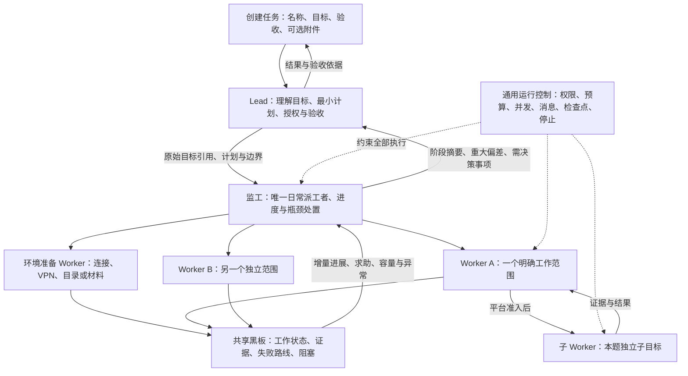

# Lead、监工与 Worker：职责收敛和启动效率方案

日期：2026-11-03，北京时间。根据用户本轮明确要求重新设计：入口保持“创建任务”，任务目标与验收自由输入；Lead 不执行解题或环境操作；监工协调执行；Worker 承担具体工作并可受控委派子 Agent。本报告为设计和评估，没有修改运行代码、配置或正式设计正本。

## 1. 建议结论

多目标、共享资源或复杂环境任务采用 **Lead → 监工 → Worker**。subagent 仍属于 Worker 类型，只是挂接到某个父派工的题内工作；环境准备 Worker 也是 Worker 的一种权限配置，不增加第四类管理角色。

单题且依赖简单时用 **Lead → Worker**，省去监工的额外模型回合。Lead 仍只负责说明、委派和验收，不能回退为亲自做题。是否需要监工取决于协调工作量，不按某个固定 CTF 平台或题目数量硬编码。

上一版图中“代码调度器”的策略职责改由监工承担。平台代码保留通用运行控制：按授权创建/启动执行、持久投递、容量/费用准入、身份验证、停止与回收、状态记录。它不固定选题顺序、连接方式、VPN、hint 或靶机数量。



## 2. 三类角色如何分工

| 角色 | 必须承担 | 明确不承担 |
| --- | --- | --- |
| Lead | 理解完整用户目标与验收；识别硬前置/授权/停止条件；形成短计划；创建和授权监工；接收用户新要求；处理重大取舍；最终验收与用户沟通 | 执行 shell、配 VPN、取完整题库、下载附件、调试 exploit、逐条监视工具输出 |
| 监工 | 持续拆分可执行工作；组织环境准备；维护依赖和优先级；批量建工作项/派工；创建、复用、停止 Worker；处理资源等待、求助与停滞；向 Lead 汇总 | 长时间亲自取材、编写解题脚本、代 Worker 做题；每次普通操作都请示 Lead；自行改写用户验收或增加总预算 |
| Worker | 执行被分配的准备/调查/解题/验证工作；自主选具体路线；登记证据和失败方向；提出求助；申请同范围子 Worker；交付可复查结果 | 全局派工、改变其他题目责任、改预算、放宽验收、结束整场任务 |

Lead 的计划描述“做什么、为什么、边界与完成依据”，监工决定“当前谁做哪一项、依赖怎样解除、何时增援”。普通调度无需往返两层审批。任务资料与工具仍能按需回读；短计划不能替代原始用户目标，必须保留原文引用。

## 3. 先解决 Lead 启动慢

### 首轮行为

Lead 第一次规划回合只产出足以开始的内容：

- 任务目标和验收依据。
- 已知入口、附件、授权范围及原文引用。
- 必须先满足的条件与立即停止条件。
- 首批可交给他人的工作、初始策略和明确未知项。
- 管理权限、费用/人数限制及需要升级的事项。

随后在同一规划回合创建监工并下达任务。**不要求它先联网核实、读完全部目录、写完整解题方案或创建所有成员。** 未知信息可以成为第一批调查工作，不能全部留给 Lead 自己补齐。

监工首次工作同样以开始执行为目标：先派最早可执行的准备/调查/解题工作，同时继续拆分后续任务。支持批量分配，但不能把“一次批量”理解为必须等待全部范围确定。

每个派工只需明确五件事：输入与来源、负责边界、交付证据/完成条件、必要前置、资源与权限。按可独立验收的目标拆，不按“全部 Web 题归一个人”打包，也不把具体漏洞路线替 Worker 写死。准备和目录发现可记录为派工/共享记录；竞赛题目按来源 ID 单独建账，不能把“VPN 配好了”算成一题通关。

### TSec 的实际启动路径

```text
Lead：提取任务规则 → 创建监工并授权
监工：立即派环境准备 Worker
环境 Worker：建立本任务网络 → 从实际执行路径做指定 VPN 检测
    检测失败：封住后续准入，报告原因，按任务要求停止
    检测通过：交付证据与可用连接，再获取目录
监工：按 unique_code 建题；第一批可执行题立即派给求解 Worker
    其余范围、材料和资源状态继续盘点
Worker：求解 → 逐 flag 提交/记录 → 必要时题内委派 → 完成/交接
监工：根据真实结果补位与调整，不等所有 Worker 同时结束
Lead：只接阶段摘要和重大例外，最终按用户验收出结论
```

本任务要求 VPN 通过前不得调用 Benchmark API，因此这些依赖不能为了并行而跳过；规则来自本任务，另一个公网目标不自动套用 VPN 流程。环境准备 Worker 可以继续承担初始目录发现，但一旦共享前置已经可用，应及时交付，不能把全部材料收集完才通知监工。

配置 VPN 不等于给所有成员连通了网络。当前各 Agent 网络命名空间独立；共享 VPN 应作为任务环境的受管服务/网络出口，生命周期不依附于环境 Worker 的一个 turn。不能依赖某条短命令留下的后台进程，也不能把 Lead 的 localhost 当作全队连接。这个环境能力仍需单独落实，管理分层不会自动解决网络问题。

## 4. 权限矩阵

| 工具能力 | Lead | 监工 | Worker / 子 Worker |
| --- | --- | --- | --- |
| 读取任务原文、验收与摘要 | 全局 | 执行所需全局信息 | 本工作范围及必要任务约束 |
| 更新总体计划与验收解释 | 有；受原始用户要求约束 | 提出调整建议 | 无 |
| 创建/替换监工 | 有；默认一个有效监工 | 无 | 无 |
| 创建/分配/停止 Worker | 保留管理权，通常交监工执行 | 授权范围内的日常管理权 | 仅申请/取消自己范围内的子任务 |
| 题目/工作项批量登记和分配 | 可检查或接管 | 有 | 提交发现/建议，不改全局责任 |
| 黑板更新 | 计划、验收、重大决定 | 优先级、分工、阻塞处置 | 自己的进展、证据、失败路线、候选与交接 |
| shell、文件分析、解题工具 | 无 | 默认无 | 依能力配置授予，仍经 envd |
| VPN/软件安装/网络管理 | 无直接执行权 | 派准备工作或调用已授权的环境管理工具 | 仅指定准备 Worker 按需获得；普通求解/子 Worker 不继承 |
| 平台实例管理 | 决定授权范围 | 有已授权结构化工具时管理；否则派限定操作任务 | 只使用获准实例，不能任意启停其他工作资源 |
| hint、候选提交、平台验证 | 规定本任务决策边界 | 协调资源和政策 | 经任务授权可执行；子 Worker 默认只交候选给父 Worker |
| 修改总预算/越过用户停止 | 无 | 无 | 无 |
| 结束任务与最终报告 | 正常收尾由 Lead；用户/系统停止优先 | 提交结束建议、执行停止要求 | 交付本工作，不结束全局 |

Lead 保留创建、关闭成员的管理权，但不能同时与监工给同一 Worker 派互相冲突的任务。平时 Lead 通过监工变更执行计划；需要直接接管时，先撤销/暂停旧监工的派工授权，再执行替换或重分配。服务端识别唯一有效监工与授权代次，旧监工不能刷新一个题目 revision 后继续指挥。

来自用户的停止、平台强制预算结束和已确认的任务硬终止条件应先封住新工作；不能等待两轮管理 Agent 同意才停止。最终结果整理不能暗中重开执行或改变已确认的停止原因。

## 5. 子 Worker 与黑板

一个 Worker 负责一个明确范围，可以为独立子问题申请 subagent。它只获得创建/取消自身子任务的能力，不获得全局 `create_member` 权限。创建前服务核对父派工、工具交集、名额、预算和资源；结果独立持久化，父 Worker 负责采用/否定和最终交付。

子 Worker 仍是 Worker 类型，按父关系和能力配置收窄权限；首次不允许递归后代。独立子问题要写清输入、期望产物、禁止重复的既有尝试，避免几个人都从头解整题。父只等待已获准且确实启动的子任务；容量满时继续独立路线或由监工重排，不产生全员等待子任务的死锁。

黑板保存：本轮目标、关键假设、已尝试/已排除方向及依据、脚本和产物引用、当前阻塞、下一步建议、候选与可信回执。普通原始日志不广播；子结果先到父 Worker，Worker 求助/结果到监工，监工摘要/重大例外到 Lead。记录原件保留，管理层按引用查看需要的详情，不自动复制全员会话。

多 flag、hint 扣分、3 个实例、提交错误分类等由本次任务规则和工具解释，不成为所有任务的内置流程。单个附件题可以没有网络、目录与计分阶段；工作范围仍受用户验收要求约束。

## 6. 监工怎样提高效率，又避免成为新瓶颈

| 情况 | 监工的处理 |
| --- | --- |
| 有独立可执行积压且有容量 | 批量派发，避免一个 Worker 囤积多项未开工工作。 |
| 目录尚未全部发现 | 已知项先推进，另有 Worker 继续盘点。 |
| 某题缺输入或实例 | 仅暂停依赖它的工作；安排取材/资源操作或安全交接，其他题继续。 |
| Worker 有具体求助 | 看已有尝试和证据，选择缩小范围、换路线、题内增援或调配其他空闲 Worker。 |
| 长命令仍正常运行 | 不把暂时无新记录当作失败，不重复启动相同副作用命令。 |
| 只有模型调用/命令数量增加，无有效产出 | 合并成一次复查事件，要求说明当前假设与下一步，必要时调整路线。 |
| 单工作可隔离失败 | 按既有恢复/清理机制处理该工作；共享身份/账本不明则停止准入并升级。 |
| 需要改变用户范围、验收或重大资源策略 | 升级 Lead，不自行改目标。 |

监工使用事件触发的短回合，接受完成、求助、资源可用、失败、明显积压等增量信息；没有变化时等待。代码可以统计容量、执行状态和积压并发通知，但不决定哪种漏洞路线更有希望、是否应该取 hint 或何时放弃一道题。

如果持续同时存在“可执行积压、空闲容量、没有前置阻塞”，运行底座向监工发一个去重的派工缺口提醒；仍未处理时升级 Lead。这样可观察监工是否漏分配，不靠强制创建固定人数来伪装并行，也不让两个管理 Agent 同时抢着派同一份工作。

管理任务拆分会增加一层模型交接；只有避免 Lead 的长执行、让更多独立工作及时开始，才可能抵消这部分开销。不能把相同的全部准备步骤搬给监工串行执行，然后宣称已经提速。

## 7. 人数、预算与上下文

沿用现有“最大队友数不含 Lead”语义时，监工也占一个名额。上限 20 的示例是 **1 Lead + 1 监工 + 最多 19 个 Worker/子 Worker 名额**，不能后台悄悄额外开管理 Agent。如果后续改成管理/执行分开配置，需要在界面明确展示并迁移，旧快照不改义。实际模型调用、命令和靶机容量仍分别准入。

Lead 保留原始用户目标、当前短计划、验收、关键决定与汇总；监工保留工作板、资源状态、分配与待处理例外；Worker 保留其具体题面和尝试。父子关联不等于无条件复制父完整上下文。环境凭据不因角色层级自动广播。

内部费用仍由平台执行最坏预留、unknown 保留和逐请求记账。现有“不向模型披露剩余平台金额/时长”的约定不在本轮暗改；任务明确提供的比赛期限、平台读回的结束状态可以作为任务事实。若需要更精细的截止前策略，应明确所需信号和来源，不能让监工伪造可用预算。

## 8. 当前实现的真实改动面

目前不是三类角色的实现：

- `CtfRole` 仅有 lead/teammate，Profile 校验要求恰好两套工具；见 [ctf.py](../../packages/contracts/src/bbx_contracts/ctf.py#L18)。新增监工要同步角色合同、工具模板、模型参数、配置发布与 UI，旧 teammate 可继续作为 Worker 的内部名称。
- 创建、派工、协作者修改、停止与完成权限多处写死 Lead；见 [create_member](../../services/blackboard/src/bbx_blackboard/ctf.py#L1071)、[派工授权](../../services/blackboard/src/bbx_blackboard/ctf_board.py#L605)。应统一少量角色/关系权限判断，不能只改一个前端工具列表。
- Worker 回合结果和求助目前直接发 Lead；见 [结果通知](../../services/blackboard/src/bbx_blackboard/ctf.py#L2623)、[request_help](../../services/blackboard/src/bbx_blackboard/ctf_board.py#L1016)。若不改路由，增加监工后 Lead 仍收到所有明细。需按持久派工关系发给直接负责人，重大事项再升级。
- 执行环境当前给所有 Agent sudo，目录不是对 root 的强隔离；见 [README](../../README.md#L91)。要实现最小权限，普通 Worker/子 Worker 不能沿用全员 sudo，准备权限应按指定工作单独授予；只隐藏工具名不够。
- 正常执行已有 `settle → drain → finish_turn`，继续复用。停止结算竞态、旧范围授权、子执行回收仍需专项验证，不能重复引入另一套清理状态机。

推荐按三批交付：

1. **角色与首轮委派**：三类工具合同、Lead 无执行权限、监工唯一日常派工、结果逐级路由、单题可跳过监工。
2. **启动与准备闭环**：按前置条件放行首批工作、共享网络/任务环境生命周期、容量和等待原因、及时交付材料。
3. **受控子 Worker 与进度干预**：同范围委派、权限交集、父子停止、事件汇总和相关恢复。

不新建微服务、独立队列、调度 DSL 或通用工作流引擎；优先复用现有黑板、消息、Session 和执行控制。`pi-subagents` 是否接入仍按前轮的受控适配条件验证，不因新增监工就自动适配完成。

## 9. 怎样证明有效

先用脚本化模型验证权限和实际调用顺序：Lead 第一次规划后就能创建监工；监工首轮就能派准备/求解 Worker；Lead/监工不能执行解题命令；父子和监工/Lead 不会双重指挥；旧任务不改变角色语义。

再以相同任务、模型、预算与环境重复比较“Lead+Worker”和“Lead+监工+Worker”，分别记录：

- 首个准备 Worker 开始时间，首个真正求解 Worker 开始时间。
- 必需环境准备耗时，以及环境就绪到第一批求解开始的等待。
- 首个可信结果时间、得分/有效完成数随时间变化。
- Lead/监工模型耗时与费用占比、无变化的唤醒次数。
- 可执行积压与闲置容量同时存在的时长，重复劳动与交接失败次数。

不能用“第一个环境 Worker 已创建”冒充“已经开始解题”，也不能仅比较 Agent 数量。三层模式若对简单单题只有额外开销，就保留双层路径。

本轮只读取相关源码并完成设计评估。没有安装插件、运行真实任务、访问 TSec/VPN 或修改运行代码；未重复已有源码基线测试。文档检查包含本地链接和 `git diff --check`。建议单独提交 `docs: define Lead supervisor and Worker responsibilities`，仅本报告。
