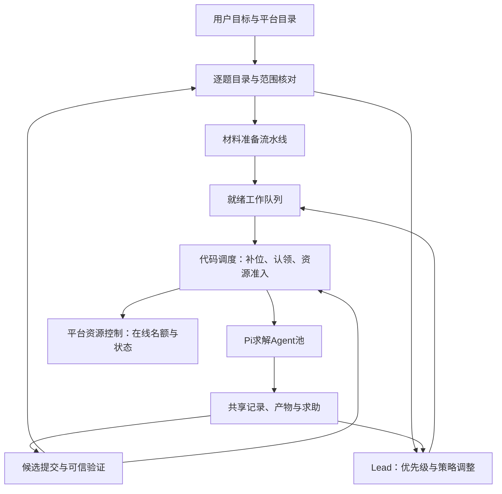

# CTF 策略、调度与协作架构审查

日期：2026-11-03（北京时间）。本轮为架构评估与改进建议，没有修改运行代码、提示词、平台配置或业务数据，没有续跑任务、调用任务模型或访问外部靶场。

## 1. 结论与范围

需要把 CTF 模式从“Lead 自行建队、派信，runtime 消费邮箱”，推进为“Lead 制定策略，系统维护逐题目录、准备队列、执行分配和资源约束”。当前协议可靠性已较完整，主要缺口在调度决策和协作闭环；继续堆叠提示词不足以保证逐题覆盖和并行度。

保留 Pi、PostgreSQL、MinIO、持久 Session、事务邮箱、现有 envd 和 generation fencing。各职责先放在现有服务内部，不增加一个需要模型参与的调度主管，也不引入另一套 Agent 框架。

审查对象是最新本地任务 `400d5309-4da8-49be-acc1-de7adbabe66f`（`test`），以及当前主线生产源码 `56fa9e0`。此前报告使用的是另一任务 `d789b8b0-…`，本报告不复用其运行指标。最新任务运行于 10 月 28 日、早于 11 月 2 日 Pi 部署；本次不能据此断言新 Pi 版本实测仍有相同耗时。

## 2. 最新任务证据

| 项目 | 实际记录 | 含义与边界 |
| --- | --- | --- |
| 运行窗口 | 2026-10-28 15:34:08–15:59:03，24分55.5秒 | 原上限80分钟，因系统异常提前结束 |
| 成员配置 | `max_teammates=20`，不含 Lead | 实际1 Lead + 7队友；7次创建工具调用、7个队友创建成功 |
| 建队时序 | 第4分35.9秒创建4人，第13分32秒再创建3人 | 首批成员创建后约12分钟才收到首次派工 |
| 首次派工 | 第16分37.5秒写入，约1.2–1.3秒后队友turn启动 | 前66.7%墙钟没有队友解题turn；首派延迟主要发生在派信前 |
| 任务板 | 1次批量创建9个大包，1次批量分配9包 | 不是完全没用批量工具，而是把独立题合并成包 |
| 分配示例 | 18题Web包归1人、8题逆向包归1人；同一人先做6题云安全，再做9题服务侧题 | 大量工作被单人串行持有，系统无法逐题补位 |
| 题目身份 | 9包 `external_id` 全空、协作者全空，最终全部 `in_progress` | 未建立平台题目与内部题目的逐题映射；空协作者本身不等于错误 |
| 共享交付 | 4条共享记录，其中2条artifact登记、2条结果记录；`request_help=0`、`record_candidate=0` | 两条结果正文报告提交正确；未独立向平台核分，不能当可信总分或完整通关统计 |
| 成果通知 | Lead收到2条 `challenge_progress` 系统通知 | 重要记录通知机制已有实际工作，不能继续归因为“黑板完全不通知Lead” |
| Lead负担 | 45条成功model_output观察、62次执行命令；35次命令在首个队友turn前 | Lead承担了大量准备和执行工作，限制了首派速度 |
| 并行占用 | 队友turn峰值7，全程平均约2.05 | 仅按turn区间积分，不代表模型请求并发或CPU利用率 |
| 终止原因 | member-5的 `ExceptionGroup` 触发 `system_failure`，随后全队收尾 | 保存的故障摘要没有足够叶异常信息，不能仅凭此确定底层根因 |
| 费用 | 已记账约¥4.60，原预算¥100 | 不能据余额单独推断可同时放行20次模型请求；还需考虑每次调用的预留和供应商限制 |

用户原始目标已明确要求“先快速获取所有的附件题交给子Agent做”。派工文本也提到优先离线附件题，但实际8题逆向仍交给一名成员，部分材料仍处于Lead后台采集阶段。说明策略文字已存在，缺少可检验的执行约束。

当前 `ctf` v20 与任务冻结的 `ctf-task-settings` v16，两角色模板均与仓库模板逐字一致，相关批量及精确读取工具也已开放。该样本的核心问题不能解释为这几项能力没有发布。任务配置两角色共用 `deepseek-flash/max`，没有角色参数覆盖，也没有平台结构化适配绑定；异步命令三工具未在该配置启用。

## 3. 已核实的架构缺口

### 3.1 上限没有形成可执行的并行策略

- [`CtfOptions`](../../packages/contracts/src/bbx_contracts/ctf.py:85)只有队友数量上限、步数和上下文阈值；创建成员时只执行上限校验。
- [`create_member`](../../services/blackboard/src/bbx_blackboard/ctf.py:1098)统计所有未removed队友，包括stopped成员。这是名册容量，不是当前计算并发；新设计必须区分成员身份、活跃工作、模型请求和本地重计算。
- [`initial_input_parts`](../../services/blackboard/src/bbx_blackboard/ctf.py:171)只注入目标、背景、验收和附件，没有可信的容量摘要；Lead的opening instructions也没有20或max_teammates。任务配置不会自动成为模型可见的调度状态。
- [`CtfCoordinator`](../../services/agent-runtime/src/bbx_runtime/ctf/coordinator.py:615)按`ready_member_ids`消费已有邮箱，没有检查可执行积压并创建/续接队友、自动分配下一题的决策。
- [`idle_watchdog`](../../services/blackboard/src/bbx_blackboard/ctf.py:825)只在全队无活跃turn、无可执行输入时介入；有人长期忙碌时，即使大量题无人推进，也不会触发这个看门狗。

因此，“最多20”目前只保证不超限，无法保证在20项独立工作就绪时用足20个位置。也没有证据支持程序暗中把成员上限固定为10。

### 3.2 单题策略没有得到数据模型支持

[`CtfChallenge`](../../packages/contracts/src/bbx_contracts/ctf.py:544)有owner、协作者、粗状态和验证结果，但没有标准化的材料准备状态、离线/在线需求、资源等待原因、可执行阶段或优先级依据。现有批量接口是单题写操作的循环，`external_id`仍可省略，无法阻止模型把整类题装进一个标题。

“一题一行”“先离线、再在线”虽然写在提示或用户目标中，却缺少目录覆盖校验和就绪条件。队友无法从共享队列领取下一项，Lead也无法可靠判断应当扩到多少人。

### 3.3 认领解决权限冲突，尚未解决工作流转

[`update_challenge`](../../services/blackboard/src/bbx_blackboard/ctf_board.py:617)允许认领无owner的pending题，修改owner或协作者需Lead/用户。它已有CAS和权限约束，值得保留。

不足在于：owner持有一包工作后，没有逐项执行状态、未开工工作的公平转移、执行接单确认或基于进展的交接机制。邮箱租约保护消息投递，turn/generation保护执行身份；它们都不直接表示某题某条求解路线的工作归属。`CtfAssignmentInstruction`当前只有recipient和自由正文。

### 3.4 准备、资源和验收仍大量依赖Lead临场写脚本

最新任务通过共享脚本约定3个外部容器名额、采集附件、释放资源。核心协议无法直接观察这些脚本的队列、占用、下载是否完整、资源是否已释放。

仓库已有固定版本的MCP权限和结果来源合同，但当前任务没有绑定平台适配器；代码内可解析的适配仅`fake_ctf_v1`且明确test_only。因此真实平台目录、资源及提交回执尚未进入可依赖的调度事实，不能把shell里的`correct:true`直接当可信accepted。

### 3.5 故障隔离与持续调整不足

当前coordinator对未被既有分类处理的成员异常会[`request_close(system_failure)`](../../services/agent-runtime/src/bbx_runtime/ctf/coordinator.py:555)。某些共享状态故障确实需要全局暂停，但普通成员可隔离失败不应一律结束整场。

现有[`request_help`](../../services/blackboard/src/bbx_blackboard/ctf_board.py:1016)与重要记录通知已提供基础闭环；仍缺少“求助待决→负责人接单→明确支援边界→支援产出→owner消费/合并”的可观察过程。成员姓名像专业角色，不代表系统已经拥有可查询的技能和就绪能力。

## 4. 建议的目标架构



以上是现有服务内的职责划分，不代表增加这些独立部署服务。

### A. 把平台目录变成逐题事实

通过受信任、固定版本的适配入口导入完整目录，按任务与来源中的稳定ID幂等建题；已发现目录页立即小批入库并启动准备，后台继续读取剩余目录。记录分页是否结束、目录数量和无法访问的范围，整体收尾前必须对账。

平台有稳定题目ID时强制映射到`external_id`，一项独立平台题保留一条challenge；多flag题仍是一题，逐个flag的提交状态另行记录，不把独立题与同题多flag混淆。普通分析/报告任务保留人工建题能力，不能把平台专有合同强加给通用模式。

分类至少表达：材料是否ready、当前阶段、下一阶段需要哪些资源、阻塞原因、已验收flag数/总数、可获得分数及来源。未知先记unknown，后续依据实际材料分类，不根据“逆向”“附件”标题断定纯离线。

### B. 材料准备与解题形成流水线

对需要启动容器才能下载的题，执行“申请受控在线名额→确认可用→下载与校验→登记不可变产物/版本→在确认允许释放后关闭→离线分析”。每题材料ready就投递，不等待全部附件完成；不需要容器的下载可独立并行。

在线名额按实际阶段占用：离线分析不占用在线容器位置，需要在线取样、交互利用或在线验证时再申请。下载失败、资源unknown与明确busy分开处理。释放前确认关闭不会丢失必要状态；存在状态依赖时保存恢复依据或继续保留资源，不能机械关闭所有容器。

资源队列和状态持久化在平台侧，复用现有dispatch/settlement来源合同。在线上限3由适配配置约束，不从某次自然语言或共享shell锁隐式推导；重启后先与平台对账，结果未知先查询，不重复启动/关闭。

### C. Lead负责策略，代码负责稳定补位

Lead持久化一个短策略摘要：当前目标、优先工作类别、准备与求解的分配倾向、哪些题需要增援、何种事件触发调整。它不必逐条批准命令，也不必逐题拼装已经确定的派工正文。

代码调度持续根据策略挑选ready工作，续接合适的空闲成员；有独立积压而现有成员不足时，才创建新增成员。一个成员默认仅持有一个正在执行的主工作项，未来工作留共享队列，避免一个人囤积18道未开工题。相关材料和专业上下文有价值时可偏好原成员，但不能因此永久串行占有整类题。

并行决策分开处理三层限制：队友名额、模型请求准入、本地CPU/内存重作业；外部在线容器再单独限额。系统使用已有费用/时限规则做准入，不能通过增加Agent绕过账本。

有20项独立ready工作、预算预留和资源允许时，应向20名队友扩展；只有7项ready工作时使用7人是合理的。产品应展示“上限/当前执行/就绪积压/阻塞原因”，让未用满具有可解释依据。先采用自动目标，不增加没有必要的“最低必须创建20人”规则。

给Lead注入小而可信的能力摘要：成员上限、已占用与可派工位置、就绪队列、资源等待原因和需要决策的异常；沿用原有预算信息披露约定，不因此恢复向Agent播报剩余金额/时间。

默认策略应能表达用户的离线优先要求：优先准备可转离线的材料；材料就绪后尽量铺开独立求解；3个在线位置供必要取样和在线题滚动使用。同时结合实际预计可得分、预期耗时、hint扣分和资源占用调整优先级，不把“所有离线题做完才允许任何在线工作”写死。估计值只作为启发式，保留等待时间加权，避免难题永久饿死。

### D. 将题目责任与阶段执行分开

保留单owner负责该题最终交付。为准备、求解、验证及必要的独立协作路线提供最小结构化派工：challenge_id、phase、输入产物版本、负责边界、依赖、输出要求、接单状态和执行代次。优先复用现有instruction ID、turn和邮箱投递；只为无法表达的阶段事实增加字段/记录，不再维护一套与turn竞争的运行事实。

claim next通过服务端事务选择有权限的ready工作并占用，接单失败可退回；普通私聊仍不能改变权限。若添加阶段lease，必须绑定turn/generation并与现有续租衔接。接单超时、无进展与心跳失联是不同状态，不能单靠时间过期就让第二人同时执行有副作用的操作。

回收/重派前先保存交接、隔离旧执行并确认drain；迟到结果按代次进入历史或待合并，不能覆盖新owner状态。未知平台副作用未核清前不得自动重放。

### E. 协作围绕具体问题与产出闭环

允许owner提出具体帮助，也允许Lead/策略规则在持续无有效进展时发起检查；有效进展指新证据、候选、阻塞解除等，不把每次命令或模型输出当进展。

每次增援写清“需要解决什么、哪些路线已失败、可用证据、与owner的边界、何时交付”。先分配空闲且匹配的成员；确有独立方向和资源余量时新增成员。协作者产出登记为本题可引用记录，owner确认采用/拒绝及依据，再关闭支援。协作者可向owner或Lead升级阻塞，避免所有困难只能由owner代传。

保持成员直接沟通、不可变登记产物和独立工作目录；重要事件定向通知，普通尝试留共享记录，不广播所有工具输出。已有通知机制继续复用，在安全边界合并输入。

Lead收到求助、有效成果、资源就绪、成员失败或策略偏离时更新计划；定期轻量检查持续积压/未达预期并行和长时间无进展，即使其他成员仍在运行。检查先用代码判断，只有需要选择时才唤醒模型，避免多加一个持续反思的LLM循环。

### F. 局部失败隔离，结果核验独立

可以确认局限于单成员、且检查点与副作用已结清的失败，隔离该成员并有界续接或重派，其他独立成员继续。共享环境不确定、账本/检查点不一致、全局认证失效等仍需全局暂停；不能简单把所有异常改成忽略。

验证服务接收候选并通过授权的平台适配器提交，持久化每个flag的回执与得分，再触发逐题进度和下一项工作。去重与结果未知查询复用原有幂等机制，平台没有幂等提交保证时不能承诺恰好一次。公开solution与平台accepted继续分开：缺solution不抹除已得分，solution也不能伪造通关。

## 5. 落地顺序与验收

| 阶段 | 范围 | 核心验收 |
| --- | --- | --- |
| P0a | 逐题目录导入、源范围覆盖、最小策略及材料就绪字段 | 有稳定ID的平台目录逐题映射，无漏项/重复；一页就绪可先开工 |
| P0b | ready队列、自动补位、可信容量摘要 | 脚本化模型下，20项独立ready工作与允许20人的配置能占满20人；受限时明确给出约束 |
| P0c | 平台资源/附件准备流水线与结构化验证 | 在线名额始终≤3；离线工作不被在线名额阻塞；资源unknown不重放，回执逐flag落库 |
| P1 | 阶段接单/交接、协作增援、成员级失败隔离 | CAS冲突不双领；旧代次不覆盖；一名可隔离失败不终止其他独立工作 |
| P1 | 持续积压/无进展检测与短计划更新 | 仍有成员运行时也能发现未开工队列和被搁置求助；不会反复催促或重复派工 |
| P2 | 启用合适的异步命令、验证角色推理/输出配置 | 不依赖长阻塞shell等待；依据同题对照选择配置，保留困难题推理能力 |

当前已实现角色run_options，无需重新开发这项能力；最新任务未配置覆盖。可以对Lead协调调用与困难求解尝试不同推理/输出策略，但必须通过对照验证，不能从“max耗时长”直接推断降低推理必然得分更高。

最小离线评估应覆盖：20个独立工作/20成员，3在线资源混合离线工作，部分材料下载失败，成员完成自动接下一题，owner求助与支援合并，资源响应未知，重启恢复，用户停止以及迟到旧代次结果。供应商调用、外部平台均用脚本化替身，先验证调度不变量。

真实模型评估另外进行：相同题集/模型/费用和时限，对比当前版、仅提示词调整版、自动调度版，重复运行并记录波动。观察可信得分、首个有效派工时间、首flag时间、ready工作排队时长、逐题覆盖、有效并行、在线资源占用、重复劳动、求助响应和单分成本。20个Agent只是资源使用条件，不是最终成功指标；本次样本没有历史CPU/供应商限流数据，也没有当前Pi版本的对照，不能承诺性能提升百分比。

## 6. 实际检查、复查与偏差

- 通过PostgreSQL `READ ONLY`事务核对任务、名册、turn、消息、题目、记录、工具计数与配置版本；运行服务/数据保持，未读`.env`，报告不复制任务凭据、原始命令或私有逐字推理。
- 根据11个turn的开始/结束时间计算队友占用；用派工消息时间与turn启动时间核对首派延迟。未把模型/工具累计秒相加当墙钟，也未把记录中的提交声明当外部可信验收。
- 复核实际冻结模板与仓库模板相同，区分已有能力和建议新增能力。未对正在部署的Pi系统发起真实任务，因此建议仍需行为评测。
- `UV_CACHE_DIR=/private/tmp/bbx-uv-cache make check`实际通过：**2605 passed、438 deselected，210.35秒**；Ruff、Pyright和5项Pi原生检查通过。该检查验证现有代码基线，不证明建议中的调度行为或得分提升。
- 诊断指标断言、报告本地链接检查及`git diff --check`通过。未为纯文档审查重复运行Docker集成或浏览器检查。忽略目录`.data/ctf-strategy-audit-20261103/`保留去除原始目标/派工正文后的统计、模板比对、时序指标与检查日志。

只读复查示例（适用于当前本地Compose项目；不输出目标、凭据或命令正文）：

```sh
docker exec -i bbx-ctf-team-mode-postgres-1 sh -c \
  'exec psql -X -U "$POSTGRES_USER" -d "$POSTGRES_DB" -v ON_ERROR_STOP=1' <<'SQL'
BEGIN READ ONLY;
SELECT id, name, status, ctf_options, started_at, finished_at
FROM tasks ORDER BY created_at DESC LIMIT 1;
SELECT agent_id, end_reason, started_at, finished_at
FROM ctf_turns
WHERE task_id = '400d5309-4da8-49be-acc1-de7adbabe66f'
ORDER BY started_at;
SELECT id, data->>'title' AS title, data->>'owner_id' AS owner,
       data->>'work_status' AS status, data->>'external_id' AS external_id
FROM ctf_challenges
WHERE task_id = '400d5309-4da8-49be-acc1-de7adbabe66f';
ROLLBACK;
SQL
```

本轮不修改`docs/design/`。如果进入实现，应先按本方案明确要更新的CTF数据合同、调度责任、资源状态和异常边界，经用户同意后先提交设计，再分P0/P1开发。无需为本次分析申请设计修改许可。

建议本轮文档提交：`docs: assess CTF strategy and scheduling architecture`，仅包含本报告和HANDOFF审查摘要；不提交忽略目录中的诊断材料。实现阶段需同步contracts/API、blackboard、runtime、配置发布/兼容、工作台状态与相应回归，不只改Lead模板。

## 7. 外部架构参考

Anthropic的[多Agent研究系统经验](https://www.anthropic.com/research/multi-agent-research-system)强调明确的工作边界、按任务复杂度配置并行以及基于真实轨迹评估；Microsoft的[Magentic-One架构说明](https://www.microsoft.com/en-us/research/articles/magentic-one-a-generalist-multi-agent-system-for-solving-complex-tasks/)将任务计划与执行进度分为两个循环，在停滞时更新计划。本报告据此建议保留简短策略与进度反馈，但“代码补位+逐题流水线”是针对本项目证据作出的设计判断，不是上述系统已替本项目验证的结论，也不需要因此切换框架。
