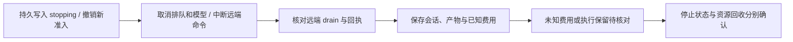

# 平台底层架构改造方案

> 2026-11-06 当前入口：[平台架构重构开发方案](平台架构重构开发方案-20261105.md)与[审核报告](平台架构全面审核-20261105-report.md)，三路第二轮审核已通过进入 P0/P1。用户已授权开发及正本同步；本稿以下内容仅保留前轮设计记录，不再独立约束实施。题内 Intent/Fact、公告、Lead-only 建题、窄命令接入/低权限文件、netns 转发出口及命令审计以当前入口和设计正本为准。G1–G7 尚须实际验证，未部署。

2026-11-05 · 按官方 Kubernetes 实现重构；Pi SDK + 任务专属 MCP + OpenSandbox BatchSandbox · 设计待审核，未开发

本轮先审核文字，不更新拓扑。此前 13 页图集和 Kubernetes 候选图尚未同步本轮源码结论，不作为当前部署合同。源码依据与修正见 [官方 Kubernetes 实现核对报告](OpenSandbox官方Kubernetes实现核对-report.md)。

本架构服务普通任务、单题CTF和多题评测；CTF 只是其中一种任务协作方式。现有业务数据、旧任务和已经具备的预算、停止、恢复能力必须保留。

审核时先看第 2 节部署归属、第 7–8 节任务 MCP/官方 Kubernetes 接入、第 12 节删除与改造范围。第 4 节保留已核对的 core/SDK 比较。CTF 与 OpenSandbox 的旧文档作为专项材料，不再各自定义另一套底层架构。停止、预算和授权合同继续保留，底层实现按官方SDK和Kubernetes重新组织。

本轮已选定：使用社区 `pi-subagents` 承担子会话机制，由平台自动继承父 Worker 的有效配置。第 5.3、7.6、10.2.1 节是目标合同；工具与任务隔离以第 7–8 节最新选择为准；第 14.3 节独立列出未验证接缝。选型确定不代表集成已经通过。

## 1. 最终要建成什么

平台保留任务、黑板、权限、预算与调度，采用 **Pi coding-agent SDK 运行 Agent、agentgateway 接入模型与 MCP、OpenSandbox 提供执行环境**。新架构只选 SDK 一套会话内核；core 作为 SDK 内部依赖使用，现有直用 core 的执行器只服务迁移窗口中的旧任务，不作为长期并行选项。

| 部分 | 唯一职责 | 不交给它的职责 |
| --- | --- | --- |
| 平台后端 | 任务、版本配置、黑板、预算账本、权限、人工输入、验收 | 不再实现厂商模型协议和通用沙箱服务 |
| Agent Runtime | 取得任务执行权，运行会话，落实调用授权、停止与恢复，衔接 SDK、插件、网关和执行环境 | 不再写一套与 Pi 并行的模型/工具循环 |
| Pi coding-agent SDK | 官方 AgentSession、SessionManager、压缩、资源加载与人工插话；默认关闭本机执行/文件工具 | 不决定任务权限、领取哪道题或整场是否完成 |
| pi-subagents（社区扩展） | 复用 Pi SDK 创建子会话，提供委派、消息、状态、结果与取消 | 不作为平台权限、席位、预算、检查点或回收的权威 |
| agentgateway | LLM 路由、MCP 聚合、认证、策略、连接及请求观测 | 不作为任务预算账本或容器调度器 |
| OpenSandbox | 官方 MCP 命令/文件；Server/SDK 生命周期、execd 与 Egress | 不负责黑板认领、Agent 会话或 Flag 验收 |

本阶段不引入常驻监工 LLM、ContextForge、OpenSandbox Console Web/BFF、pi-durable、Chord 应用框架，也不自建通用 Kubernetes 调度器。`pi-ai`、`pi-agent-core`、`pi-mcp` 都是 Runner 内的官方库，不各自部署容器。Agent 的模型与工具协议处理移到 Node/Pi；Python 保留业务服务和 OpenSandbox 官方 SDK 接入。

采用“完整目标、分步替换”：开发时按第 13 节推进，不能把所有底层一次切换，更不能把旧任务悄悄转成新模式。

## 2. 总体架构与实际部署

### 2.1 部署选择与归属

新任务以 Kubernetes 为唯一目标部署后端；旧 Docker/envd 任务仅保留迁移窗口兼容。选择官方 `kubernetes + batchsandbox`、非池化、每个 Sandbox `replicas=1`。不同时引入 SIG agent-sandbox、fast-sandbox、Pool 和自研 Sandbox Operator。

**一个 Task = 一个 Namespace + 一个 OpenSandbox Tenant + 一个有效 Sandbox。** Lead、Worker、subagent 在同一 Task 内共享 Sandbox；不同 Task 的凭据、工作卷、MCP 实例与网络分别绑定。Tenant=Task 是 BBX 映射，不是上游自动识别平台任务。

| 部署对象 | 粒度 | 谁负责 |
| --- | --- | --- |
| Web、blackboard API、数据库、对象存储、业务 MCP | 平台共享 | 现有服务；黑板、验收、输入、预算与配置权威 |
| Runtime 控制模块、模型准入、独立 cleaner | 平台共享，保留在现有 agent-runtime 服务 | 任务租约、Pi 会话控制、席位、调用账本与停止；不直接调度 Sandbox Pod |
| agentgateway | 首版一个活动实例，LLM/MCP 分入口 | 官方模型/MCP 路由；平台唯一配置发布者 |
| OpenSandbox Server | 一个活动实例 | 官方 SDK/API 管 Sandbox 生命周期，官方多租户鉴权；MCP 出站 Key 不等于 MCP HTTP 入站认证 |
| 官方 CRD/Controller、OpenSandbox Ingress | 集群共享 | 创建/回收 Sandbox Pod、TTL、端点路由和 Secure Access |
| Task Runner Pod | 每个运行 Task 一个 | 平台按固定模板创建；包含 Node/Pi Runner、任务专属官方 MCP、可信 task-network 三个容器 |
| Sandbox Pod | 每 Task 一个 | 官方 Server 创建 BatchSandbox，官方 Controller 创建 Pod；CTF/通用镜像 + execd + 官方 Egress + 固定 task-link 隧道组件 |
| 会话卷与工作卷 | 每 Task 分开 | Pi journal 不挂载到求解容器；附件/脚本/结果在任务工作卷，归档进入对象存储 |

20 个 Worker/subagent 席位不是 20 个 Pod。主 Node 运行 Lead/Worker 与前台子会话，插件后台进程仍在本 Task Runner Pod 内，纳入同一 supervisor。实际后台进程数量/复用仍待 U-S3 验证。

可信 Runner 不执行题目命令，不挂载求解工作卷；Agent 使用的 command/file 工具只指向 Sandbox。任务 MCP 使用独立租户 Key，Key 只注入可信 MCP 容器，不提供给模型或 Sandbox。MCP 容器镜像可由平台封装固定版本官方 Python 包；不声称官方已发布专用 MCP 镜像。

### 2.2 两条调用路径

- Agent：Pi SDK / pi-subagents → 官方 pi-mcp → agentgateway → **本 Task 官方 MCP** → 内部 SDK → OpenSandbox Ingress → 本 Task execd。
- 平台：Runtime / cleaner → 官方 SDK → OpenSandbox Server，负责创建、查询、续期、销毁；已有命令观测、取消、归档使用官方数据面接口。
- 黑板、Flag 提交与受控环境请求仍走 BBX 业务 MCP；模型仍走第 6 节的唯一准入路径。

agentgateway 管模型/MCP；OpenSandbox Ingress 管沙箱执行端点。两者职责不同。Kubernetes API 只供平台资源模板管理和官方控制器使用；Lead/Worker/subagent 不持有 kubeconfig、集群 ServiceAccount 权限或 Docker socket。

平台以官方 HTTP TenantProvider 对接已有任务库，将任务凭证映射到预先创建的 Namespace。固定版本实际令 tenant.name=namespace，因此 tenant_ref 直接采用 Namespace 名；不能在共享 Namespace 下换几个 HTTP Key 就宣称不同 Task 是不同租户。命名空间/配额/网络策略/Runner 模板是平台的任务资源管理，Sandbox CR/Pod 创建、调度与 TTL 由官方负责；不复制官方控制循环。

官方的 `TaskScheduler/taskTemplate` 调度进程任务，不承担题目认领、模型规划或 Flag 验收。上游同名 Task 与 BBX Task 必须区分。

### 2.3 创建、状态与故障边界

任务资源先有绑定再启动；创建 Namespace 与默认网络策略后，准备租户/密钥、Runner/MCP、会话卷，并通过 SDK 创建 Sandbox。Runner 与 Sandbox 可并行准备，Lead 可先理解目标；依赖环境的动作必须等待对应 readiness。网络附件默认待机，Lead 决定连接条件，Worker 不参与配置。

`namespace_ready、runner_ready、sandbox_ready、task_network_ready、capture_ready` 分开保存，不能用一个 Pod Running 代表全部就绪。实际 Pod UID 变化会使旧执行环境失效：暂停新调用，递增环境代次并核对未决操作，不能把 K8s 补建视为原进程和内存已恢复。

Runner 首版使用受平台租约控制的普通 Pod、restartPolicy=Never，不让通用 Deployment/Job 失败重试直接重跑 Agent 任务。Sandbox 按官方默认 Never，不随意覆盖成 Always。恢复须经过已确认 journal、输入、账本和远端执行的核对。

独立 cleaner 留在共享 Runtime，不能随 Task Runner Pod 一起消失；任务资源、会话、费用与证据的结束分别确认。每个 Agent callback 按可信 session/run 取身份，不用共享 process.env 表示“当前 Agent”。

### 2.4 官方部署范围与版本

OpenSandbox 固定 `release-1.2.0` / `62a64f0b48cdd6b410f36e53c74dc7559c87719a`，使用对应 Helm/CRD/Controller/Server/Ingress 版本；SDK 与 MCP 为 1.2.0。Server Helm 是 Recreate，配置启动加载；普通多副本 HA 尚未承诺，首版不为它启用 HPA。

按官方顺序安装基础 CRD、Controller、Ingress 与 Server。动态 Task Namespace 必须处于 Controller 的观察范围，不能固定只观察一个静态工作命名空间。固定版本 Server 按资源/Namespace 创建常驻 informer，只提供全停，删除 Task 不回收单个 watcher。长期任务服务必须先采用修复版本或补一处上游 informer 有界回收；不把定期重启掩盖成已解决。Ingress 已共享跨 Namespace watcher，不需每 Task 新建 Ingress。目标部署选 Cilium，明确 Pod→节点/API 的实体策略、必要探针例外与连接撤销行为；Namespace 与租户 Key 不能替代实际网络隔离。一期 runc 的范围是跨 Task 凭据/API/卷/网络隔离，共享宿主内核，不承诺抵抗容器逃逸。需要该内核边界时再采用 Kata 加固档；gVisor 与当前 Egress 不兼容，不列为默认组合。

Agent 保持 `pi-coding-agent@1.5.0` 与同版官方依赖、`agentgateway@v1.7.0`；SDK 要求 Node >=22.19.0，当前项目要求 >=22.21.0。`pi-subagents@0.85.0` / `b6647222bd2e849021054292927ef39fea0793ed` 是 Nico Bailon 维护的社区扩展。管理员在可信 Runner 镜像中锁定安装，Worker 不安装。版本选定不等于组合已实测。

默认 Helm 不能照搬本机：Server requests=4Gi，Ingress 默认两个副本、各 requests=4Gi，合计预留 12Gi，尚未含 BBX/Controller/任务。首版显式一个 Ingress 副本与小规模 values，本机只作单任务功能验证；实际 requests/limits 以测量定值。

第一版先做镜像预拉、显式 requests/limits、连接复用与并行准备；不启用跨任务共享预热池，不宣称 Kubernetes 自动缩短首题时间。资源配额需给网络组件、init 和收尾留下容量；模型并发与 Pod 资源分别控制。

依据与代码行号见 [官方 Kubernetes 核对报告](OpenSandbox官方Kubernetes实现核对-report.md)。

## 3. 平台管理哪些对象

下面是逻辑合同，不要求每行都新增独立表。已有表与日志能承载的字段优先复用。

| 对象 | 最小字段与含义 | 状态权威 |
| --- | --- | --- |
| Task | `id, goal, acceptance, attachments, mode_profile_version, budget, deadline, status` | 平台 |
| RuntimeLease | `task_id, runtime_id, run_epoch, expires_at`；一个任务只有一个有效所有者 | 平台数据库 |
| AgentSlot | `id, task_id, role, pool_state, assignment_id, generation`；身份可以空闲 | 平台 |
| AgentSessionBinding | `sdk_session_id, agent_id, assignment_id, epoch, parent_session_id, journal_ref, active_leaf_id, confirmed_seq, confirmed_hash` | SDK 管会话内容；平台管归属、单写者和确认位置 |
| ChildRunBinding | `child_id, parent_agent_id, parent_assignment_id, plugin_run_id, sdk_session_id, slot_id/generation, config_revision, policy_version, process_owner_ref, state, cleanup_state` | 平台保存归属和席位；插件运行状态作为证据，不能直接释放容量 |
| WorkItem | `id, source_id, title, scope, category, priority, prerequisites, delivery, status, owner, revision` | 黑板 |
| SandboxBinding / TaskInfrastructure | `task_id, infrastructure_id, cluster_ref, namespace, namespace_uid, tenant_ref, runner_pod_uid, sandbox_id, sandbox_pod_uid, create_op_id, backend_version, image_digest, environment_revision, workspace_ref, status` | 合并到既有环境绑定；OpenSandbox/K8s 提供实际状态，不再建第二套 Pod 状态机 |
| ExecutionBinding | `task_id, sandbox_id, agent_id, assignment_id, epoch, cwd, command_ids`；cwd 是协作约定 | 网关强制 Task 归属，MCP/SDK 提供执行证据 |
| McpSandboxRegistration | `task_id, sandbox_id, target_revision, instance_generation, registration_state` | 任务环境绑定中的可重建状态，不要求单独新表；每 Task 一个 target/实例 |
| ModelCall | `call_id, attempt_id, task/agent/epoch, model_revision, pricing_revision, reservation, state, usage, provider_request_id` | 平台账本 |
| ToolInvocation | `invocation_id, session/turn/tool_call_id, task/agent/epoch, tool_revision, args_hash, state, remote_execution_id, result_ref` | 平台操作账本 |
| HumanInput | `message_id, task_id, target, mode, sequence, epoch_binding, status, applied_checkpoint` | 平台持久收件箱 |
| ConfigurationRevision | 模型、MCP、工具集、提示词、环境模板的版本与摘要 | 平台配置库 |

可信调用上下文包含 `task_id、agent_id、assignment_id、run_epoch、generation、policy_version`。由平台根据令牌和数据库绑定生成，不能由模型通过工具参数选择。所有有副作用的调用都有独立 ID；模型返回的 `tool_call_id` 不能单独当跨会话全局幂等键。

`task.status`、`agent.state`、`sandbox.status`、`model_call.state`、`tool_invocation.state` 分别保存。任务停止不等于沙箱进程已经停止；沙箱已销毁也不等于费用已经核对完成。

服务之间只需要下面这些接缝；名称是建议合同，不声称现有接口已经全部实现。

| 接缝 | 输入 → 输出 | 必须保留的语义 |
| --- | --- | --- |
| Runtime ↔ Node 控制协议 | `open_session / prompt / steer / follow_up / abort / checkpoint / close_session`，带 request_id 与 epoch → ACK/事件/错误 | 仅控制 SDK 会话；删除逐模型/逐工具绕回 Python 驱动 Agent 的旧协议 |
| 模型准入 HTTP | 平台受限身份 + 固定模型路由 + 模型请求 → 标准流式响应及调用回执 | 覆盖所有模型客户端调用；请求 ID 与 attempt_id 分开 |
| MCP 调用准入 | invocation_id + 获准会话身份 + 工具版本/参数摘要 → 一次派发许可 | 同 ID 不重复执行；校验当前任务状态，不靠 JWT 到期代替撤销 |
| 会话检查点 | sdk_session_id + epoch + SDK journal 位置/hash/leaf + 调用结果引用 → 确认位置 | 不复制第二套 Python 消息历史；只确认 SDK 会话及业务回执的对应关系 |
| 工作项认领 | task/worker + 当前 generation → assignment 快照或无任务 | 数据库原子更新；停止优先；认领与发布唤醒事件同事务 |
| 子任务委派 | 父 Worker 受限身份 + 子目标/材料引用/交付 → child/run 绑定与状态 | 平台原子借位、自动解析配置；插件负责子会话；无法绑定身份或加载必需接入时拒绝启动 |
| 环境接入 | 可信 Task/Assignment 绑定 + 生命周期/执行操作 → handle/状态/结果 | Sandbox 必须匹配当前 Task，平台 UID/管理身份及 Runner 路径不开放给模型 |

新 HTTP API 名称和错误码在合同阶段落定；上述边界不要求另建服务、队列产品或第二个编排引擎。通知采用现有持久事件/outbox，丢失通知由数据库状态对账恢复。

操作回执区分 `rejected_before_dispatch、completed、cancelled_confirmed、unknown`。命令非零退出或 MCP `isError` 不应不经判断就转成传输未知；错误是否允许重试依赖执行证据和工具幂等合同，不能只看 HTTP 状态码。

### 3.1 状态权威与最少存储对象

| 权威 | 保存什么 | 其他组件如何使用 |
| --- | --- | --- |
| BBX 数据库 | Task、黑板、owner、席位/父子分配、账本、输入、确认游标、配置与持久事件 | API 事务唯一写入业务事实；Runtime 缓存不另有余额/owner |
| 官方 Pi SessionManager | 原生会话条目、分支/leaf、压缩记录 | 平台保存归属与确认位置；前端只读 ConversationEntry 投影 |
| OpenSandbox / Kubernetes | 实际环境、Pod UID、端点、卷与官方生命周期 | 平台引用为环境证据，不能直接把题目标 completed |
| agentgateway | 当前活动路由/工具策略与连接 | 平台持有配置正本并核对 applied revision |
| Task MCP | 固定出站配置和可重建 Sandbox handles | 不作为身份、业务状态或执行结果持久库 |

逻辑对象不等于新建表：TaskInfrastructure 合并既有环境绑定；ChildRunBinding 属于 Assignment 的父子扩展；ExecutionBinding 由 invocation 引用；MCP 登记属于环境状态；WorkItem 复用现有 challenge/普通业务对象，不同步维护第二张题库。

### 3.2 版本、席位与状态的含义

| 标识/维度 | 什么时候改变 | 不能混同 |
| --- | --- | --- |
| run_number | 用户明确开始新一轮续跑 | 不是控制者换届次数 |
| run_epoch | 数据库 CAS 变更任务执行权 | 旧 epoch 可补既有证据，不可新派发 |
| assignment_id / generation | 接新题、交接、借位成为 helper | 稳定 agent_id 不能替代分配身份 |
| environment_revision | Sandbox/Pod 实例或必要网络条件改变 | Pod UID 变更不得沿用旧就绪状态 |
| configuration_revision | 提示词/模型/工具/环境规格发布 | 热更不自动改写运行中任务快照 |
| Slot.occupancy | free / main / helper / draining | 这些数量之和等于 N，Lead 另计 |
| Assignment.wait_reason | none / model / budget / environment / verification / help / user | 等待不是额外席位，也不等于释放 owner |
| cleanup_state | pending / running / blocked / complete | 与任务业务终态、模型结算分别展示 |

Namespace/基础设施名称在一次资源生命周期内固定；资源彻底回收后重新运行使用新infrastructure_id与名称，不复用已删除的Namespace/凭据身份。Task的历史ID保持不变，当前绑定通过CAS切换。

租约以数据库时间、所有者与 epoch 做 CAS；失去租约的旧控制者不能自动续租复活。新 epoch 初始处于恢复冻结，直到第 10.4 节核对完成才开放求解。

### 3.3 创建配置与角色输入输出

用户创建入口只需任务名、原始目标、验收要求、附件、模型/费用/时长、Worker 上限；不要求填写 Namespace、MCP 地址或连接类型。VPN/公网/附件需求由 Lead 从任务材料理解，受控能力缺失时返回明确缺口。

配置分四层：管理员部署能力（镜像/网络/CNI/官方版本）、角色 Profile（提示词/模型/工具/Skills）、任务选择与附件、平台解析出的有效快照。后端一次解析并记录来源/版本，前端不自行合并，Worker 不填写 subagent 的模型/cwd/MCP 参数。

| 角色 | 初始输入 | 必须通过工具产生的输出 |
| --- | --- | --- |
| Lead | 原始目标、验收条件、附件引用、当前黑板与实际能力/环境状态 | 环境请求、来源和题目登记、优先级/提示/换人决定、Flag 提交与可信验收、结束说明 |
| Worker | 唯一 Assignment、原题/材料/地址、已有尝试、工具/目录绑定 | 方向/失败/证据、候选 Flag、交付/求助、本题子目标委派 |
| subagent | 父题目事实、局部目标、自动继承的有效配置和子身份 | 局部结果与产物、失败条件/求助；回父 Worker，不自行提交/完结整题 |

时间/金额硬限额由平台控制，不要求 Lead 逐次核算或批准命令；平台向需要调整策略的 Lead 提供真实剩余可用性/阻塞通知。空闲 Worker 只预建身份/席位，实际 SDK 会话在有工作时创建。

### 3.4 通用边界与默认行为

| 事项 | 明确合同 |
| --- | --- |
| 时限起点 | run_started_at在任务取得容量/租约、进入资源准备时持久化；环境准备和模型排队计入本轮时限，普通排队未开工单独显示；外部评测截止时间独立且优先 |
| 重启/续跑 | 进程重启、MCP重连不重置期限/金额；用户明确续跑才生成run_number并应用其授权额度。helper局部期限只能收紧 |
| 原子锁顺序 | 同Task的停止、认领、借位均先锁Task/校验epoch，再按稳定ID顺序处理分配/席位/题目；事务内不做模型、网络或K8s调用，唤醒走同事务outbox |
| 多控制者 | 任务租约和操作去重为权威；控制器内存队列可重建，不用“全局锁已换人”推断外部Runner死亡 |
| 重试 | 只有确定未派发/未执行或协议明确幂等时有界重试；发送后不确定保存unknown。等待有截止与原因，不让模型轮询修复平台状态 |
| 大输出 | 原始结果先受限保存为产物，再把摘要/引用给模型。解析失败或传输被截断不是成功结果；不为补输出重跑命令 |
| 请求限额 | 工具schema、网关body上限和准入摘要必须一致；过大输入明确拒绝/改材料引用，不对截断正文授权。图片/二进制不通过文本read冒充支持 |
| 配置并发 | 任务冻结有效配置；管理员发布与网络apply使用revision/CAS，冲突返回实际版本，不静默覆盖。安全停用立即影响准入 |
| 事件合并 | 普通进展按Task/Assignment/事件类型合并最新摘要，原记录保留；候选Flag、硬前置失败、用户停止立即入高优先级队列；同一Lead已有回合时追加待办，不每条事件另开模型回合 |
| 备份/保留 | 会话确认卷、产物对象、账本、审计分别记录保留与删除状态；删除任务不顺带删除未归档证据或待核费用，按明确保留策略处理 |
| 终态交互 | 复盘是只读历史上的新会话/用途额度，不自动恢复Solver；Task终态仍可接收迟到结算/复盘事件 |

正文中的这些是目标合同，新增枚举/字段在contracts集中定义并生成OpenAPI/TS类型；不要求每一行新增服务、表或配置开关。

## 4. Agent Core 与 coding-agent SDK 的具体比较

### 4.1 SDK选型与职责

直接采用coding-agent SDK作为新架构唯一内核，复用官方会话、压缩、资源和输入机制。它内部仍使用core；平台不继续维护另一套上层会话实现。

| 能力 | 直用 core 的方案 | coding-agent SDK 的方案 | 本稿归属 |
| --- | --- | --- | --- |
| 模型/工具循环 | 官方 core | SDK 内部官方 core | 官方 |
| 会话保存、恢复、分支与上下文重建 | 平台维护 Session/history、序列化与修复 | 官方 SessionManager 与日志格式 | SDK 管内容，平台管归属与确认 |
| 压缩、摘要、溢出处理 | 当前有 CTF 自研压缩/恢复逻辑 | SDK 已有成套入口 | SDK；全部请求经过预算入口 |
| 执行与文件工具 | 平台自建/复刻 | SDK 支持显式禁用/选择工具 | 官方 OpenSandbox MCP；关闭本机工具，不另写 operations |
| skills、提示词、扩展加载 | 自建加载和生命周期 | 官方 ResourceLoader/扩展机制 | 平台提供受控资源清单 |
| steer/follow-up/abort | core 有低层能力，平台补会话生命周期 | SDK 提供会话级接口及 queued/settled 事件 | SDK + 平台持久输入收件箱 |
| MCP | Python 客户端/工具转换继续自维 | 官方 pi-mcp 与 SDK MCP 机制 | 复用官方客户端，补调用身份 |
| 黑板、席位、子任务权限、验收 | 平台实现 | SDK 也不提供本平台业务 | 平台保留 |
| 严格预算、unknown、跨服务停止 | 平台实现 | SDK 本身不能替代 | 平台保留 |
| 迁移与依赖成本 | 当期改动小，继续维护兼容层 | 当期迁移较大、依赖包更多，长期可删上层自研 | 本次接受迁移成本；无长期双内核 |

已有 `bbx_runtime/pi/*.py` 共约 **2,423 行**；连同 session/context、普通/CTF runner 与 `worker.mjs`，此前静态统计到 **5,633 行相关代码**，另有 1,068 行 CTF middleware。它们含业务逻辑，不能全算作可删除行数，但足以说明 core 并非“只接一个小循环”。逐文件取舍见第 12 节。SDK 本身不会自动提高解题速度；主要收益是少维护一套会话和工具语义，启动/内存/调用延迟仍需测量。

依据：[SDK](https://github.com/earendil-works/pi/blob/v1.5.0/packages/coding-agent/docs/sdk.md)、[SessionManager](https://github.com/earendil-works/pi/blob/v1.5.0/packages/coding-agent/src/core/session-manager.ts)、[官方远端工具示例](https://github.com/earendil-works/pi/blob/v1.5.0/packages/coding-agent/examples/extensions/ssh.ts)。

### 4.2 `subscribe` 不等待，不等于 SDK 无法接入

普通AgentSession.subscribe适合流式展示，不承担落库屏障；SDK另有可等待扩展边界，按下面合同接入。

| 接口 | v1.5.0 行为 | 使用方式 |
| --- | --- | --- |
| `session.subscribe` | 普通同步通知，不 await 返回的 Promise | 展示/投影通知；不凭此放行下一步 |
| 扩展 `tool_call` | await handler；明确 block 或异常可阻止工具执行；会话已处理当前 assistant 工具请求 | 工具前的 journal 确认、调用登记和准入检查 |
| MCP 工具 `execute` / 回执绑定 | 可以 await 执行、远端句柄和持久回执 | 结果持久化失败不返回正常成功；官方 MCP 的最后准入点在网关，BBX 业务可再次检查 |
| 公开 `session.agent.subscribe` | core 会等待监听器；SDK 自身也已注册处理器 | 只追加已验证的落库观察/屏障，不覆盖 SDK 自身工具 hooks；禁止在回调内 await 等待自身完成的 abort |
| `before_provider_request` / `before_provider_headers` | await handler，但捕获异常后可继续 | 可辅助注入上下文/调用标识；不能只靠 throw 阻止费用请求 |
| `tool_result` / 通用通知扩展 | 部分错误被报告后继续 | 不作为唯一持久结果或权限屏障 |
| `agent_end` 与 `agent_settled` | 前者可能还有自动续行；后者才表明 SDK 自动工作已收敛 | UI 显示 SDK idle 用 settled；任务 finished 仍看平台验收与 drain |

因此硬约束仍放在现有模型准入服务、平台工具服务及调用账本：缺有效身份/epoch、检查点确认或一次调用许可就拒绝。扩展即使异常被 SDK 记录，后端也不能因此放行。SDK 只加载平台可信扩展，不能在本轮通过覆写私有方法维持旧 callback 结构。[SDK 事件与工具 hooks](https://github.com/earendil-works/pi/blob/v1.5.0/packages/coding-agent/src/core/agent-session.ts)、[扩展错误处理](https://github.com/earendil-works/pi/blob/v1.5.0/packages/coding-agent/src/core/extensions/runner.ts)。

### 4.3 只保留一份会话内容权威

**官方 SessionManager 管内容；平台数据库管业务。** 新 Runner 不再维护 `state.in_memory.messages`、Python Agent/Content/ChatResponse 镜像和第二套历史裁剪规则。

- SessionManager 的 JSONL、entry id、parent/leaf、压缩记录是原生会话内容。保存在任务 Runner 的专属持久日志目录，不放在 Worker 可读写的解题 Sandbox。
- 平台保存会话归属、epoch、输入收件箱、模型/工具账本、journal 位置/hash 与归档引用。读取用投影是缓存/展示模型，不能反向成为 SDK 历史的第二个写入者。
- 一会话一有效写入者。故障接管使用新的 epoch 工作副本，平台切换有效引用；旧进程不能继续覆盖新副本或获取执行许可。
- Kubernetes 首版以任务专属持久 journal 卷为当前恢复源，优先使用支持单 Pod 写入约束的存储；对象存储保存确认备份与归档，不在每次工具/模型前复制完整历史。卷丢失时只能恢复已确认备份，并核对备份后的所有操作，不静默丢弃尾部事实。
- SDK 使用同步 append/write 并在写失败时回滚对应内存条目，但没有提供本平台的数据库事务或每次 fsync 保证。平台在有效边界确认新增日志范围已满足所选持久卷的刷新/落盘合同，再 CAS 确认位置；不把同步 append 当 fsync。可等待的公开接缝和 U-S1 仍须实测，未确认记录不能当作已可靠恢复。

检查点表示官方完整日志及 active leaf；常规边界只确认新增字节/条目和 hash，必要时读取官方 `getHeader/getEntries/getLeafId` 校验恢复/分支，不在每个边界反复复制全部 getEntries。不能仅保存 `session.messages`。分支切换可以只改变活动 leaf，不能恢复成“文件最后一行所在分支”。首条 custom input 也可能尚未触发工作日志文件创建，此时直接保存官方格式的完整条目快照到独立检查点对象；不要提前创建 SDK 尚待 `wx` 创建的工作文件，也不要把不存在的文件当成输入已落盘。

三个关键顺序：

1. **工具前**：SDK 已保存 assistant 工具请求 → 确认 journal 位置 → 登记逻辑 invocation → 网关检查 Task/epoch 并准入 → 官方 MCP 执行；BBX 业务工具可再次检查。
2. **工具后**：平台先持久保存 MCP 结果/unknown → Pi SDK 接收工具结果并写 journal → 确认关联位置 → 才允许依赖该结果的下次调用。结果已保存但 journal 缺失时，从原 invocation 补入 SDK 日志，不重新执行工具。
3. **模型前**：当前 journal/输入状态完成确认 → 模型入口原子预留并登记 attempt → 转发网关。压缩也走这个入口，不能只把主对话 streamFn 接上预算。

第 3 步使用一个公开 `session.agent.streamFunction` 组合包装：保存原 stream function，调用前确认 journal/epoch 并传入当前调用关联，随后委托原函数处理模型协议与流。它不实现第二套 Agent loop，也不自己解析所有厂商流。模型 HTTP 入口仍是最终拒绝点，缺有效关联即拒绝；包装器与 HTTP 入口共用同一 call/attempt，不重复预留。默认压缩会复用该 stream function，缓存预热则另有直接 ModelRuntime 路径，首版显式关闭。小样必须覆盖主对话、自动/手动压缩、摘要与中断，不依赖普通 subscribe 或可能吞错的 payload hook。

恢复以原 invocation/attempt 为幂等单位；SDK 会话恢复不提供远端副作用 exactly-once。原生 SessionManager 的修复/重建能力负责对话结构，平台调用账本负责外部事实，双方不互相推测。[日志写入实现](https://github.com/earendil-works/pi/blob/v1.5.0/packages/coding-agent/src/core/session-manager.ts)、[日志格式](https://github.com/earendil-works/pi/blob/v1.5.0/packages/coding-agent/docs/session-format.md)。

### 4.4 直接使用官方 OpenSandbox MCP 工具

新会话默认关闭 Pi 内置 bash/read/write/edit 及其他能访问 Runner 本机的默认工具，只显式激活获准 MCP 和业务工具。SDK 负责会话、模型、压缩与扩展；不再为四工具编写远端 operations。

| 官方工具原名 | 当前语义 | 平台约束 |
| --- | --- | --- |
| command_run | sandbox_id、command、background、working_directory、connect_if_missing；返回 Execution | 只允许当前 Task；登记 invocation/远端 ID；cwd 是协作目录，不限制任意 shell 访问同任务其他文件 |
| command_interrupt | 按 sandbox_id、execution_id 中断，返回 interrupted | 校验命令归属；回应不证明所有后台子进程都已停止 |
| file_read/file_write | 文本、编码和字节范围；write 有 mode/owner/group | 当前 Sandbox 绑定与官方 schema；不增加逐 Agent 文件 ACL；不是图片/二进制工具 |
| file_search/file_create_directories/file_move/file_delete/file_delete_directories | 查找、创建、移动、删除 | 按角色开放，文件权限沿用容器/官方工具；题目目录是协作约定 |
| file_replace_contents | 替换内容并返回计数 | 不等同 Pi 唯一匹配 edit；先读、确认范围、检查计数并复读，不承诺原 Pi diff/原子编辑语义 |

官方 MCP 1.2.0 没有独立命令状态/增量日志、图像读取或 isolated-session 工具。平台可通过官方 SDK 观测已绑定执行 ID、做中断与归档，投影到现有执行记录；不接受 Agent 任意命令并代执行。确需 Agent 原生增量读取或图像预览时，只补明确缺口，不重建四工具体系。详见 M1–M5。

Node 不持 OpenSandbox 管理密钥。工具原名与网关前缀建立映射，以固定版本 tools/list 发布。[官方 MCP 源码](https://github.com/opensandbox-group/OpenSandbox/blob/release-1.2.0/sdks/mcp/sandbox/python/src/opensandbox_mcp/server.py)、[Pi 工具选择](https://github.com/earendil-works/pi/blob/v1.5.0/packages/coding-agent/docs/sdk.md#configuring-a-session)。

### 4.5 精简的 SDK 配置边界

| 项目 | 选择 |
| --- | --- |
| 会话构造 | 每个有效 Agent 一个 createAgentSession；SDK 独占会话循环，Python 只发控制指令 |
| ModelRuntime | 显式配置平台 provider/模型元数据，厂商出口只经预算入口和 gateway |
| ResourceLoader | 复用官方接口，资源来自平台发布版本；不扫描任务附件中的扩展或宿主个人配置 |
| 工具 | 默认禁用 Pi 本机工具，只激活获准官方 MCP 与业务工具，无四工具备用路径 |
| 压缩 | 复用官方压缩，原始日志保留；预算等待时暂停，不自研第二套压缩恢复器 |
| 自动重试/预热 | retry.enabled=false、provider maxRetries=0、cacheWarming=off；后续按逐 attempt 账本开放 |
| MCP | 官方 pi-mcp 客户端，见第 7 节；身份/元数据及不确定调用的重试由平台合同限制 |
| 插件与 subagent | 锁定 pi-subagents；Worker/helper 共用 BBX 接入扩展，平台自动继承配置；不自建整套子会话框架，不允许模型安装任意插件 |

SDK 包会带入 TUI/codemode 等依赖，但 Web 不使用 TUI，不自动开放 codemode 或 CLI 命令。官方 `Full Control` 示例允许显式供应这些边界，无需重写整个 SDK。[受控初始化示例](https://github.com/earendil-works/pi/blob/v1.5.0/packages/coding-agent/examples/sdk/12-full-control.ts)。

若 checkpoint/epoch 等关键错误被拦截成工具错误，平台同时使该会话的新模型/工具准入失效，并由外层 supervisor 取消；不能让 SDK 不断花费模型调用“修复”权限或持久化失败。单次普通解题错误仍可按正常结果交给 Worker 判断。

技能资源必须能被实际工具读取：平台发布批准的版本包，Runner 用 ResourceLoader 解析，Sandbox 中提供对应只读资源路径；不向模型宣告它的远端 read 无法读取的 Runner 私有路径。任务目标、附件和人工消息按带来源的任务内容注入，不直接解释成任意 CLI/扩展命令。资源发布与角色授权由平台负责，资源格式和会话使用复用官方能力。

系统提示词中的 OS、cwd、HOME、已安装工具和网络状态来自 Sandbox/Assignment 的能力快照，不照搬 Runner 的本机环境。命令只进入当前 Task Sandbox，不继承 Runner 变量/凭据，相对路径按任务共享环境解释。这些是一次性环境绑定，不要求 Lead 逐条审核 Worker 命令。

## 5. Runtime 与容器调度：分别控制四种容量

| 容量 | 约束什么 | 满额后的行为 |
| --- | --- | --- |
| Runtime 任务容量 | 可同时持有的任务、Node 进程及上下文内存 | 任务进入持久队列 |
| Worker 席位 | 同时承担主任务或子任务的 Worker 身份数 | 工作项等待，不继续创建身份绕过上限 |
| 模型并发 | 平台、供应商/路由、任务、Agent 的在途模型请求 | 排队或等待释放事件，不唤醒 Lead 反复询问 |
| 执行资源 | Sandbox CPU/内存/PID、命令并发、外部靶场名额 | 对应操作等待，不占用不相关资源 |

20 个 Worker 不等于 20 个模型请求必须同时发送，更不等于 20 个容器。TSec 的 3 个靶场名额是第五种外部任务约束，单独记账。

容器 CPU/内存是硬资源上限；`max_concurrent_commands` 是任务执行准入上限，按环境模板配置，不根据 Worker 数自动等比例放大。不尝试靠解析任意 bash 猜出准确 CPU 消耗。命令读状态、取消和收尾有独立控制通道，不被长命令占满普通执行槽位后饿死。

### 5.1 任务启动

1. 保存 Task 和有效配置，预建 Worker 身份/席位；空闲成员不调用模型。
2. Runtime 原子取得租约和 run_epoch，按平台任务容量准入；K8s 配额不足显示等待原因，不能反复唤醒 Lead。旧本机 max_running_tasks=2 不是新集群的性能承诺。
3. 创建 Task Namespace、默认拒绝网络策略、租户映射与 Runner 基础资源，SDK 准备 Sandbox。Lead 可理解规则；执行、VPN 与采集分别等待真实 readiness。
4. Lead 通过 environment 配置已发布的网络能力，按任务要求做预检；创建材料齐全、前置满足的黑板工作项。
5. 调度事务原子认领并绑定空闲 Worker，注入题目与本 Task 环境，唤醒 Pi。相同事件可重试通知，不能重复认领或重复创建环境。

创建请求带平台 create_op_id/Task 标签；官方 create 每次产生新 ID，不提供本平台幂等承诺。创建响应丢失先在本租户查证并核对原操作；数量不唯一或创建仍可能进行时保存 unknown，不盲目再建。没有确认可用的环境时不让一批 Worker 空转。

租约失联先撤销新准入。新 Runtime 核对旧模型调用、远端执行、Pod UID 和检查点，确认收敛后才复用工作区。官方自动补 Pod 不能跳过这一业务恢复屏障。

### 5.2 Worker 派工规则

规则固定在简单的任务运行策略中，不做调度 DSL：

1. 停止、暂停、权限与前置条件检查优先。
2. 只选择未被有效领取、材料齐全的 ready 工作项。
3. 先比较 Lead 的业务优先级；仅在同优先级内按等待时间保护，不自动越过 Lead 的业务优先级。
4. 同优先级满足等待保护后，再匹配空闲 Worker 最近完成的题型；无同类立即派其他题。先选工作项再匹配空闲成员，不让遍历成员的顺序长期偏置派工。
5. 没有相同题型时立即领取其他题，不空等；不抢占正在求解的题。
6. 一个主工作项只有一个 owner。子 Agent 参与同一题的一个子目标，不再次领取该题。
7. 有积压且有可用席位时由事件立即补位；定时看门狗仅补漏，不通过模型轮询。

更换主任务时新建会话，保留受控方法摘要和脚本引用，不把上一题的 Flag、目标地址、凭据和整段对话带入下一题。

### 5.3 subagent 规则

#### 5.3.1 委派与配置的责任

采用 `pi-subagents`，复用其 SDK 子会话、状态、结果、消息和取消机制。Worker 只提交**子目标、输入引用、预期产物**，可补充已有尝试与局部交付时限；不选择模型、cwd、MCP 地址、工具权限、凭据或平台预算。helper 角色由平台固定发布。插件接口暴露的额外参数在启动准入时校验，不能仅靠提示词约束。

第一阶段只开放本题单层委派及读取、追加指令、取消能力。任意工作流脚本、定时任务、外部 CLI Runner、跨机器放置、安装/改写 Agent 定义和递归委派均不开放。插件角色、配置与强制扩展位于可信路径，不从题目附件或 Worker 可写目录自动发现。

#### 5.3.2 自动继承合同

“继承”以父 Worker 当前有效快照为来源，在可信侧解析，不复制其会话对象或任意宿主配置。

| 配置 | 自动继承规则 | 不下传或重新绑定的部分 |
| --- | --- | --- |
| 任务与题目 | 同 Task、父 Assignment、题目范围、材料和黑板摘要 | 不另认领主任务，不扩大目标范围 |
| 模型 | 默认沿用有效模型、思考强度及平台 provider 策略 | 重新登记子调用；不复制父 attempt、额度预留或凭据 |
| 工作目录 | 同一题目可见 cwd，相对路径保持一致 | 为 child_id 约定 `.subagents/<child_id>/` 产物目录；独立调用身份，不加 OS 硬隔离 |
| OpenSandbox / 网络 | 同一 Task Sandbox、VPN、代理及已准备工具环境 | 独立记录子命令；共享本任务文件/进程环境，不授予管理 API |
| 执行/文件工具 | 同版官方 OpenSandbox MCP 与父有效范围 | 子工具显式装配；禁止本机工具回落 |
| MCP / 黑板工具 | 父 Worker 有效工具合同与访问范围，再与 helper 权限上限取交集 | 子身份、子 MCP 会话和独立 invocation；不复制父 bearer token |
| 提示词 / Skills | 同版本获准技能，统一 helper 系统规则，当前题目事实 | 不照搬 Worker 的整题 owner 职责；不自动 fork 全部对话 |
| 时间 / 费用 / 容量 | 同任务截止时间、原预算账本、Worker 总席位限制 | 不给每个子任务重新发一份总预算；局部时限只能收紧 |

子会话默认 fresh，平台自动注入当前题目所需事实和引用，Worker 补充局部目标。配置继承与对话复制分别控制。快照保证版本一致，但实时暂停、撤权和停止始终优先。

#### 5.3.3 任务内软隔离与平台权限

用户已明确：**不同 Task 使用不同 Sandbox；同 Task 多 Agent 共享环境，不要求逐 Agent UID/GID、isolated session 或挂载硬隔离。** 子 Agent 仍有独立模型上下文、平台身份、MCP 身份、调用 ID 与日志，用于归属、计费和控制。

题目 cwd 和 .subagents/<child_id>/ 是协作约定：不读写无关题目目录、不覆盖他人产物、子任务写自己的文件、父 Worker 合并，共享修改明确写者。通过系统提示词和黑板记录落实，不把目录、文件锁或路径校验描述为任意 shell 的安全边界。并发命令可以自行修改文件，平台不承诺捕获每次写入。

接口权限仍强制：helper 权限取父 Worker 有效范围与 helper 上限的交集，不能改 owner、整题状态、得分、最终 Flag，不能调用 Lead 的提交、团队管理或 finish_task。疑似 Flag 交父 Worker。共享 Sandbox 不存放平台总密钥或 Lead 提交凭据；相同 OS 权限下不声称角色之间可防御恶意读写/进程干扰。

跨任务访问由 Task→MCP target、官方租户范围与网络策略联合阻止；知道其他 sandbox_id 不取得其租户权限。Runner cwd 用于可信资源加载，MCP working_directory 属于任务 Sandbox，两者不混用。

#### 5.3.4 席位、执行和通知

主任务认领和子任务借位共用原子容量入口。先验证父分配仍有效，再借空闲席位并登记 ChildRunBinding，之后启动插件；启动前拒绝可归还，已启动但状态未知必须核对。helper 不能同时领取另一主任务。没有空闲席位立即返回容量不足，父 Worker 继续求解，禁止所有父 Worker 等待额外子席位形成环等。

默认先覆盖可独立求解的 ready 主任务，再借余量增援。例如上限 20，18 个主 Worker 加 2 个 helper 已满，Lead 另计 1。模型并发与执行并发另受原有准入控制；插件 usage/cost 用于展示与核对，不替代平台账本。

目标支持插件异步子会话，使 Worker 可继续当前题目；短委派可走前台路径。前台在主 Node 内，异步由插件后台 Runner 承载，均归同一 Task supervisor。后台进程数量、复用、失联接管与停止证据须先通过 U-S3，不能因 `detached` 就脱离平台管理。

子结果按 `plugin_run_id + child_id + assignment + generation` 关联和去重，经持久事件通知父 Worker。父普通模型回合结束不撤销仍有效的子任务；父分配取消、移交、整题结束或 Task 停止则级联收尾。已停止的父分配只保存迟到结果，不启动新模型回合，不投给下一题。无 UI 的 SDK 场景不能只依赖插件 UI 专用事件；保存状态与结果是补漏依据。具体停止流程见第 10.2.1 节。

上游本身的 tools 默认值、前台扩展加载和 MCP 注册并不等于上述完整继承，接入必须显式完成；事实依据与最小验证见 [pi-subagents 接入评估](pi-subagents接入评估-report.md)。

## 6. LLM 调度与预算

### 6.1 唯一请求路径

`Pi / pi-ai → Runtime 模型准入入口 → agentgateway LLM → 厂商`

模型准入入口复用现有预算事务与调用记录，不重写厂商 SDK。它校验任务身份、会话确认与模型能力，排队、预留、转发流式响应并保存用量。agentgateway 管理供应商协议、上游路由和连接。Node 使用官方 ModelRuntime/pi-ai，仅持有任务受限身份；Sandbox 不获得模型凭据。新 Runner 删除逐模型的旧 Python Agent callback，账本只在这个入口准入一次。

用量来自网关标准化结果或可信 SDK 回执，按 attempt 进入同一账本；Node 丢失时没有完整回执就保留 unknown。Python 不重建全部厂商响应解析器；确需保留原生协议的路由，先明确其回执来源再开放严格预算。SDK SessionStats 的本地 cost 不能直接替代平台费率/币种下的结算。

主对话、压缩、摘要、subagent、人工介入后的继续都计入同一 Task。初期不提供未入账的后台预热或“免费系统调用”。

### 6.2 路由与计费版本

平台维护业务模型档位和允许模型列表；agentgateway 接管具体厂商后端。每次调用固定 `model_revision、pricing_revision、route_revision`，不能用可变的别名解释历史费用。

模型元数据包括输入模态、上下文窗口、最大输入/输出、工具调用、推理选项、缓存计费和币种。多模型别名的能力不能超过实际后端共同支持范围。第一版优先使用经验证的统一协议；必须保留厂商原生特性的模型使用获准的原生协议路由，仍经过相同预算入口。

现平台以 CNY 配置价格。新方案继续使用同一账本币种；网关美元估算不得直接相加。费率、必要的汇率及生效时间按版本记录；未知价格不能冒充严格预算可控。[现有模型配置](../../services/blackboard/src/bbx_blackboard/platform.py)。

任务金额预算沿用现有模型费用口径；Sandbox 用 CPU/内存/TTL 限制，不能按 Agent 数重复计算环境。外部付费 MCP 若需要纳入金额预算，应先接其计量合同；第一版不把未知的外部费用混入已有模型费用账本。

### 6.3 原子预留从第一版就保留

```text
可用额度 = 任务额度 - 已结算费用 - 在途预留 - 待核对占用
只有本次费用上界 <= 可用额度，才能实际发送请求。
```

预留必须覆盖已允许的输入、最大输出以及对应费率。无法得到可信上界的模型/图像/特殊计费类型，不开放“严格金额上限”路由；不能拿平均 token 估算冒充费用上界。已存在的 `ctf_call_reservation` 和预算事务是复用起点，还需把限制一致地扩展到普通任务、压缩和新的调用入口。

| 结果 | 账本处理 |
| --- | --- |
| 尚未发送，被取消或被准入拒绝 | 释放未发送预留 |
| 收到完整可信 usage | 幂等结算实际费用，释放差额 |
| 已发送，断流/超时/取消且 usage 不完整 | 转为 unknown，占用保留，等待核对 |
| 收到重复回执 | 按 attempt_id 去重，不重复收费 |
| 实际费用超过预留 | 记录超额证据，暂停相关路由/新准入并报告，不改小实际费用 |

调用状态：`queued → reserved → sent → settled / unknown`。`reserved` 是在途已批准但尚未发送；`unknown` 与 `reserved` 在账本中互斥，不能重复计入公式。本地 HTTP 连接槽与上游在途容量分开：连接结束可释放前者；上游可能仍在执行时，保留所属供应商/容量组的未决占用。只有确认上游结束、或达到该后端可证明的执行终止边界，才释放后者；仅 usage 缺失但上游已终结可以释放并发。不得靠本地超时或任意等待时长宣布厂商停止。unknown 费用独立保留。

agentgateway 当前预算使用 API Key 维度及响应后的用量结算，不提供本平台的并发任务预留。它可作为额外限流和观测，不能替换平台账本。[agentgateway 预算实现](https://github.com/agentgateway/agentgateway/blob/v1.7.0/crates/agentgateway/src/http/budget/mod.rs)。

### 6.4 排队、失败与重试

- 共享队列按任务轮转，任务内对等待时间排序，避免一个 20 Worker 任务占满全平台模型并发。Lead 的验收/干预可优先，但不无限抢占普通 Worker。
- 优先等待并发容量，临近实际派发再预留费用；不让大量排队请求长期占满预算。发送前再次验证 epoch、停止状态与费率版本。
- 只有在途占用导致不足时是 `budget_wait`，等待结算事件；剩余额度本身不足是 `budget_exhausted`。等待不产生新的模型调用，也不每次都唤醒 Lead。
- 初期关闭 Pi、provider 和网关的叠加自动重试。Runtime 只对确定未派发/明确未执行的请求有限重试，每次实际发送都单独预留和记录 attempt_id。
- 断流后不重新拼接另一个模型的输出。已发送且结果不明时不盲目重试，也不隐式跨模型 fallback。
- 同模型健康后端选择可复用网关；跨模型切换必须在新的调用边界重新校验能力、价格和上下文。网关自动多次尝试只有接通逐 attempt 计费后才能启用。
- 排队具有截止时间。准入等待和停止通过平台控制状态返回，不能作为模型需要“自行解决”的工具错误无限重试。

## 7. MCP 与工具管理

### 7.1 Agent 工具与平台控制分开

**Agent：** Pi SDK / pi-subagents → 官方 pi-mcp 与调用绑定 → agentgateway → 官方 OpenSandbox MCP。BBX 业务 MCP 只保留黑板、汇报、平台提交、验收与受控 VPN/代理模板请求；专业工具进入各自获准 MCP。平台不再转发通用命令/文件，也不再通过 Pi 四工具包装一次 Python SDK。

**平台：** Runtime / 独立 cleaner → 官方 OpenSandbox SDK/API → Server / execd，负责创建、查询、续期、已有命令观测/中断、归档和销毁。生命周期不必绕 MCP；这不是 Agent 可选的执行旁路。管理身份 sandbox_connect 完成两条路径的交接。

每个 Agent/权限版本使用独立 MCP 身份/会话并复用连接；平台签发 task/agent/assignment/epoch，模型不能自填。工具前确认 journal、登记 invocation，回包先保存平台结果再写 Pi 日志。重连只恢复传输，不自动重放有副作用的 tools/call。

使用官方 pi-mcp 客户端与薄工具注册，屏蔽 Runner roots，固定工具合同；不保留 Python Agent MCP 第二主路径。创建 Task 时发布一个任务 MCP target；创建 Worker/subagent 只保存绑定，不逐个生成 target。官方 MCP 内部用 SDK 是上游实现，与平台 SDK 管理职责分开。

### 7.2 工具授权与任务隔离收敛

Kubernetes 目标方案使用每 Task 独立 MCP 实例与租户 Key，不再让一个持有全平台凭据的 MCP 服务承接所有任务。

1. agentgateway 校验可信 Task/Agent 身份，只允许该任务的 MCP target，按角色过滤 tools/list 并拒绝越权 tools/call。MCP session_id 不充当任务身份。
2. 官方 OpenSandbox 以租户 Key 将 Server 查询和连接限定到本 Task Namespace；执行端点启用 Secure Access。普通文件/命令操作沿用官方实现。
3. CNI阻止Sandbox直连其他Task、Runner管理/工具接口、MCP和集群管理面；仅明确放行本Task指定隧道端口及必要控制回包/探针，同Namespace不全放行。

在一租户一个有效 Sandbox 的合同下，不另写共享 MCP 的逐请求资源归属数据库查询，也不逐文件校验目录、owner/group/mode 作为 Agent 隔离。file_read 正常开放；本题目录、子产物目录和共享文件写者是提示词/黑板协作规则，平台不承诺防御同任务任意 shell 干扰。

平台原有实时准入仍保留：核对有效 assignment/epoch、Task 是否停止、invocation 与调用参数摘要，管理已准入/unknown；command_interrupt 核对执行归属，BBX 业务工具核对角色。管理工具仍禁止；普通工具可懒连接当前 Sandbox。sandbox_id 与可信环境绑定做简单匹配，避免误用同 Task 残留的旧实例；不是另建资源归属数据库或文件 ACL。参数级限制如确需检查，使用 HTTP route authorization/现有 extAuthz；mcpAuthorization 本身不提供参数值。[网关授权边界](https://agentgateway.dev/docs/standalone/latest/documentation/configuration/security/mcp-authz/#tool-arguments-are-not-available-during-authorization)

授权故障拒绝；同 invocation 不同参数拒绝，同 ID 读原状态。官方 MCP 不理解 BBX 账本：网关是最后的平台派发准入点，停止前已准入请求仍可能到达上游。停止后拒绝新准入，已有副作用按 drain/settle 核对；投递或结果不明保留 unknown，不重放。

MCP 只接受可信网关和管理连接。租户密钥不进入求解环境；网关路由不能由模型参数选择。每任务 target 数量随 Task 增长，不随 Worker/subagent 数量增长。

### 7.3 管理 MCP Server 与部署 MCP Server 分开

平台已有模型与 MCP 版本库，继续作为配置入口。接入记录保存：`server_id、version、transport、endpoint、credential_ref、tool_manifest_hash、enabled、health`。角色工具集保存引用和精确工具名；工具描述也是不可信外部内容，不得覆盖系统指令。

管理流程：登记服务 → 探测并发现目录 → 审核/选择工具 → 发布版本 → 下发网关 → 核对生效 → 新任务引用。tools/list 发生变化只生成待发布差异，不自动给运行中的 Agent 扩权。安全停用可立即撤销；普通配置升级对已运行任务维持固定版本。

专业MCP必须说明实际执行位置和是否支持Task网络/工作区绑定。继承MCP配置不等于远端服务器自动使用本Task的cwd或VPN；不支持这种绑定的服务按外部网络工具标注，不宣称其请求已进入任务环境。CTF本地工具优先预装在Solver镜像，通过官方command_run调用，避免每个命令再包装一个MCP服务。

不同题目平台的API由Lead依据原始规则使用BBX受控platform客户端：绑定来源、凭据引用、方法/路径/请求体与稳定操作ID，保存原始回执。TSec的得分/三名额/错误分类是来源适配，不写进通用Pod调度。没有公开API的站点只能使用已发布、支持本Task网络的可信浏览器能力；缺能力明确报告，不把提交凭据写进Solver脚本绕过角色边界。

目录快照只固定工具合同，不能自动冻结远端服务器实现。要求强可重复性的 MCP 必须使用可固定版本的部署/端点；外部服务无法固定时标记该限制，schema 变化则暂停该工具并重新发布，不伪称本地 version 字段能锁住远端代码。

第一版接入已部署的 HTTP/Streamable HTTP MCP，默认只开放所需工具能力。resources、prompts、sampling、elicitation 等能力须有独立权限/产品处理，不能因为服务声明支持就自动启用；不向服务器暴露宿主文件 roots。需要 stdio 服务时，由管理员把它封装成独立服务后登记，禁止用户任务让 Runtime/Gateway 任意执行 `npm install` 或任意 stdio 命令。镜像更新、资源配额、重启属于部署管理，不能误认为网关已经负责远端容器运维。

### 7.4 网关配置如何与平台同步

agentgateway `v1.7.0` 已提供 `/api/config/resources` 及按 kind/id 的更新接口，资源包括 `llm.provider/model/virtualModel`、`mcp.target/policy` 等；有配置校验和存储 generation。平台无需改写一份网关源码来动态登记服务。[配置 API](https://github.com/agentgateway/agentgateway/blob/v1.7.0/crates/agentgateway/src/ui.rs)、[配置存储](https://github.com/agentgateway/agentgateway/blob/v1.7.0/crates/agentgateway/src/config_store.rs)。

首版保留 **File 模式 + 平台唯一写入者**：平台从已有版本库生成完整快照，经原生 `POST /api/config/raw`（`application/yaml`）发布。平台记录 desired_revision、applied_revision、配置摘要与 last-good。发布串行化，不额外建立网关数据库配置权威；上述 resources API 留作可复用能力，不同时维护两套发布路径。

写入成功后，核对 `/api/runtime` 的 configReload 状态、错误，并从活动 stores（如管理 `/config_dump`）比较 BBX 管理的 routes、targets、授权策略、模型路由与 backend 指纹，才允许新任务引用。raw/effective 的磁盘回读不能代替活动资源确认；secret 版本单独对账，普通日志不记录 raw 配置或明文凭据。接口成功与文件已更新都不等于某个 BBX revision 已在运行时原子生效。失败时暂停受影响的新准入、重新发布 last-good 并验证；不能先宣称回滚成功。保留仍有任务引用的旧版本路由，固定进程级设置的变化走明确重启流程。

Kubernetes 下将网关可写运行配置放在专用可写卷，不能把 POST raw 指向只读 ConfigMap 挂载。启动引导配置与平台发布快照分开，重启后从平台版本库恢复并核对活动资源，再开放任务准入。首版一个活动实例，暂不增加 Gateway API Controller 与第二条配置写入路径；未来扩容需验证逐副本生效与连接状态，不能直接启用 HPA。

真实上游凭据保存在服务端加密存储/密钥引用中，按需配置到网关后端。固定并安全保存 MCP session key，避免重启随机变化。管理端口只开放给平台管理身份；不能设置 `UI_READ_ONLY=true` 后又假定 BBX 写 API 仍可用。官方 UI 不作为独立配置入口。凭据/target 更新后，旧 MCP 会话需按版本排空、关闭并重连，不能假定热更已经替换旧 upstream 连接。紧急撤销检查实时生效，优先于固定版本。

正常热更按“暂停受影响范围新准入 → 处理在途调用 → 发布并确认活动配置 → 排空/关闭旧会话并建立新会话 → 恢复准入”。未决 invocation 保留原 target、工具与配置版本独立对账，不迁到新 target 重试。紧急撤销先让授权失效，再处理取消与清理；既有副作用无法靠配置回滚撤回。全流程只封锁实际受影响范围，不因一个工具 unknown 无限暂停整个平台。

### 7.5 官方工具名与角色权限

以下为官方 MCP 1.2.0 原名。平台默认使用 SDK/API 管生命周期，管理 MCP 是可选能力，不要求平台改走 MCP。

| 工具/能力 | 平台 Runtime / cleaner | Lead | Worker | subagent |
| --- | --- | --- | --- | --- |
| sandbox_create / sandbox_kill / sandbox_renew / sandbox_list | 默认对应 SDK/API | 无 | 无 | 无 |
| sandbox_connect | 管理身份仅预连接已保存的 Sandbox ID | 无 | 无 | 无 |
| sandbox_get_info / sandbox_healthcheck / sandbox_get_metrics | 可查询 | 当前 Task 获准诊断 | 默认不装配，由平台供状态 | 默认不装配 |
| sandbox_get_endpoint | 管理/发布需要时使用 | 默认不开放原始端点 | 无 | 无 |
| command_run | 不代理 Agent 任意命令 | 诊断、材料和规定验收 | 当前题目求解 | 本题子目标 |
| command_interrupt | SDK 可直接清理绑定命令 | 自己的命令 | 自己的命令；子运行走 subagent 取消 | 自己的命令 |
| file_read / file_search | SDK 观测/归档 | 当前任务材料 | 本题/共享材料约定 | 本题必要材料约定 |
| file_write / file_create_directories / file_move / file_replace_contents | 初始化/归档控制 | 自身准备目录约定 | 本题工作目录约定 | 子产物目录约定 |
| file_delete / file_delete_directories | 清理 | 获准范围 | 按 Profile 开放自身产物清理 | 默认无 |
| BBX 业务工具 | 原业务合同 | 黑板管理、environment、platform、team_control、finish_task | blackboard_read / report | blackboard_read / report 局部字段 |
| 插件 subagent | 借位与停止治理 | 非日常解题工具 | 本题委派/消息/状态/取消 | 无递归 |

environment 只保留 VPN/代理等平台模板请求，不提供通用 shell/file 转发。任务内 Agent 共享 OS 权限，工具隐藏不代表 shell 已失去相应能力；默认运行用户由镜像设置，平台总密钥和 Lead 提交凭据保存在 Sandbox 外。

官方 command_run 未暴露 SDK 的 timeout/uid/gid/envs/isolated session 参数。平台落实任务时限和最终回收；目录用于协作，不新增逐 Agent 硬隔离。真实命令状态与输出边界见 M3，文本替换见第 4.4 节。

### 7.6 共用 BBX 接入扩展与子权限边界

Worker/helper 共用一份受控接入扩展：按可信会话绑定注册官方 OpenSandbox MCP、专业 MCP 与黑板工具，禁用本机默认工具。平台自动生成 helper 的有效工具清单，不由模型指定权限；跨任务授权由网关核验，BBX 业务权限由业务处理器核验。子调用在流量、操作账本和费用中显示独立作者，同时关联父题目。

优先复用插件公开 `registerRequiredChildExtensions`，设置 `requireForAllRunners: true`，使必需接入扩展在子会话加载/启动失败时拒绝运行，禁止绕到外部 Runner。使用 `registerSubagentCapabilityCeiling` 收紧 allowedTools/allowedAgents；这是插件工具集约束，不能替代跨任务资源授权。需要 BBX 扩展时不能同时设置 `denyExtensions: true`，该组合会被上游拒绝。

显式加载获准扩展，关闭 ambient 自动发现。前台子会话无需复制父进程的工具函数闭包；BBX 扩展在子会话里重新绑定工具实现。MCP 继承服务器/工具合同，连接与凭据按子身份建立。子会话原生 SessionManager 与 stream/checkpoint 接入仍有 U-S1 待验证项，不将“扩展加载成功”当成恢复合同通过。

## 8. OpenSandbox、VPN 与流量

详细字段、组件事实和接缝见 [OpenSandbox 接入方案](OpenSandbox接入方案.md)。本节只规定平台目标合同。

### 8.1 计算、数据与调用边界

每 Task 一个 Namespace/Tenant/有效 Sandbox；同任务共享 OS 用户、文件、进程和网络，取消逐 Agent UID/isolated session/私有挂载要求。可信 Runner 与 Sandbox 是两个 Pod；前者持有受限平台身份，后者执行题目代码。租户、路由、网络和卷绑定共同隔离不同任务。

官方 SDK/API 创建、查询、续期、归档和销毁；close() 仅关闭客户端连接。Sandbox TTL 显式设置，平台业务截止时间和收尾期限分开；自动续期不得把任务无限延长。首版不启用自动暂停/唤醒、访问自动续期或快照作为业务恢复捷径。

平台保留 create_op_id 与 Sandbox/Pod UID。SDK 创建未知先对账；Pod 替换后重新确认环境，不把 Running/健康检查当内存或后台命令恢复。

调用 SDK 前先保存确定的 claim 名称。任务工作 PVC 使用官方 createIfNotExists 能力，deleteOnSandboxTermination=false；Sandbox 销毁不先删除尚未归档的成果。正常收尾先归档再回收 PVC/Namespace；故障时保留卷，必要时使用固定只读归档 Job，无法读取则显示待处理。会话卷独立持久化，不挂载进 Sandbox。创建失败时这类保留卷也未必被官方回收，cleaner 按 Task 绑定查证，不能只扫描 managed 标签。只给临时无保留价值的卷开启随 Sandbox GC。

### 8.2 SDK 与任务 MCP 交接

1. Runtime 使用本任务租户身份调用 SDK 创建 Sandbox，保存唯一绑定与创建记录。
2. 对本任务 MCP 实例用管理身份 sandbox_connect(已保存 ID)，预热连接并核对健康，然后发布环境状态。
3. Agent 不开放 create/connect/list/kill/renew 等管理工具。普通工具允许在本 Task 当前 Sandbox 上使用 connect_if_missing=true：它只连接既有环境，不创建环境；由固定租户 Key 和有效 Sandbox/环境代次约束。无需将该字段再列为安全硬禁。
4. MCP 重启只影响本 Task；暂停至服务健康，再预连接或让下一次获准操作懒连接原 Sandbox。连接恢复不是业务操作重试，未决 command_run/file 写入不重放。
5. 每 Task Service 首版仅一个 MCP 实例，避免进程连接表跨副本漂移；不需要全平台共享 MCP 的多实例粘性方案。
6. 停止/销毁时撤销本 Task 新工具准入，独立 cleaner 保持 SDK 通道；晚到结果只对原 invocation 结算。

### 8.3 环境规格与官方模板

BBX 环境 Profile 固定镜像 digest、requests/limits、工作卷、networkPolicy、secureAccess、超时和网络能力。它不是任意 Kubernetes YAML；API 的 templateId 属于 fast-sandbox，不是 PodTemplate 选择器。

Server 启动读取一份 batchsandbox_template_file。普通 containers/initContainers 列表可能被运行时内容替换；官方 spec.shardPatches[0] 保留并在创建 Pod 前战略合并。它是**管理员可信的完整 Pod 补丁**，会在 Server 检查之后覆盖最终 Pod，必须审核最终清单的容器、镜像、权限、卷、RuntimeClass；不能只验证模板深合并。

本方案用它固定加入 task-link 并为已生成的 egress 容器按 name 合并必要环境变量。Task 不上传 patch；任务之间只有 Secret 内容和受支持 API 参数变化。请求必须明确包含 networkPolicy，确保 egress 已生成；否则只给 egress 合并 env 可能产生无镜像的无效容器。

### 8.4 两个 Pod、一个外部 VPN 会话

| 位置 | 组件 | 权限与数据 |
| --- | --- | --- |
| 可信 Task Runner Pod | Pi Runner、官方 MCP、task-network | 不运行题目 shell、不挂载解题卷；task-network 持本 Task VPN 凭据与隧道服务端身份 |
| 求解 Sandbox Pod | 工具镜像/execd、官方 Egress、task-link | task-link 仅持内部隧道客户端身份；没有外部 VPN 凭据、Benchmark Token 或平台管理密钥 |

**VPN 在可信 task-network 终止，Solver 经固定 WireGuard 三层隧道使用其出口。** 同一个外部 VPN 会话承载 Solver 转发和可信提交，避免要求 VPN 支持两个登录会话。公网任务也沿用该任务出口但不启动外部 VPN；附件任务没有无谓的目标网络操作。

task-network 复用成熟的 VPN 客户端、WireGuard、DNS 转发器和 TLS forward proxy；平台只实现窄的配置/状态监督。task-link 只配置固定隧道。两者不是 Agent，不提供通用 shell/file/MCP，不新增网络 Operator。代价是每 Task 增加两个固定网络容器及一跳集群内隧道，不随 Worker 数增加；延迟、吞吐、MTU和内存需实测。

两端由可信平台发布配置和短期运行许可，网络组件在许可失效时关闭 Solver 转发，不能因控制服务失联无限继续出网。两端先发布待机配置。容器 readiness 只说明管理循环可用；tunnel_ready、vpn_ready 与 task_network_ready 独立保存。VPN 断线不能让 execd 修复/收尾入口同时消失。官方 Ingress 拒绝非 Ready Sandbox，不能以“VPN 已连接”作为 Sandbox Pod readiness 形成启动等待环。

### 8.5 三条通道与过滤位置

| 通道 | 固定路径 |
| --- | --- |
| 解题 | Solver → Egress → task-link → 加密 UDP → 本 Task task-network → VPN/获准公网 |
| 提交 | Lead 业务工具 → 现有可信平台客户端 → 经认证的本 Task TLS forward proxy → 同一 VPN → Benchmark |
| 控制 | Runtime/MCP/模型入口/Server/Ingress 使用集群控制路由，独立于任务 VPN |

HTTP forward proxy 只服务可信平台 HTTP/API 客户端；Solver 的 TCP/UDP/ICMP 走三层隧道，不把 HTTP CONNECT 冒充全协议 VPN。提交 Token 在可信客户端附加，明文 HTTP 只出现在可信 Runner 网络侧，不经过 Solver netns；平台客户端限制目标和重定向，Solver 隧道不能访问 proxy 或 Runner 的其他本机服务。

Runner 保持原默认路由。来自隧道接口的转发流量，以及可信 proxy/DNS 指定流量，进入单独 Task 路由表；VPN redirect-gateway 不得改写所有控制流量。Sandbox 为 Ingress 回包和隧道外层保留控制路由，断链不回退直连出网。WireGuard 标记不复用官方 Egress 的 0x1，不清空官方 nft/iptables 表。

隔离采用两层：Cilium 在 Pod 外限制 Sandbox 仅访问本 Task 隧道端口、所需控制回包与探针；可信 task-network 在解封装后过滤 INPUT/FORWARD，拒绝访问 Runner 服务、其他 Task 和集群控制面。只放行隧道外层 UDP 不够；内层目的地址和实际出口必须再次约束。CNI 的 host/remote-node/kube-apiserver、DNS、探针与已有连接行为必须实测。

普通 Linux Solver 不获 NET_ADMIN。CTF 是否保留 NET_RAW 按实际工具需求发布，不能一边宣告支持原始报文工具，一边隐式禁用能力。若保留 NET_RAW，同 netns Egress 不作为不可绕过的最终隔离边界；跨 Task 与控制面仍由 Pod 外策略和可信出口控制。任务内共享网络允许协作，不代表能访问可信 Runner 的网络命名空间。

禁止集群访问要结合出口接口和地址范围：拒绝经控制网转发到集群内，但允许合法私网靶场经 VPN 到达。不能粗暴禁止整个 10.0.0.0/8。隧道/Pod/Service 地址冲突需显式重新分配或映射；无法正确路由就阻塞，不悄悄连错目标。

### 8.6 DNS、代理、配置与最小权限

DNS 复用官方 OPENSANDBOX_EGRESS_DNS_UPSTREAM（IP[:port]）。固定 shardPatches 按容器名 egress 合并该 env，指向每对独立隧道中选定的可信 DNS 地址；Runner 的成熟转发器再按 Task 选择 VPN/公共 DNS。**官方 EgressConfig 没有 [egress.env] 入口，不填写不存在的 TOML 字段。** 隧道外层端点使用平台解析后的内部地址，启动不依赖尚未就绪的任务 DNS。

官方 egress.upstream_proxy 是 Server 级、只处理被 MITM 接管流量的 HTTP(S) CONNECT 链路，不用于每 Task 自定义 VPN/代理。首版不叠加透明 MITM；现有正文采集需求列为单独能力闸门，不能把连接/PCAP冒充完整HTTP正文。

网络附件的最小控制合同：

| 操作 | 输入 | 成功判据 |
| --- | --- | --- |
| apply | task/epoch、expected_revision、配置 hash、Secret 引用、operation_id | 读到指定内容并应用，回报实际 revision 与健康证据；Secret 发布不算已应用 |
| status | 当前绑定/配置 revision | 组件健康、隧道/VPN/DNS、目标预检分别报告；不返回密钥 |
| freeze / cleanup_only | 可信停止意图、epoch、允许的收尾范围 | Solver 新旧流量均被阻断；只保留获准可信关闭/查询路径 |
| release | 原任务绑定和清理意图 | 外部会话/隧道/进程收敛，不能用 HTTP 受理代替已退出 |

这些是现有 environment/cleaner 的内部协议，不新增 Agent 工具套件。控制入口只接受平台身份，不接受 Solver 隧道来源；配置卷只读挂载给对应网络组件。不能等 Kubernetes Secret 的投射刷新才生效紧急停止，freeze 必须有直接受控通道和许可过期兜底。并发 apply 用 expected_revision 串行化；普通网络配置不因模型重试重复切换。

Lead environment 提交协议/配置引用、目标/路由、DNS、MTU、必要回连端口和预检条件；平台校验并发布本 Task 配置 revision，不执行配置里的任意 up/down/plugin 脚本。未知协议或设备能力返回 unsupported，按任务范围补适配；不因用户目标自由输入就承诺支持所有专有客户端、二层网络或交互 MFA。

VPN Key、隧道Key、代理身份和 Benchmark Token 分别持有；只给必要容器挂载。task-link/network 的 NET_ADMIN、TUN 等通过固定模板提供。官方 Egress 默认禁 IPv6 的 init 可能 privileged，需按最终镜像/清单做部署准入例外；不能声称全部符合 restricted。Kata 是可选加固档，gVisor/Egress 组合不默认支持。

### 8.7 网络变更、停止与采集

网络更新先冻结受影响的新执行，直接freeze并确认Solver新旧业务流量已阻断，核对/结束受影响命令，再应用新配置。仅开放受限可信预检；实际revision、隧道和目标预检通过后重新发运行许可，不能让旧连接跨revision继续执行。TSec 的全局前置优先：从实际 Solver 路径 GET http://10.0.100.58，HTTP 200 且 status=ok 才继续；首次失败立即停止，不靠换URL/自动修复掩盖失败。

停止时由共享 Runtime（不依赖活着的 Pi）把 task-network 切为 cleanup-only：切断 Solver 的新旧业务流量，拒绝新的提交，只保留规则允许的可信查询/关闭外部资源通道。目标平台已结束且规则禁止继续调用时，不再发 close；保存未确认资源状态，由本地清理和目标平台生命周期收尾。

采集放在 Solver 隧道内侧，避免对 Runner 外部 VPN 无差别抓包，把提交 Token 写进共享 PCAP。模型/MCP 日志提供调用归属，不代表所有网络行为。逐 Agent 网络归属需要 execution→PID/socket 证据，缺失时标为 Task 级/unknown；不依靠 UID 或目标 IP 猜测。HTTP(S) 正文采集的协议/证书/性能范围独立声明。

保留现有 traffic/artifact manifest 与 UI、SDK 字节归档和大输出引用。VPN、可信提交、网络过滤、内层采集必须一起通过 K4；不能只测 ping 后宣布 TSec 可用。

## 9. 黑板与角色协作如何使用这套底层

Lead 的核心是控制黑板和整体进度：理解目标 → 准备环境 → 获取题目材料 → 创建可执行工作项 → 决定优先级/提示/换人 → 提交 Flag → 根据可信结果验收。Lead 不亲自解题，不逐条审核 Worker 普通命令。

Worker 只领取一个主工作项，阅读其范围与材料，使用解题工具和同题 subagent，更新尝试和 Flag。平台自动认领、补位与执行权限校验；LLM 判断只用于策略和例外，不用于每次确定性派工。

黑板关键字段：

| 分组 | 字段/规则 |
| --- | --- |
| 来源与题目 | source namespace、source unique_code、原题名/题干引用、category、scope、附件/地址引用；保留原始材料，不依赖模型复述替代原文 |
| 调度 | priority、prerequisites、environment_revision、status、owner、assignment_revision；owner 和认领版本由平台写 |
| 求解 | 当前方法摘要、已尝试方向、结果、失败原因、证据引用、下一步、求助；Worker 可写自身题目的这些字段 |
| Flag | 候选值受限保存、作者、证据、submission_id、状态、外部回执；Worker 提交候选，Lead 触发验证 |
| 验收 | accepted/rejected/duplicate/unknown、正确数/总数、累计得分；只有可信验证流程可推进完成 |

CTF 沿用五个 work_status：pending / in_progress / blocked / completed / cancelled。ready 是派发条件，claimed 由 Assignment 表示，solving 是运行投影，不再增加并行可写状态。普通模式保持其已有业务状态。

report.ready_for_verification 与候选/证据同事务保存，把当前 Assignment.wait_reason 置为 verification；work_status 仍为 in_progress，owner/席位保留。单独报告一个 Flag 不自动停止 Worker，可继续其他 Flag。明确拒绝清等待并唤醒原 owner；unknown 保持待核对。多 Flag 部分正确不等于通关，清理确认前不把旧身份/工作区交给下一题。

dispatch.ready 由 pending、开放领取、材料/环境有效、无owner、旧执行已清理派生；容量是另一个条件。领取事务必须重新检查，ready_since 不因改分类/优先级随意重置。

更新时点是方向取得结论、关键证据、候选 Flag、求助、交接、完成；不要求每条 bash 都让 Worker 生成黑板总结。普通进展合并成摘要供 Lead 看，Flag 候选、全局前置失效、任务结束等关键事件及时通知。容量/预算等待由代码处理，避免 20 Worker 的普通状态消息挤满 Lead 上下文。

角色提示词和上下文注入的全文沿用 [CTF 架构设计稿](CTF架构设计稿.md)，发布成版本化 Profile。角色边界由提示词解释、服务端强制；读取到的题目、网页、MCP 描述和附件均作为任务材料，不能据此扩权。

## 10. 人工介入、停止与故障恢复

### 10.1 人工输入

Web 使用 POST 保存输入，SSE 展示事件，第一版无需额外 WebSocket 服务。

| 模式 | 动作 | “已应用”判据 |
| --- | --- | --- |
| steer | 在 Pi 允许的当前工作边界插入纠偏 | 输入 message_id 已进入确认检查点 |
| follow-up | 当前 run 的待办完成后追加目标 | 同上 |
| abort-and-replan | 先停止本 Agent 当前模型/执行，保留结果，再注入新指令 | 停止核对完成且新输入进入确认检查点 |

前端区分已接受、排队中、已应用、被取消和失败。SDK 返回 queued 不代表已可靠消费。默认投递 Lead；用户可明确选择 Worker。广播拆成可追踪的目标集合，不对同一输入无限重复注入。

平台先保存 HumanInput，再通过 SDK steer/follow-up 或携带 input_id 的 `sendCustomMessage` 注入。建议使用官方 custom message 的 details 保存 input_id/来源/目标范围，避免按正文相同判断重复；正文仍是用户输入，不被当成系统指令。只有对应 SDK entry 已进入确认 journal，平台才标记 applied，并关联首次参与的 model attempt。不能声称 JSONL 追加与数据库确认天然是同一事务，恢复时按 input_id/entry_id 对账。

输入在 run 结束边界到达时，由持久 outbox 再次唤醒。停止/交接时明确处理 SDK 尚未消费的队列，不能让旧题输入落到新题。`session.abort()` 只结束 SDK 活动，远端 drain 继续由平台完成。[SDK 输入与 custom message](https://github.com/earendil-works/pi/blob/v1.5.0/packages/coding-agent/src/core/agent-session.ts)。

任务级消息在重启后可投递到当前有效 Lead；绑定旧 assignment/epoch 的命令不能自动投给新题。输入乱序、重复 POST、进程在确认前崩溃都以 message_id 与检查点去重恢复。

### 10.2 停止顺序



停止意图先持久化。模型与工具入口实时拒绝新的旧 epoch 调用，再发取消；控制用的回读、终止与归档权限独立保留，不受普通执行预算耗尽影响。不能先撤销全部管理能力再发现无法停止远端命令。

旧 epoch 的迟到 usage、执行终态和取消确认仍允许收敛其原 call/invocation；它们不能创建新操作、推进已交接题目或覆盖新 epoch 会话。执行取消与证据落库采用不同的取消上下文，避免一次 abort 把结算也取消。

取消 MCP/HTTP 等待不等于远端进程停止。按已知 execution_id 用 command_interrupt 或平台 SDK 中断并核对；无 ID 或脱离后台进程保留 unknown，没有逐 Agent 会话可删除。网关/MCP 故障时独立 cleaner 仍可用受限 SDK/API 查询、中断、归档、销毁，不能借此续跑求解。整 Task 必要时销毁 Sandbox；控制路径也失败则暂停新执行并保留 unknown。

Kubernetes 任务清理另有顺序：先撤销 Agent 准入、停止会话/命令并归档，再通过官方 SDK 删除 Sandbox，核对 Pod/CR 的实际清理状态，然后回收 Runner、任务 PVC、凭据与 Namespace。费用 unknown 继续独立结算。不能先删 Namespace，再依赖其中的容器上传证据；不能强删官方 finalizer 当作正常成功。

官方 TTL/finalizer 负责其资源/进程任务，并不覆盖平台所有 command_run 或模型调用。Namespace/Pod 卡在 Terminating、节点失联或归档失败时保留 cleanup_pending/unknown，不虚构已回收。租户查询有 TTL 缓存，停止不能仅依赖吊销租户 Key；清理期间保留可信 SDK 权限。

#### 10.2.1 父子任务停止与回收

插件的 detached child 不会因为父会话结束而自动终止；平台必须主动执行以下合同。普通父回合结束不触发该流程；停止、分配撤销/移交、题目收尾与总时限才触发对应范围的级联停止。

| 顺序 | 动作 | 完成证据与边界 |
| --- | --- | --- |
| 1. 固定停止范围 | 持久标记父分配及所有子绑定 STOPPING，关闭新借位、模型、工具、续跑和通知触发准入 | 与子任务启动共用有效性检查；启动竞态中迟到的子绑定只能进入停止，不能开新工 |
| 2. 立即发取消 | 并行取消父/子 Pi 会话、插件后台运行和已知 remote execution；SDK 清理不依赖故障网关 | 不先等待父 SDK idle；取消、回读、归档控制权不受普通预算耗尽影响 |
| 3. 排空并保全证据 | 记录父子 settled、插件运行终态、后台进程归属、remote execution、文件 I/O 与产物归档 | 分别核对，不用一次插件 completed、HTTP 取消或 command_interrupt 回应 代替全链路证明 |
| 4. 清理后台宿主 | 独立 supervisor/cleaner 接管，确认停止范围内子会话与进程均已收敛 | 单子任务停止优先取消该运行；同任务共享 Runner 仍有有效兄弟会话时不整体杀进程；无法核实未知执行影响范围时升级为Task冻结，整Task停止才回收全部宿主 |
| 5. 处理迟到结果 | 按原 run/epoch/invocation 保存结果、结算已发生用量，去重插件通知 | 禁止通知自动唤醒已停止父会话，禁止把旧题结果注入新 Assignment |
| 6. 归还容量 | 执行、I/O、相关子运行及目录清理确认后，释放借用席位与父工作区 | 执行未知则隔离、不复用、不重放；仅费用未知且执行已清理可释放席位，但保留费用占用 |

后台 Runner 的 PID 只作观测字段，杀进程须验证 supervisor 持有的实际进程句柄/任务所有权，不能信任插件文件中的任意 PID。主 Node 失联后先关闭该任务准入，独立 cleaner 从持久绑定接管，不能等待插件通知来证明停止。

恢复顺序为新租约 → 核对旧父子运行/远端副作用 → 确认已知回执与子日志 → 恢复获准输入 → 重新开放准入。插件的 resume/recovery 也必须经过此顺序，不能绕过平台重新创建同一子任务。前端分开展示“停止已受理 / 会话停止 / 清理待核对 / 已回收”。上述是设计规则，U-S1/U-S3 通过前不标为已验证能力。

### 10.3 异常默认值

| 情况 | 处理范围 |
| --- | --- |
| 已确认某 Worker 的普通工具失败、脚本非零退出 | 仅该 Worker 获取结果并继续/求助 |
| Worker 会话异常，远端影响范围可核对 | 逻辑停用该成员、保留现场；其他已安全执行的成员继续 |
| 成员执行是否停止不明 | 不复用身份/工作区；仅有证据证明影响限于成员时局部暂停，否则冻结本Task新执行，不拿软目录当屏障 |
| 不能确定影响范围 | 暂停全任务新派工，保留现场和可安全核对通道；不直接杀死所有正常成员 |
| Sandbox/VPN/权限隔离等共享前置损坏 | 暂停依赖该前置的工作；按任务规则决定整场停止 |
| 用户停止、任务时限或权威平台结束信号 | 全任务停止；不再执行任务规则禁止的 API |

状态无法判明就记录 unknown，不能伪装成功或靠重试“消除异常”。控制面恢复后按证据解除暂停，不让一次 Worker 异常永久卡死全队。

### 10.4 统一恢复流程与崩溃窗口

停止与恢复共用冻结、取消、核对、归档流程，不再各自维护一套恢复引擎。首版不热接管仍活着的 detached child，不把 Pod Running 当 Pi 主进程健康。

1. **冻结、取得恢复执行权**：持久写原因，禁止认领、借位、输入触发、模型/工具/提交及网络变更；数据库 CAS 新租约/epoch。新 epoch 此时仍无求解许可。
2. **固定旧操作集合**：列出旧 Assignment/child、attempt/invocation/create/submission、环境 UID 与确认游标。迟到结果只能更新原记录。
3. **停止旧宿主**：并行取消 Pi、插件子运行与已知命令；Pi 已死但 MCP/network 仍活也执行。共享控制侧直接使 network 进入 cleanup-only，不能等 Pi 发请求。
4. **核对外部副作用**：已知命令查询/中断；无 ID 或影响不明时冻结共享 Task 环境。软目录不是隔离证明；必要时保全工作卷并销毁执行环境，不能一边 unknown 一边重派。
5. **核对环境创建/代次**：同 create_op_id 查零个仍可能是创建中/回滚中，保持 unknown；一个核实规格/归属后绑定；多个先隔离查证，不随便选一个。Pod UID 改变使旧执行/网络/采集就绪失效。
6. **结束旧 Runner 网络与卷占用**：允许的外部资源收尾、Solver 清理确认后，旧 Runner Pod 退出并释放 journal 卷。使用 ReadWriteOncePod 时不得提前启动新 Pod 争抢挂载；不承诺原 VPN/靶场无缝续跑。
7. **恢复会话和绑定**：校验官方 journal 完整记录/hash/active leaf，创建新 epoch 工作副本；按原 ID 补已保存回执和未消费输入。新 Runner/环境重新绑定、验证 readiness；子运行复用原关联，不重复借位/启动。
8. **最后放行**：CAS 检查当前租约、确认游标、环境代次与清理条件，解除实际范围冻结，outbox 唤醒有效会话。

K8s 对象被强删、新 Pod UID 或命令查询 404，均不证明分区节点上的旧进程已死。节点/进程无法证明终止或隔离时保留 frozen/unknown；不得强删 finalizer 后当作干净恢复。

| 崩溃窗口 | 恢复动作 | 禁止的动作 |
| --- | --- | --- |
| 输入已入库，未进入确认日志 | 按原 input_id 注入 | 换新 ID 重发 |
| journal 已持久，确认 ACK 丢失 | 查询同 checkpoint 或重做期望旧游标 CAS | 重新执行已记录动作 |
| invocation 已登记，未消费派发许可 | 确认未发出后取消/恢复原意图 | 无依据标成已执行 |
| 许可已消费，结果未保存 | 查原执行；无法核实记 unknown | 原命令重发/改 target 重试 |
| 结果已入账，SDK 尚未写入 | 补给匹配的原工具请求并确认日志 | 再调工具获取同结果 |
| SDK 已写结果，确认响应丢失 | 对账原日志与游标 | 重复加入结果 |
| child 启动回复丢失 | 依原启动 ID/plugin run 查询 | 再借席位启动第二个 |
| Pi 主进程失联，child/MCP/network 仍在 | 封闭 epoch，按宿主与远端证据收尾 | 父回合 idle 就释放成员 |
| Sandbox Pod UID 变化 | 环境新代次，核对旧实例并重做前置 | 将查不到旧命令视为未执行 |
| 模型已发送，流/usage 丢失 | 保留费用与必要的上游未决容量 | 隐式 fallback、释放硬在途上限 |
| Flag submit 响应丢失 | submission=unknown，按任务接口核对 | 当作错误答案或无条件重提 |
| 归档失败但 Pod 已退出 | 保留确定工作卷、清理待核对 | 直接删除 Namespace/PVC |

journal 卷是首版恢复源；确认游标更新、输入消费和 outbox 在一个平台事务中完成。SDK 写文件和数据库并非同一事务，上表通过稳定 ID/游标补齐窗口，不声称外部副作用 exactly-once。普通 token delta 不触发逐 token 全局事务。

## 11. 完整走一次任务

### 11.1 TSec，多题、VPN、20 个 Worker

1. 用户输入原始规则、验收条件、附件/凭据引用和数量；平台保存快照、建立空闲席位，准备本 Task Namespace/Tenant、Runner/MCP 与一个 Sandbox。VPN 所需网络附件和可信提交通道必须已通过 K4；未通过不能发布 TSec 就绪能力。
2. Lead 读取原文，准备所需 VPN。按用户规则首先执行指定 HTTP 健康检查；失败立即按指定文案停止，不能用平台 URL 代替检测，也不能继续题库 API。
3. 检查通过后，Lead 的受控平台工具带认证请求 challenges。保留原响应，批量创建黑板题目；有真实附件/离线材料才安排离线任务，不能假定该 API 一定提供附件。
4. Lead 按优先级启动最多 3 个靶场。pending、available、stop_pending 和启动结果未知均占用保留名额，确认关闭才能释放。
5. 一个题目可解就发布 ready，Runtime 立即原子派给空闲 Worker；不等待 Lead 填完整份总计划。离线任务独立推进，模型调用都经过同一预留账本。
6. Worker 分析题目，必要时通过 pi-subagents 委派同题子目标；平台借位并自动绑定模型、逻辑 cwd、MCP 和执行环境，子身份写独立产物目录。子 Agent 不重新 start、不占额外靶场名额、不持有 Benchmark Token；父汇总后把方向/证据与候选 Flag 写本题黑板。
7. Lead 收到候选事件，调用 submit；正确数未满则继续本题，错误则通知原 Worker，duplicate 不重复计分，网络未知先核对。通关后更新 completed 并 close，确认名额释放后启动下一题。
8. Worker 释放旧题并保存受控方法摘要，优先领取同优先级的相同类型题。20 个席位不强行塞进仅有 3 道在线题；有可拆分子目标才增援。
9. 任务结束/时限/Token 错误等触发停止屏障，归档已有结果。总分按每题最新累计得分求和，不把历史累计值重复相加；缺少历史分数时明确未知。

规则存在 `invalid_state` 的文字冲突时，按明确业务原因区分“名额满”“通关后 hint”和“任务已结束”；无法区分就暂停并报告。该解释必须在任务规则解析时明确，不能由错误重试逻辑自行猜测。

### 11.2 单个附件题与普通任务

单题：同一底层只建立一个主工作项，唤醒一个 Worker；有需要才借子 Agent，其他席位不花模型费用。无需 VPN、TSec 管理接口或在线提交；Lead 根据用户验收条件检查证据，不能虚构平台验证结果。

普通任务：切换任务协作 Profile，工作项可以是调研、实现、校验等，沿用既有普通模式的业务处理；会话、工具、模型预算、人工介入和执行环境仍使用上述基础设施。底层合同不含强制 flag 或 category=web 等 CTF 专有字段。

### 11.3 运行中人工纠偏与故障

用户给 Worker 补充线索时，输入先落收件箱，边界注入并显示应用回执；要求停止某方向时，先中断该 Worker 与相关子任务的远端执行，再开始新方向。Runner 重启恢复最新已确认会话和操作回执；执行结果未知的命令不重放，也不把同一工作项交给第二个 Worker 试图掩盖问题。

## 12. 具体删减与前端整合

工作区含开发暂停前的 WIP，以下区分现有能力、目标差距和待迁移代码；不把 WIP 当成生产已合入功能。删除项是实施计划，本轮未删除源码。

### 12.1 后端与 Runtime 的保留、替换、删除

表内 Runtime 路径相对于 `services/agent-runtime/src/bbx_runtime/`。

| 范围 | 处理 | 删除/收缩的边界 |
| --- | --- | --- |
| `pi/agent.py、pi/client.py、pi/data.py、pi/hooks.py、pi/stream.py` | 新任务用 SDK 替换；legacy 下线后删除对应旧执行实现 | 不继续维护 Python Agent/ChatResponse/Content、模型往返、第二份消息历史和流包装 |
| `pi/bridge.py`、`services/agent-runtime/pi/worker.mjs` | 替换为薄 SDK Runner 控制协议 | 仅保留进程健康、会话控制、事件关联、停止；删除逐模型/逐工具回调驱动和供应商 wire 解析 |
| `session.py、ctf/session.py、progress/session.py` | 收缩成 SDK journal 归属/确认、输入与业务回执适配 | 删除新路径中的旧 history-provider/checkpoint 内容编码；旧数据保留只读转换 |
| `ctf/context.py、ctf/middleware.py、responses_history.py、derive_history.py` | SDK 接管通用历史结构、压缩与恢复；逐函数拆除 | 保留黑板证据引用、业务消息注入、费用/权限检查；不整文件盲删 |
| `pi/tools.py` 与 `runner.py` 的 Agent 外部 MCP 客户端 | 新路径改官方 pi-mcp；旧任务结束后移除重复客户端和结果转换 | Python 仍可作为平台 MCP 服务端，不再作为另一套 Agent MCP 主机 |
| `ctf/execution.py、ctf/platform.py` | 取出归属、调用 ID、结果未知、回执逻辑作为执行服务 | 删除 envd 专用 MCP transport/boot 细节后，使用 OpenSandbox binding；安全语义不能随旧协议一起删 |
| `scheduler/supervisor.py、ctf/coordinator.py、scheduler/lock.py` | 复用业务规则，替换全局锁/本地协程死亡假设和恢复分支 | 独立 Runner/child 可跨共享控制服务重启存活；不能直接 finish 旧 active Agent 或释放席位 |
| `ctf/budget.py、usage_receipts.py`、blackboard 账本 | 提取公共准入/结算，复用事务与幂等 | SDK usage 作为来源之一，Pi 本地 cost 估算不替代 CNY 账本 |
| `execenv/manager.py、clients/envd.py`、`services/envd/` | 新任务使用 OpenSandbox；旧任务清空后删除通用 envd 后端 | 先迁出仍需保留的采集/产物合同，再删容器与服务，不能连证据能力一并丢弃 |
| blackboard `platform.py、worker_settings.py` | 统一资源版本、有效配置解析和发布 | 不长期保留“直连 Pi provider”和“网关 provider”两套可写连接配置 |
| `traffic/collector.py、ctf/artifacts.py` | 保留归档、证据、来源验证 | 改采集来源，不重建一套 UI/存储格式 |
| contracts、OpenAPI、部署与依赖锁 | 增量升级公共合同，固定 SDK/gateway/OpenSandbox 版本 | 删除新路径废弃字段的可写入口；保留历史 schema 解释 |

Agent 适配集中为四组：**SDK Runner/平台扩展、官方 MCP 工具注册与调用绑定、模型/工具业务准入、journal/输入/事件投影**。OpenSandbox adapter、任务资源模板管理与网关发布器继续留在现有服务内。

Kubernetes 新增落点（计划，未创建实现）：

| 建议落点 | 工作范围 | 明确不复制 |
| --- | --- | --- |
| Runtime `execenv/opensandbox.py` | 官方 SDK 绑定、创建对账、续期、观测、归档与销毁 | 官方 Sandbox API、execd、Pod 创建/重试 |
| Runtime `execenv/task_resources.py` | 固定 Namespace/配额/网络策略/Runner 模板、Pod UID 观察、任务资源收尾 | 通用 K8s 调度器或新 CRD/Operator |
| 部署目录内固定 Helm values / Runner 与网络模板 | 锁官方版本、单活 Server、TenantProvider、shardPatches、Secret 与网络策略 | 拷贝维护一套官方 Chart/Controller 源码 |
| task-network / task-link 镜像与配置合同 | Runner可信出口/代理，Solver仅L3隧道；待机健康、revision与cleanup-only | 通用 shell/file 服务、LLM 管理层、全平台代理配置 |
| contracts / Profile / OpenAPI / Web | 环境绑定、能力、准备/阻塞/清理状态；角色沿用现有工具集合 | Kubernetes 资源编辑器、另一个 MCP/沙箱管理前台 |

迁出 envd 后删除旧 Docker 网络 relay、宿主端口/容器直控、逐 Agent OS 用户管理和重复 MCP 客户端；保留业务限额、审计、归档、unknown 与历史只读适配。

### 12.2 本轮源码审核发现的前端问题

| 优先级与触发 | 现有依据 | 改造要求 |
| --- | --- | --- |
| P1：更换 SDK 后会话正文/工具结果可能消失 | `web/src/ctf/view.ts:57` 读取 `session.state.in_memory.messages`，识别 function_call/result、供应商 reasoning、bbx_tool_results；普通会话另读 trace URI | 浏览器不解析执行器内部日志；服务端提供统一 ConversationEntry，旧数据转换只放只读适配层 |
| P1：CTF 终态复盘只看到已排队，异步答复不自动出现 | `ctf/Conversation.tsx:38` 终态关闭 mailbox/session 轮询；`CtfWorkbench.tsx:130` SSE 只更新 state；backend `ctf.py:1261` POST 仅排队 | 会话事件驱动目标查询更新；求解任务终态不等于复盘会话无待办 |
| P1：终态费用校正或外部续跑后状态滞留 | `CtfWorkbench.tsx:27` 漏 budget.updated、cost.reconciled、task.resumed；`ctf/live.ts:30` 却依赖它们刷新 | 合并事件传输与注册合同，事件清单生成/统一入口；领域 reducer 分开 |
| P1：创建页默认模型/推理强度不一定是最终角色值 | `NewTaskPage.tsx:196` 与 `CtfSettings.tsx:137/153` 的覆盖来自不同快照；backend `api.py:813` 和 contracts `ctf.py:401` 再合并 | 服务端 resolve 配置，创建前展示每角色最终模型/推理强度及来源，按当前选择校验 |
| P1：派工选项隐含权限改变，和当前 Lead 设计冲突 | `NewTaskPage.tsx:191` manual/automatic；`CtfSettings.tsx:148` 自动模式 Lead 无命令/平台执行权限 | 新任务删除派工模式开关，固定批准的角色/Worker 池规则；旧任务权限快照只读保留 |
| P1：缺失费用被补成 0；成员总数冒充可用容量 | `CtfWorkbench.tsx:212/219`、`BlackboardWorkbenchPage.tsx:168` | 用账本已知/预留/未知字段；席位单独返回，不从 members.length 推算 |
| P2：三套角色编辑、消息发送、恢复状态持续分叉 | ProfilesPage、CtfSettings、ProgressSettings；三份 Conversation；普通续跑不随 payload 更新 request_id，CTF 会更新 | 共用编辑外壳、发送/控制操作意图与幂等规则，保留业务范围差别 |
| P1：把 SDK session_id 替换平台 agent_id 会破坏深链/画布状态 | `BlackboardWorkbenchPage.tsx:105`、`components/canvasState.ts:9` 依赖稳定平台 ID | agent_id 保持；另存 sdk_session_id、assignment_id、epoch，不把基础设施 ID 当 UI 身份 |

这不是一次仅换颜色或控件的重构。以上问题连接后端状态合同，必须和 SDK 接入一起改。

### 12.3 导航、创建页和设置页怎么收敛

**全局导航继续只有“任务 / Agent 配置”**，不新增独立 subagent、OpenSandbox Console、MCP Console、LLM Console 或成果树入口。任务负责人在同一个平台完成操作，基础设施管理界面不再重复成为业务配置正本。

| 页面 | 保留 | 合并/移除 |
| --- | --- | --- |
| 创建任务 | 名称、自由目标、验收要求、附件、模型、金额/时长、Worker 席位；运行设置可折叠 | 新任务去掉 manual/automatic、core/SDK、envd/OpenSandbox 等实现开关；不增加必填 VPN 表单 |
| 角色与权限 | 普通任务角色、CTF Lead/Worker/subagent、成果整理角色各自语义 | 一个编辑外壳展示提示词、模型继承、技能、工具与权限；三套保存/冲突/工具表合一 |
| 模型与工具 | 模型/MCP 连接登记、启用、健康、版本、价格与授权 | 使用平台统一发布到 gateway；删除旧直连 provider 的重复字段和第二套凭据来源；高级协议选项收起，不删除管理员必需的连接能力 |
| 执行环境 | 版本化镜像、requests/limits、网络能力及准备/阻塞/清理状态 | 管理员环境规格区；普通创建页不暴露 Namespace/Tenant/Pod patch，不把未验证 VPN 显示为可用 |
| 配置发布 | 草稿、应用中、生效/失败、实际版本、影响范围 | 统一保存/发布反馈；不一处“保存立即全部生效”、另一处“新任务生效”却不说明差异 |

新任务模型/权限/资源以一次服务端解析结果冻结；用户仍可改任务目标，不需要先懂 provider、MCP Header 或进程配置。配置编辑返回“最终生效值与来源”，不是让浏览器自行合并多层覆盖。正在运行的任务更新指令通过明确的任务输入/配置变更合同处理；legacy 的既有生效规则在窗口期准确标注，不能悄悄改义。

删去已被 SDK 接管的旧上下文裁剪、YAML 增量推送、种子探索等参数的**新任务编辑入口**。保留任务费用/时限、并发、停止宽限和环境资源，这些仍由平台负责。工具目录从服务端发布，`workerOptions.ts`、CtfSettings、ProgressSettings 不再硬编码三份可用工具真相。

### 12.4 工作台合并外壳，保留领域视图

共用 TaskHeader、Goal、费用摘要、连接状态、允许动作、恢复表单、会话、Inspector、产物和流量入口。前端从后端 capabilities/blocked_reason 展示操作，不能把一次 POST 返回或按钮 loading 消失当作“已停止”。

- 普通模式保留 Fact/Intent 的依据、争议、认领和裁定；成果树仍是同一任务中的视图与独立用途额度。
- CTF 保留 Lead 中心、Worker 内圈、题目外圈的已认可画布；题目仍有概览/解题流程/文件。子 Agent 在父 Worker/题目关系里呈现，不新增第二个 Agent 池或全局页面。
- 子 Agent 详情显示父题目、子目标、继承配置版本、有效工具范围、独立产物路径及运行/回收状态；模型/cwd/MCP 不另加一套创建表单。待实现能力不显示为运行成功。
- 席位按 main/helper/free/draining 计数，总和等于 N；等待模型/预算/环境/验收是占用席位的另一维度，不重复相加。Lead、模型在途及 TSec 靶场名额分别展示。
- 保留 `ConversationBubbles、ReasoningBlock、ToolSteps、InspectorLayout、TaskGoal、TaskAttachments、EvidenceViewer、WorkspaceExplorer、TrafficDrawer/PacketInspector` 和现有画布状态工具。
- 保留用户坐标、视角、草稿、窄屏不卸载会话、安全 Markdown、证据来源/历史截止版本、键盘与输入法行为；三个领域画布不合成巨型万能画布。
- `rejected/unknown/duplicate/accepted`、部分 Flag 与通关、已交付与可信验收分别呈现，不新增假百分比或人工“点通过”捷径。

### 12.5 四个统一前后端合同

| 合同 | 最小内容 | 前端删减收益 |
| --- | --- | --- |
| TaskRuntimeView | task/agent/turn/cleanup 独立状态、Worker 席位、环境状态、allowed_actions/blocked_reason、有效配置 | 删除多页面状态猜测、重复停止/恢复逻辑 |
| ConversationEntry | 稳定 entry/message ID、agent/session/turn/来源、文本/实际保存的 reasoning/工具与结果、input_id/投递状态、历史版本 | 删除浏览器里的旧 Session/Pi 双解析、供应商推理提取和结果恢复 |
| TaskEvent | schema_version、task_id、run_number、version、type、agent/turn/operation_id、payload；快照带 snapshot_version | 一个任务一个实时连接；共用断线补发、去重、合批和错误状态；领域 reducer 留独立 |
| OperationIntent / BudgetView | 同 payload 同幂等 ID、payload 变化新意图；受理与完成分开；币种、已结算/预留/未知、scope、完整性 | 合并三套发送和两套恢复；不再把未知费用补零 |

服务端合同统一放 contracts，OpenAPI 生成 TS 类型。旧事件/日志通过服务端只读适配进入同样视图，前端不再新增一套 Pi 专用工作台。

SDK token delta 可即时显示，但不为每个 token 写一笔全局数据库事务。持久消息/状态使用任务 version；临时流片段使用消息内序号，断线后以确认的 ConversationEntry 对账，不把未确认文字当历史事实。只有实际收到 token 流才显示 streaming，不能用动画伪装 checkpoint 刷新。

求解、复盘、成果整理共用同一套会话与账本接口，保留用途和已承诺的独立额度语义。终态复盘是只读历史上的新会话工作，不自动恢复解题任务；有待办时会话继续订阅，费用校正也继续可见。最终总额与分用途额度由账本返回，浏览器不自行拼造。

### 12.6 明确的前端删除清单

1. 删除 `ctf/view.ts` 中旧 Session 结构、供应商 reasoning 和 bbx_tool_results 解析；保留领域标签，历史转换移到服务端。
2. 删除 CtfWorkbench 自建 EventSource 生命周期和事件名称清单，合并到公共 TaskEvent 客户端；保留 CTF reducer。
3. 合并普通/CTF/成果整理的发送意图、草稿保护、幂等和轮询；复用现有 `agentClientState`，不只抽一个 Sender 外观。
4. 合并任务启动/停止/恢复和预算摘要；相同 payload 未知响应重试沿用 ID，改变 payload 生成新意图。
5. 合并三套角色编辑器、硬编码工具清单和 Markdown 安全配置；成果树引用解析仍作为领域扩展。
6. 移除新任务的旧派工/执行器开关和过时参数；不删除用户历史配置、任务日志和验收证据。

只有对应新合同和调用方已经接通，才删旧实现；不以保留兼容为理由继续给新任务开放两套入口。

## 13. 分阶段实施与验收

用户审核后才进入开发。此前暂停的 automatic-dispatch WIP 不能直接继续提交：其中 Lead 禁执行、只读兜底 Worker、旧工具面等与当前设计有冲突，需要先列出可复用和应撤回的部分。

| 阶段 | 可独立审核的交付 | 主要落点 | 最小验证 |
| --- | --- | --- | --- |
| 0. 合同与旧WIP清点 | 固定角色/状态权威、环境/网络/恢复合同及版本；列出保留/撤回清单 | contracts、Profile、OpenAPI、任务报告 | 旧快照/manual语义不变，不改旧fixture冒充迁移 |
| 1. 官方K8s基础贯通 | Task Namespace/租户/MCP、非池化Sandbox、PVC/UID/清理；先确认task-link/network装配和informer修补 | 官方Helm配置、两个薄环境模块、网络附件 | 无真实模型；两任务隔离、创建/停止未知与留卷；网络接缝尽早验证 |
| 2. SDK单会话与子接缝 | 官方journal持久卷、预算与工具准入、输入/恢复；先过U-S1 | SDK Runner、可信扩展、checkpoint/账本关联 | 一套假模型故障注入覆盖确认窗口和子会话屏障 |
| 3. 多Agent与前端合同 | 主任务认领/helper借位、有效配置继承、统一事件与运行视图 | coordinator、board、共享配置/会话UI | 隔离PostgreSQL验证不双领；20席位含helper，普通与CTF复用 |
| 4. 完整任务闭环 | VPN、可信提交、正文/PCAP可见性、TSec规则与cleanup-only | 任务网络、现有platform客户端、traffic adapter、Web | 假TSec验证3名额/多flag/终止；真实隔离网络验证K4，不调用模型 |
| 5. 切换与删除 | 新任务仅新架构；legacy条件满足后删除旧envd/core执行层和重复前端 | 旧执行器/依赖/部署、只读历史适配 | 历史可读、证据可追溯，不保留两套新任务入口 |

UI/API 合同从阶段 0–1 就接入，不能在 SDK 都迁完后再修会话空白和控制状态。原预算与停止不变量从阶段 1 起必须保留，实现可以替换，不要求保留旧 hooks。阶段 4 未过不能宣布 VPN/TSec 已完整支持。

模型 attempt、调用授权、执行绑定、stop/drain/unknown 和迟到证据审计随阶段 1–2 一起交付；后置的是网络审计展示和完整产品界面。不能把恢复所依赖的证据记录推迟到最后一阶段。

验证控制在关键风险上：复用现有 fake provider、账本、停止与 API fixture；新增 SDK 接缝测试，不为新 SDK 继续维护完整的旧客户端实现测试。当前 legacy 回归在窗口期保持原断言；退役时删除对应实现测试，历史只读兼容测试保留。提交仍遵守仓库要求，不反复运行无关全量测试，全部自动化模型调用使用假模型。

前端最少复用四组 Mock 场景：①统一会话含旧记录/SDK记录、异步复盘和草稿保护；②断线补发、乱序/重复与费用校正；③停止受理/实际停止/清理/恢复的完整状态；④配置继承、生效版本、冲突保留草稿。保留现有附件、历史证据和画布状态回归，不增加针对每个 JSX 分支的重复测试。

性能记录分开看：环境 ready 时间、首个工作项 ready 时间、首次 Worker 求解时间、首个可信结果时间、模型排队时间、MCP/SDK 调用附加延迟、空闲席位有积压的持续时间。此处是采集与验收目标，不填未测量的 p95 或“提升倍数”。

迁移按任务固定 SDK/执行后端/工具合同/资源版本。旧快照缺字段视为 legacy；运行中不热切换会话格式或执行后端。回滚先停新准入、保留日志与在途证据，不能把已产生副作用的 SDK 任务直接倒回 core 重跑。

legacy 退出必须有可检查条件：没有仍需旧内核运行/续跑的任务；已承诺的旧任务已完成，或用户已明确同意转为只读；历史读取、证据与复盘已由只读适配接通；部署中不再有旧执行绑定。之后删除旧内核、envd 和客户端依赖，不把“以后再删”当成无限期兼容。原历史数据和价格/验收回执不随代码删除而清空。

## 14. 最终审核的选择与实施闸门

### 14.1 建议用户审核的少量选择

| 选择 | 本稿建议 | 影响 |
| --- | --- | --- |
| Agent 数量口径 | 创建页明确写“Worker 上限 N”，Lead 另计 1 个；subagent 借用池内席位 | 对齐本会话预建 Worker 池的设计；另一个会话示例按总数含协调者，需要统一 UI，不能只在文档里含糊写 N |
| 新任务内核 | 采用 coding-agent SDK 1.5.0；core 仅作其内部依赖，旧执行器限迁移窗口 | 优先官方会话、压缩、工具与资源能力，减少长期自研 |
| 工具主路径 | 基础工具与专业工具统一经过 agentgateway MCP；控制面单独走 SDK | 多一跳网关，换取单一权限与管理入口；通过连接复用控制开销 |
| 初期部署粒度 | Kubernetes；每 Task Namespace/Tenant、Runner+任务 MCP、一个非池化 BatchSandbox | 官方管理执行 Pod；平台仅做任务绑定和固定模板；不按 Agent 创建 Pod |

这四项是产品/部署建议，不属于开源组件自动决定的事实。

### 14.2 不应留到上线后才验证的接缝

1. SDK journal 单写者、持久输入的 entry 对账、消费确认与 settled 边界；持久化失败后模型/工具硬门禁生效。
2. MCP 逐调用准入、Task→target 路由、官方租户与端点认证、配置活动资源确认及旧会话排空；不假定官方 execd 理解 BBX epoch。
3. Task Sandbox 的跨任务 ID/网络拒绝与后台停止；Runner 失联后独立 cleaner 能继续收尾，不热收养未核清的旧 child。
4. 并发模型预留、迟到 usage、重试去重均使用同一账本；已停止 epoch 的证据不会丢失或变成新操作。
5. shardPatches 网络附件在实际 Kubernetes/CNI/RuntimeClass 完成装配；VPN/Egress 不互相破坏，Lead 平台通道可达且凭据不会在共享明文网络泄露。
6. 共享 Sandbox 的逐 Agent/命令流量归属达到实际需求，unknown 明确展示。
7. 官方 MCP 工具接入的任务路径、图像与完整输出没有 Runner 文件旁路；官方 MCP 的会话失效恢复不重复副作用。
8. 统一前端合同完整展示旧/新会话、终态复盘、费用校正和停止进度；移除旧解析/设置后功能不丢失。

这些是实施前期的集成验收，不是让用户替我们判断技术细节。未通过时调整接入方案并提交具体差异，不能伪称原生能力已满足。

本轮终态建议明确为 SDK。上述事项是阶段 1–4 必须完成的接入验收；出现问题先调整具体适配，不能无依据地把一个 hook 的局限扩大为“SDK 不可用”，也不能靠跳过 I/O drain、开放宿主工具或重放未知副作用来过关。

SDK单内核方向已确定；U-S1和Kubernetes/网络等具体接缝尚待验证，不能当作完整组合已经无风险或已部署通过。

### 14.3 subagent 尚未验证的问题（均待验证，非已实现能力）

| 编号 | 已知事实与待验证问题 | 最小通过条件 | 未通过时的处理 |
| --- | --- | --- | --- |
| U-S1 子会话检查点 | 插件内部使用 createAgentSession，但公开 exports 未暴露通用原始子会话创建回调；强制扩展不等于 awaited journal/stream 屏障 | 假模型验证前台/后台子会话工具前后日志顺序、持久化失败拒绝、结果丢失后不重放 | 若公共接口不足，向上游补小型宿主生命周期接缝；不依赖私有接口长期 fork，不放宽检查点规则 |
| U-S2 自动配置与远端执行 | 原生工具/MCP/扩展继承规则不等于 BBX 的有效配置复制；Runner cwd 与 Sandbox cwd 不同 | 同题逻辑目录、独立调用身份、子 MCP 和目录约定一致；验证跨任务拒绝、无本机回落和任务内协作，不要求同 Task 硬隔离 | 必需绑定或工具缺失即拒绝启动；修适配，不静默换成本机执行 |
| U-S3 后台停止与通知 | detached 子运行可越过父会话生命期；后台数量/复用、无 UI 通知与失联接管尚未联调 | 取消与派生竞态、父停止、主 Node 崩溃、Runner 清理、远端命令、迟到通知均收敛；兄弟运行不被误杀 | 不开放无法治理的异步路径；保留现场与 unknown，不伪造停止或释放席位 |
| U-S4 版本与资源准入 | pi-subagents 0.85.0 的依赖声明不能证明与 SDK 1.5.0 实际兼容；平台额度不由插件统计保证 | 固定依赖可加载；强制扩展/权限上限生效；拒绝越权模型/目录/工具；满席位/费用耗尽与所有子模型路径计量正确 | 锁定兼容组合并报告差异；不越过原平台限额，不用真实模型反复试错 |

图中使用相同 U-S 编号。此处记录接入事实，不将技术验证转交用户决策；本轮只更新设计与图，不安装或运行样例。新的官方 MCP 能力边界见第 14.4 节。

### 14.4 官方 MCP：已确认边界与待验证项

| 编号 | 已确认事实 / 本稿选择 | 最小补齐或验证 |
| --- | --- | --- |
| M1 隔离边界 | 每 Task MCP+租户，任务内共享环境 | 验证跨 Task target、租户 ID 与 Pod IP 均被拒；不加逐 Agent 文件 ACL |
| M2 注册恢复 | 每 Task 单实例；官方 connect_if_missing 只连接既有 ID | 允许本 Task 当前代次懒连接；启动预登记仅预热；未决业务调用不重放，不建全局 MCP 粘性/登记引擎 |
| M3 命令观测 | Execution 的 id/exit_code 可为空；MCP 无独立状态/增量日志工具，未把 SDK 流回调转为 MCP 实时通知 | SDK 观测已绑定 ID 后投影；丢 ID 保留 unknown；必要时最小上游观测扩展；interrupt 不证明所有子进程停止 |
| M4 文件语义 | 文本 read/write，替换计数不等于 Pi 唯一 edit；无图像/二进制 MCP 工具 | 同步提示词，材料/产物管道用 SDK 字节接口归档；图片预览按缺口补，不恢复四工具整套实现 |
| M5 网关与版本 | 工具/target 授权、当前 Sandbox 绑定与实时准入；MCP出站Key不保护HTTP入站 | 验证Task target、角色、epoch/invocation和MCP入站网络；管理工具拒绝；已派发操作仍按unknown/drain核对 |

U-S1–U-S4 继续描述插件；U-S2 按当前任务级隔离决定修订，U-S4 还须验证 Skills 或插件默认工具要求不会恢复本机 read/bash。技能可发布为受控提示词内容与材料引用；加载兼容性仍待验证。本轮不运行上述验收。

### 14.5 Kubernetes 接入闸门（未联调）

| 编号 | 本轮已确认的接缝 | 必须验证的结果 |
| --- | --- | --- |
| K1 任务资源与租户 | 官方多租户/HTTP provider；平台固定任务模板 | 两 Task 的 target/Key/Pod IP/PVC 不能串用；新 Namespace 被官方 Controller 观察；任务状态正确 |
| K2 创建与恢复 | 官方每次 create 新 ID；Pod 可补建；工作 PVC 可保留 | 创建响应丢失能查证、不双建；Pod UID 变化暂停旧执行；MCP/Runner 恢复不重放 |
| K3 官方网络与权限 | Egress/NET_ADMIN、默认禁 IPv6 init、Secure Access | 选定 CNI/RuntimeClass/准入策略实际可运行；无控制面/跨任务直连与 IPv6 绕过 |
| K4 任务 VPN 与凭据 | Solver task-link + Runner可信 task-network；官方shardPatches仅负责装配 | 验证单外部VPN、内外层过滤、路由/DNS/MTU、HTTP可信提交、采集与cleanup-only；两端待机就绪不阻塞控制 |
| K5 生命周期与存储 | 官方 TTL/删除、PVC opt-in GC；Server 单活 | 停止/失联/升级期间状态真实，成果先归档；Namespace 回收不先删现场；清理通道存活 |
| K6 多任务长期运行 | 官方 Server 的 Namespace informer 无单项回收 | 采用修复版本或窄上游补丁；历史 Task 数增加时 watchers/threads 不持续累积，覆盖订阅/创建竞态 |

首版集中为三组关键验证：两任务隔离；创建/重启/停止/留卷闭环；VPN/提交/采集闭环。优先复用假模型和现有 fixture，不按表格每行再生成重复测试。源码核对与一次纯模板合并检查已完成，不等于以上验收已通过。

## 15. 审核依据

本轮 Kubernetes 事实与固定提交行号集中见 [官方实现核对报告](OpenSandbox官方Kubernetes实现核对-report.md)。上轮图集未更新，先以本文与环境接入稿审核。

本地源码：现有 Pi/core Python 兼容层、CTF reserve/sent/settle、普通任务 usage receipts、平台配置、MCP、ExecEnvManager、任务 supervisor、流量产物，以及前端会话/配置/事件/控制全链路。文件入口与发现列于第 12 节。

上游固定版本依据：

- [core 1.4.0 Agent](https://github.com/earendil-works/pi/blob/v1.4.0/packages/agent/src/agent.ts)、[可等待循环与输入边界](https://github.com/earendil-works/pi/blob/v1.4.0/packages/agent/src/agent-loop.ts)；对照 [coding-agent 事件分发](https://github.com/earendil-works/pi/blob/v1.5.0/packages/coding-agent/src/core/agent-session.ts) 与 [SDK 会话合同](https://github.com/earendil-works/pi/blob/v1.5.0/packages/coding-agent/docs/sdk.md)。
- [扩展边界与错误处理](https://github.com/earendil-works/pi/blob/v1.5.0/packages/coding-agent/src/core/extensions/runner.ts)、[SessionManager 写入](https://github.com/earendil-works/pi/blob/v1.5.0/packages/coding-agent/src/core/session-manager.ts)、[原生四工具](https://github.com/earendil-works/pi/tree/v1.5.0/packages/coding-agent/src/core/tools)。
- [Pi MCP](https://github.com/earendil-works/pi/blob/v1.5.0/packages/mcp/README.md)、[HTTP transport](https://github.com/earendil-works/pi/blob/v1.5.0/packages/mcp/src/transports/streamable-http.ts)、[settings](https://github.com/earendil-works/pi/blob/v1.5.0/packages/coding-agent/docs/settings.md)。
- [agentgateway 配置 API](https://github.com/agentgateway/agentgateway/blob/v1.7.0/crates/agentgateway/src/ui.rs)、[配置存储](https://github.com/agentgateway/agentgateway/blob/v1.7.0/crates/agentgateway/src/config_store.rs)、[预算](https://github.com/agentgateway/agentgateway/blob/v1.7.0/crates/agentgateway/src/http/budget/mod.rs)、[MCP 动态授权](https://github.com/agentgateway/agentgateway/blob/v1.7.0/examples/mcp-authzen/config.yaml)。
- [官方 MCP 源码](https://github.com/opensandbox-group/OpenSandbox/blob/release-1.2.0/sdks/mcp/sandbox/python/src/opensandbox_mcp/server.py)、[MCP 版本元数据](https://pypi.org/pypi/opensandbox-mcp/1.2.0/json)、[OpenSandbox 隔离会话](https://github.com/opensandbox-group/OpenSandbox/blob/release-1.2.0/docs/guides/isolation-sessions.md)、[Egress](https://github.com/opensandbox-group/OpenSandbox/blob/release-1.2.0/docs/architecture/network/egress.md)、[Credential Vault](https://github.com/opensandbox-group/OpenSandbox/blob/release-1.2.0/docs/guides/credential-vault.md)。
- [pi-subagents 子会话实现](https://github.com/nicobailon/pi-subagents/blob/b6647222bd2e849021054292927ef39fea0793ed/src/runs/shared/child-session.ts)、[配置继承与工具](https://github.com/nicobailon/pi-subagents/blob/b6647222bd2e849021054292927ef39fea0793ed/docs/agents.md)、[公开 API 与宿主生命周期](https://github.com/nicobailon/pi-subagents/blob/b6647222bd2e849021054292927ef39fea0793ed/docs/extension-api.md)。

本轮为官方源码研究与文字架构修订，运行一次纯模板合并离线检查及文档校验；未安装 SDK、拉取镜像、部署 Kubernetes、连接靶场、调用平台真实模型做测试或修改应用代码。此前前端问题来自上轮只读核对。本轮按用户要求不绘图、不更新图集。
